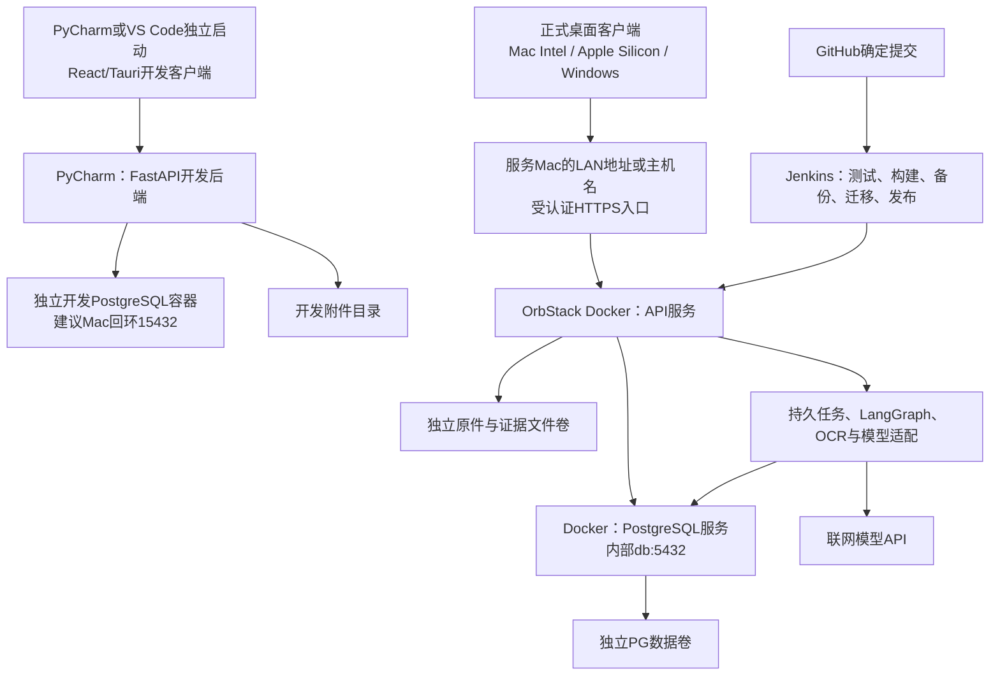

# 本地采购管理与智能对账 技术方案与实施规划

版本 1.5    更新日期 2026年11月17日    客户端 macOS Intel / Apple Silicon / Windows；服务部署本机OrbStack

项目面向单管理员在本机及局域网桌面设备使用，在软件内持续记录采购订单、收货和退货，再核对供应商对账单与正式发票，处理差异并保存确认依据。本方案记录已确认需求、任务依赖和执行状态。2026年11月17日已按代码、测试及运行环境重新核对任务，具体命令和验收证据见[执行日志](execution-log.md)。仓库中的本文件维护当前状态，桌面Markdown从仓库同步，保持任务与验收口径一致。任务下同时保留当前成果与尚待验收的子项。

## 开发执行入口

本版包含D00至D43共44项业务及客户端任务，以及C00至C13共14项环境与交付任务，总计58项。第十一、十二章说明业务开发，第十五章说明双环境和部署设计，第十六章列出Docker与Jenkins的具体实施步骤。工程已在`/Users/sunjiale/Documents/procure-reconcile`推进。现有认证、公共后端、供应商接口及基础Jenkins发布链路已有真实验证记录。单位后端配套已接入并通过完整回归，LAN稳定主机名及当前IP备用入口已完成本机严格TLS验证。本轮新源码的正式发布结果由Jenkins及采购发布状态记录，其他业务按下文状态推进。

**已确认运行方式。**本机Python后端由PyCharm独立启动。React/Tauri客户端可在PyCharm或VS Code中使用独立运行配置启动。部署时，安装后的桌面客户端连接Docker后端。两种环境共用源码与API契约，服务进程、数据库、原件、凭据和连接配置分别管理。客户端退出只释放自身连接。

当前接续顺序为本轮授权源码同步与受控发布验收，再完成D09资料管理和选择组件，随后进入D10订单。D08a纯计算可供D09复用，D08b随第一张数量金额业务表验收。D06解析平台小样、四格式样例及模型API可用性检查可独立并行。后续每次发布使用C07/C08已建立的统一通道。

**开发客户端与正式客户端。**开发客户端通过独立运行配置启动，默认连接开发后端。正式App按macOS或Windows目标构建并安装，默认连接Docker后端。“设置 → 服务连接”保存目标地址和环境，提供测试连接与登录入口，窗口持续显示当前环境。地址变更后更新连接配置并重新验证。

仓库已确定为`jaylansun/procure-reconcile`，当前Public、默认分支main；其余地址、端口、Compose项目名、路径、工具和命令按建议实施约定处理，未决项不视为已经确认。建议开发API为`127.0.0.1:18081`，本机Docker API为`127.0.0.1:18080`；二者同在Mac时可以使用相同IP和不同端口。已确认服务位于这台Mac的OrbStack，并允许局域网客户端访问；远端必须配置这台Mac的LAN地址或主机名。127.0.0.1:18080只表示服务Mac本机入口，不是其他设备的连接地址。正式LAN使用受认证HTTPS入口和18443端口。2026年11月17日已修复Mac地址漂移导致的绑定与证书问题，正式连接使用`https://sunjialedeMacBook-Pro.local:18443`，当前IP备用入口为`https://192.168.1.100:18443`。HTTPS网关发布到`0.0.0.0:18443`，API仍为回环18080，PG仅内部连接。当前Mac已使用系统信任分别验证主机名及IP入口，配置版本为`production-20261117-02`。其他设备名称解析仍待实机验证。公网继续保持当前范围之外。

快速定位：[双环境与部署方案](#十五-本地双ide与docker部署方案) · [Docker与Jenkins任务](#十六-docker与jenkins逐项实施步骤) · [原业务任务](#十一-前半程逐项开发步骤) · [一期验收](#十三-一期验收矩阵)。

## 一 需求基线与本次更新

| 事项 | 已确认要求 |
| --- | --- |
| 使用环境 | macOS Intel、Apple Silicon Mac和Windows桌面客户端；同一管理员可从局域网设备使用。服务集中在本机OrbStack，开发和部署数据独立。 |
| 数据库 | 用户已明确选择PostgreSQL（pgsql）；开发、测试、部署均使用PG，版本及驱动细节按兼容验证锁定。 |
| Python项目管理 | 已确认使用uv管理server/的依赖、锁文件和虚拟环境；pyproject.toml/uv.lock/.python-version为项目约定，PyCharm复用server/.venv。 |
| 前端与投入 | React + TypeScript；独立开发，每日约10小时投入，未约定完成日期。 |
| 目录命名 | 顶层统一为`client/`和`server/`。后端已确认controller/service/repository/entity/domain分层及类文件后缀，见代码结构约定。PyCharm可打开整个仓库，也可与VS Code分别使用。 |
| 业务主线 | 日常创建订单，登记收货和退货，核对供应商对账单与正式发票。 |
| 输入与模型 | 一期包含 Excel、文字PDF、扫描PDF和图片；使用联网模型API，允许发送待解析内容。 |
| 收货与问题货 | 一次登记到货、可接受和问题数量；问题货支持退回、换货、后续转为接受。 |
| 核对与差异 | 对账和发票状态分别管理；全部差异人工处理，接受差异必须填写原因并留痕。 |
| 历史与金额 | 保留历史确认，后续退货或漏单新增调整；人民币单币种，含税/未税输入按各自价格口径逐行计算并舍入。 |
| 数值精度 | 数量、单价最多6位小数；税率按百分数最多4位小数；金额2位小数，ROUND_HALF_UP，单据汇总已舍入的行金额。 |
| 对账日期 | 默认自然月，可自选日期范围；收退货按业务发生日期归属，历史补录保留实际日期，通过后续调整处理。 |
| 退货义务 | 每笔已纳入订单义务的退货可选择补交或减量，原订单数量保留，不重复扣减实际接受量。 |
| 超收 | 允许记录真实到货，超出有效履约额度的部分待处理；接受前追加订单变更。未纳入订单义务的超收退回不生成补交或减量。 |
| 更正 | 草稿直接编辑；生效订单追加变更；收退货通过冲销/重录并处理引用依赖；已确认对账/发票保持快照、追加调整。 |
| 访问认证 | 一个管理员账号密码登录，密码6至128个字符，支持6位纯数字；多设备共用同一账号，不开放注册或多人权限管理，会话分别安全存储。 |
| 文件覆盖 | .xlsx/.xls、PDF、PNG/JPG/JPEG，中英文；密码保护文件先由用户解密后导入，扫描PDF和图片仍属一期。 |
| 质量交付 | 解析器对比报告、分层评测集、失败案例与自动化回归记录，均纳入一期交付。 |
| 本地开发 | 后端与客户端各自独立启动和调试。可在PyCharm中配置两项运行入口，也可由PyCharm与VS Code分别运行。业务源码与部署版本共用。 |
| 部署交付 | 服务部署Docker；Jenkins从GitHub拉取代码、构建并一键部署；客户端仍为桌面App。参考本地OrbStack中DevPilot的已运行方案。 |
| 仓库现状 | [jaylansun/procure-reconcile](https://github.com/jaylansun/procure-reconcile)为Public仓库，默认分支`main`。已有应用源码、Jenkinsfile和真实SCM构建记录。新分层及单位改动的提交与发布状态另行记录。 |

**需求状态。**当前没有可用模型API、真实样本单据或业务访谈结果。评测先使用带标准答案的模拟单据，真实模型效果在接入后另行测量。

**技术状态。**PostgreSQL是已确认的数据库选型，Docker、Jenkins与GitHub交付链路已纳入要求。Tauri 2与FastAPI已正式确定，React/TypeScript及PostgreSQL继续沿用；Python项目管理已确定uv，Rust承担Tauri原生适配。SQLAlchemy/Alembic已用于现有数据库访问与迁移。LangChain/LangGraph和解析器继续按候选方案验证。部署版不再按内嵌Python sidecar设计，PyInstaller不列为一期必需项；macOS与Windows安装包只分发桌面客户端。RAG、向量数据库、多Agent和代码沙箱仍未列为已确认需求。

## 二 业务流程与计算约束

操作主线为创建订单、分批收货、处置问题货、登记退货、导入单据、关联来源、核对差异、人工处理、确认与后续调整。发票可先于对账单到达，两类核对允许交叉进行。

| 操作 | 系统保存的事实或结果 |
| --- | --- |
| 订单生效 | 供应商、物料、数量、单位、价格口径、税率及订单版本。 |
| 每次收货 | 来源订单行、本次到货量、初始接受量、初始问题量、业务日期及附件。 |
| 问题货处置 | 按数量分拆接受、退回或换货；追加处置记录，原收货事实保留。 |
| 退货与补货 | 退货关联来源数量类别；实际补货形成新收货，不提前增加接受量。 |
| 单据核对 | 按明细关联来源和覆盖数量，展示数量、价格、税率、金额及关联差异。 |
| 业务确认 | 保存本次来源版本、分配、差异处理、理由、金额及确认时间。 |
| 确认后变化 | 新增调整；改变原覆盖时关联原确认，未覆盖漏单关联历史范围。 |

### 数量口径

每一收货行满足：到货量 = 初始接受量 + 初始问题量。待处置问题量 = 初始问题量 - 后续转接受量 - 已退问题量。净可接受量 = 初始接受量 + 后续转接受量 - 已接受货退回量。所有处置受来源剩余数量约束。初始问题/待处理池中的超收数量单独标记，质量标签与是否纳入订单义务分别保存；超收经有效订单变更后追加义务纳入依据，初始到货及数量分解保持原值。退货按具体数量分段和有效义务依据决定是否需要选择补交/减量，混合退回时分别记量。

换货事项分别记录已约定、待退回、已退回和待补到。未实际退回的数量仍在问题实物池，但未完成事项占用其可安排数量，避免重复约定；撤销只释放事项占用，实际扣量仍以退货行为准。

**模拟用例。**订单100件，含税单价10元；到货100件、接受90件、问题10件。其中4件后续接受，6件退回后换货，新到6件全部接受，净接受量达到100件，累计实际到货106件。

对账确认100件和1,000元后再退回已接受货5件，假设退货按原价处理：原确认仍为100件和1,000元，当前业务净量为95件，后续待核对调整为负5件和负50元。实际调整金额须依据原覆盖与约定，不能见退货就机械扣同额。

### 必须分别保存的状态

订单履约、问题货与补货、对账确认、发票核对、AI任务分别管理。人工接受差异不改变订单或收货事实；对账单和发票引用同组交易时也不合计成双份金额。退货后的补交或减量已由用户确认可逐笔选择。原订单数量、有效应交量、实际接受量和核对调整分别保存及计算。

### 本轮确认的履约、税价与更正规则

有效应交量以原约定量和有效订单变更、退货减量记录计算；减量不覆盖原订单数量。已纳入订单义务的退货选择补交时保持应交量，选择减量时减少对应应交量；实际接受量仍只按收退货事实计算一次。例如已接受100后退5，补交则应交100/净接受95，减量则应交95/净接受95。问题货退回及减量不能机械冲减从未覆盖它的历史对账。

换货与退货共用稳定来源及事项，不能因退货又新增一份相同补交义务；已约定换货后改为减量，应同步处理原事项占用。超收以本次有效履约额度判断，考虑仍占额度的正常收货、已退回及待补来源，不能以累计到货超过原订单量就判超收，原100件换货后累计到货106的案例仍合法。先补后退等复杂时序未提供时不自行冻结新规则。

订单100实际到105，可记录真实105，正常接受部分及问题/超收待处理合计必须等于到货；超出额度的5件先待处理，接受前追加订单变更，也可退回。未纳入订单义务的超收量退回，其履约动作记为不适用，不额外补交或减少原订单应交量。禁止把未接受的超收量分配成有效核对来源。

记R(x)为金额保留2位的ROUND_HALF_UP，q为数量，p为所录单价，r为比例税率：

- 含税输入：含税行金额G=R(q×p)，未税行金额N=R(G÷(1+r))，税额T=G−N。
- 未税输入：未税行金额N=R(q×p)，税额T=R(N×r)，含税行金额G=N+T。
- 单据分别汇总已经舍入的N、T、G；不先将单价舍入到2位。正负金额使用相同对称舍入，例如0.005→0.01、−0.005→−0.01。供应商尾差仍按已确认规则人工处理。
- 数量与单价最多6位、税率百分数最多4位；输入精度超限明确提示，不能依赖数据库悄悄舍入。字段原值、计算版本和税价口径均保留。

草稿编辑保留必要审计；生效订单追加变更。已登记收退货录错通过冲销与重录，原事实保留且幂等；未确认下游分配需先解除或重算，已确认快照不删除、不回写，影响通过相应反向事实和后续调整承接。冲销所需依赖检查、原因及新旧来源引用必须可追溯。

## 三 推荐架构与职责

使用同一套桌面业务界面、Python业务模块和API契约，分为本机开发与Docker部署两种启动方式。Python业务服务仍是每套数据的受控业务写入入口，客户端始终只调用API。PostgreSQL保存业务事实、持久任务和检查点；原件与证据文件独立保存。开发和部署不共享PG实例、卷、角色、凭据或附件。



| 技术或组件 | 状态 | 职责 |
| --- | --- | --- |
| React TypeScript | 已确认 | 两种环境共用页面、表格、原件预览和复核组件。 |
| Vite Tauri 2 Rust | Tauri 2已确认；构建和原生适配按方案实现 | 桌面窗口、开发热更新、连接配置、受控HTTP/流式调用和本机文件选择。 |
| FastAPI Python | 已确认 | 本机开发进程或Docker服务，承载业务、任务、确定性计算和事务。 |
| PostgreSQL / SQLAlchemy / Alembic | PostgreSQL已确认；访问与迁移工具推荐 | 业务、任务与检查点持久化；独立开发/测试/部署数据库，显式迁移及事务并发保护。 |
| LangChain LangGraph及解析器 | 推荐或候选 | 服务端提取、复核、检查点和PDF/OCR，按原样例验收。 |
| Docker Compose OrbStack | Docker部署已要求；Compose为推荐组织方式 | 正式环境API与PG分别为容器，使用独立PG卷、附件卷和网络；开发PG另起独立实例。 |
| Jenkins GitHub | 已要求 | 从独立仓库检出确定提交，测试和构建Docker镜像，一键发布与留存记录。 |

**连接与权限。**React调用受控Rust命令，Rust读取当前连接配置和平台原生凭据设施保存的当前会话后访问Python API。开发客户端默认连接开发API，正式App默认连接部署API，支持在连接设置中修改并测试。文件内容通过API上传和下载；不向容器提交客户端绝对路径。模型密钥由所连后端管理，管理员登录会话与模型密钥分开。Tauri命令与macOS打包参考R1、R2。

**进程边界。**本地后端归PyCharm管理，部署后端归Compose/Jenkins管理。桌面应用不自动起停Python或容器，不持有Docker socket。关闭窗口、切换环境和重连只影响客户端；服务里的已受理任务按持久状态继续。实例之间不自动同步数据库或附件。

## 四 核心数据模型与关联

以下是逻辑模型建议，表名、字段和状态尚未冻结。采用业务事实、版本和确认快照表达变化，不要求引入完整事件溯源框架。每条业务明细有稳定标识，关联需要保存来源版本。

| 对象组 | 关键记录 | 关联与约束 |
| --- | --- | --- |
| 基础资料 | 供应商 物料 单位 换算 | 名称别名与换算经确认后生效，换算版本可追溯。 |
| 订单 | 订单 订单行 变更版本 | 收货和核对引用具体行及价格版本，历史约定可还原。 |
| 收货 | 收货单 收货行 数量分段 义务纳入记录 | 每次到货独立保存，接受/问题初值保留；超收待处理作为问题/待处理池子类别，质量标签与履约覆盖状态分开记录，数量分段不重复。 |
| 问题与退货 | 处置 退货行 补货事项 | 退货引用具体数量分段、问题/接受类别及当时义务纳入依据；未纳义务的超收返还可识别，处置引用实际退货，数量只计一次。 |
| 外部单据 | 账单 发票 明细 版本 | 字段确认与业务确认分开；原件及旧版本保留。 |
| 匹配与分配 | 候选关联 有效分配 | 同一维度内限制覆盖；对账与发票可独立引用同组业务事实。 |
| 差异与确认 | 差异处理 确认 快照 | 已接受差异仍有金额或数量及原因，不伪造来源分配。 |
| 后续调整 | 调整 来源事实 确认引用 | 改变已有覆盖时引用原分配；未覆盖漏单可仅关联历史范围及原因。 |
| 文件与任务 | 文件 证据 候选 修正 任务 | 原件按内容标识保存，候选与人工修正独立版本化。 |
| 账号与会话 | 单管理员账号 设备会话 | 密码只存哈希，分别保存会话有效期与失效状态；开发和正式隔离，不开放注册。 |

### 关系与剩余额度

订单行可有多条收货行；收货行可有多次问题处置和退货。账单行与业务来源通过分配记录形成多对多关系，支持合并覆盖和部分覆盖。发票使用独立核对维度，不共享一个全局已占用量。

可退数量取自对应来源累计接受或问题数量，扣除已经有效处置的数量。分配上限在确认事务内重检；接受账单数量差异时，额外数量留在差异处理记录中，不能强行占用不存在的收货量。

调整按对账和发票维度分别保存额度及应用状态，同一事实可分别影响两类核对；每个维度内可部分处理，累计不超来源。漏单从未进入确认时，原确认引用可为空；变更既有覆盖时才必须追溯具体原分配。

### 日期和变更

分别保存业务发生日期、录入时间、单据日期和确认时间。对账默认自然月，可自选区间，收退货按业务发生日期归属；补录保留原日期，通过后续调整承接已确认历史。草稿可编辑，生效订单追加变更，收退货冲销重录；已有下游引用先处理依赖，已确认财务核对以追加调整承接，旧快照及关联依据保留。基础资料和价格变更不回填历史。

## 五 业务接口与事务设计

API应表达创建订单、登记收货、处置问题货、分配来源和确认对账等业务动作。下表仅为接口草案。由FastAPI契约生成或校验前端类型，统一返回业务错误、版本冲突与可继续处理的信息。

| 接口组 | 操作示例 | 关键输入或校验 |
| --- | --- | --- |
| 订单 | 创建 确认 变更 查询 | 行明细、价格口径、税率、当前版本、变更原因。 |
| 收退货 | 登记收货 问题处置 退货 | 来源行、数量类别、数量、业务日期、处理理由。 |
| 文件 | 导入 预览 确认字段 | 内容标识、证据引用、候选版本、人工修正。 |
| 核对 | 建议来源 分配 计算差异 | 维度、范围、来源版本、分配量及关联依据。 |
| 确认与调整 | 确认账单 确认发票 纳入调整 | 当前核对版本、差异处理、原确认、来源与剩余额度。 |
| 任务与维护 | 取消 重试 恢复 备份 | 任务版本、运行标识、错误类别、备份或恢复清单。 |

### 一次确认的提交顺序

请求携带command_id和预期版本。服务开启短事务，检查幂等记录；按统一锁顺序锁定影响本次额度的稳定来源记录，再重读来源版本与可分配余额，校验全部差异已处理；原子写入分配、理由、确认快照、审计和幂等结果。事务成功后返回结果。重复请求返回同一业务结果，载荷不一致时拒绝复用标识。

不依靠按钮置灰防重。数据库唯一约束和事务处理双击、超时重试及并发确认。旧页面提交返回版本冲突，由界面提示刷新与重新核对；不得静默覆盖新状态。

### 数量金额与数据库

API精确数值用十进制字符串，服务用Decimal、PG NUMERIC存储。已确认数量/单价最多6位小数、税率百分数最多4位、金额2位；比例税率在存储/API中统一为6位小数，例如13.0000%对应0.130000。金额使用ROUND_HALF_UP，逐行舍入后汇总。列总精度、溢出上限和Decimal运算上下文在实现时记录，不能改变已确认的小数位及舍入口径。保存税价输入口径、未税金额、税额、含税金额和计算规则版本；拒绝NaN/Infinity等非业务值。列类型不替代应用输入精度与舍入校验，避免数据库隐式舍入改变已确认口径。参考R25。

PostgreSQL使用外键、唯一性、检查约束和版本字段，连接池按实际并发设上限；SQLAlchemy与psycopg 3作为推荐访问组合，Alembic显式迁移。耗时解析和模型调用放在短事务之外。所有影响来源余额的收退货、处置、分配及确认命令，应按固定顺序锁定稳定来源或余额记录，再重算与校验；不能让并发事务各自读取同一余额后超额分配。死锁或可重试事务错误在幂等前提下有限重试。参考R11、R26、R27。

### 审计与文件一致性

记录操作时间、动作、原因、目标及前后版本。原件先写临时文件并校验，再原子移动为不可变对象，最后提交数据库引用；失败后清理无引用对象。避免数据库已确认而原件尚未落盘。

## 六 文件导入与证据结构

四类输入均属于一期交付。先构建原件、页面、单元格和证据的统一结构，再接入可替换读取器。模型只能引用系统生成的证据标识，不能自行编造坐标或缺失字段。

| 输入 | 候选处理路径 | 必须处理的情况 |
| --- | --- | --- |
| Excel | xlsx评估openpyxl；xls另做读取适配 | 多工作表、合并表头、公式及缓存、数字格式、单位与隐藏区域。 |
| 文字PDF | 文本与布局提取并渲染预览 | 跨页表格、文字顺序、重复表头、合计行及页面旋转。 |
| 扫描PDF | 逐页渲染后OCR，必要时使用图像模型 | 倾斜、低清晰度、印章遮挡、表格结构和扫描文字区域。 |
| 图片 | 方向处理、预览、OCR或多模态识读 | 拍照透视、模糊、裁边及来源坐标；不能无提示补造内容。 |

混合PDF按页选择路径。Excel原生读取保留工作表、地址、原值、公式和已有缓存；缓存缺失进入复核，不把读取器当作公式计算引擎。损坏、加密、超页数或超大小文件返回具体状态；扩展名与中英文覆盖已确认；密码文件提示先解密，大小、页数、像素与并发限制在资源实验后配置。

### 统一证据模型

证据建议保存file_id、解析版本、证据ID、原文、内容类型、页码或工作表及单元格地址。图像与PDF区域还需保存坐标、页面尺寸、旋转和坐标变换，确保预览缩放后高亮仍正确。候选字段保存原值、规范值、证据列表与校验问题；人工修正另存操作与新版本。

### 读取器与模型分开评估

pdfplumber、pypdfium2、Tesseract、MinerU和PaddleOCR均可列入候选清单，按具体能力选择对比组合。候选不要求全部集成；同样例比较后，只保留满足证据、效果、资源和分发要求的组合。

PDF/OCR须分别验证macOS Intel本地开发与Linux amd64容器。pypdfium2的macOS平台要求用于开发后端兼容性判断，不能套用为Docker镜像的最低系统条件。MinerU按版本和解析层级测试；PaddleOCR另验推理后端、语言资源、原生依赖、发行许可及体积。桌面安装包无需包含服务端OCR或Python资源；开发导入成功也不证明容器可运行。资料见R7和R8。

### 重复导入

内容哈希识别相同原件，业务单据编号、主体和金额等辅助提示不同文件中的疑似重复。相同文件可关联已有记录；不同版本保留关系，由用户决定修订或新增，不能自动合并有歧义的交易。

## 七 AI流程与任务恢复

LangChain用于模型适配、结构化输出和受控查询工具；LangGraph用于阶段状态、人审暂停和恢复。业务计算与确认使用前述业务接口，检查点保存流程状态，业务数据库保存业务事实。推荐同一环境的PG数据库内分开业务/任务与工作流schema，并独立管理连接和权限；LangGraph Postgres checkpointer使用对应适配包，其setup及表迁移由受控命令管理。即使连接同一数据库，业务事务与检查点写入也不会自动成为一个事务，仍需幂等及恢复核对。参考R28。

| 阶段 | 输出 | 继续或暂停条件 |
| --- | --- | --- |
| 读取证据 | 文本 单元格 页面区域 | 文件读取失败时保留原因；可重试阶段与输入版本明确。 |
| 提取候选 | 供应商 单据头 明细 证据引用 | 缺失留空，候选格式及引用范围经过代码校验。 |
| 校验与复核 | 字段问题 人工修正版本 | 缺字段、冲突或歧义进入人审；字段确认不等于对账确认。 |
| 关联建议 | 来源候选 匹配依据 | 先按主体、编号、物料、日期和额度过滤，歧义交用户处理。 |
| 差异解释 | 差异说明 引用依据 | 数量金额由业务代码计算；模型解释不能自动接受差异。 |

### 持久化与重放

任务保存task_id、输入版本、运行版本、阶段、attempt_id、尝试次数、错误和已确认结果引用。建议先限量执行任务，OCR与PDF处理放受控工作线程或子进程；并发、超时与取消策略通过实测调整。

恢复时检查来源是否仍有效、业务写入是否已经提交、人工是否已生成新版本。取消或修正后，旧运行结果即使返回也不得覆盖新版本。进度事件携带序号，界面重连后从持久化状态补齐；建议后端HTTP事件流经Rust转发为Tauri事件，取消客户端订阅不自动取消服务端任务。具体协议在联调时验证。

LangGraph的interrupt恢复会从所在节点开头重新执行。因此模型调用缓存、结果指纹、任务版本和业务command_id分别防重。能够保证业务效果不重复，不能承诺外部模型在网络超时后只执行或计费一次。资料见R3和R4。

### 模型配置与边界

M4结束前准备可用API，比较结构化输出、图像能力、费用、延迟和失败表现。接入前用标记清楚的模拟适配器验证流程；正式效果验收使用真实调用。发送必要文字或图像会离开本机，本方案不属于完全离线运行。日志保存模型、提示词和配置版本，避免记录密钥与不必要的原文。

一期优先明确提取、关联建议和差异解释的职责。是否拆分多个Agent、引入RAG或语义重排，根据样例和效果另行决定；当前没有据此扩展产品需求。

## 八 评测与失败回归交付

解析器对比报告、分层评测集、失败案例与自动化回归记录已经确认为一期交付。它们贯穿开发，不再作为发布前临时补写的材料。

| 评测层次 | 主要指标或判据 | 记录要求 |
| --- | --- | --- |
| 字段提取 | 关键字段准确率 缺失率 | 分别记录数量、单价、税率、日期等字段的标准值及规范化规则。 |
| 明细结构 | 漏行 重复行 错列 | 逐行标注预期结果，负数、合计和跨页续表单独分析。 |
| 证据定位 | 引用有效性与位置正确性 | 统计无依据字段和错误定位；记录可回到原文的覆盖情况。 |
| 关联候选 | 正确来源覆盖率与错误候选 | 存在明确答案时记录前K候选覆盖；多来源分配按预期集合检查。 |
| 业务计算 | 数量金额与约束案例通过 | 双扣、超退、重复覆盖、跨期调整等关键不变量全部通过。 |
| 任务恢复 | 重启 取消 重试 版本保护 | 确认无重复业务事实，无旧结果覆盖；外部调用次数另行记录。 |
| 使用与资源 | 复核耗时 延迟 内存 费用 | 固定机器、版本和样例；解析时间与全任务时间分别记录。 |

### 解析器对比报告

同一批原件、同一标准答案、相同运行条件比较候选组合。报告写明工具和模型版本、配置、格式覆盖、证据输出、错误类型、时间、内存、依赖及包体积，并给出选择或淘汰原因。解析与模型提取分别计量，避免把全部改善归给其中一个组件。

### 评测集与失败记录

先建立模拟订单、收退货、账单和发票的标准事实，再生成四种格式和可控异常。开发调优样例与最终评测样例区分，保留版本与样本数。没有真实企业样本时，报告测试覆盖和已验证范围，不推导行业识别准确率。

每个失败案例至少保存case_id、输入与版本、预期、实际、错误分类、定位、修复、回归状态。可自动判定的部分加入测试，含人工视觉判断的部分保留复核记录。MRR或Recall@K只衡量候选排序，不能替代字段或业务正确性。

## 九 本地运行与数据维护

### 启动与运行

开发时先启动独立开发PG实例并确认数据库连接，再在PyCharm启动Python后端，通过PyCharm或VS Code的独立前端配置启动Tauri客户端。可分别调试，客户端命令不附带启动第二份后端。部署时先由Jenkins或Compose启动容器服务，安装后的App连接已配置地址。服务未启动时，App显示连接失败与检查入口；连接成功需要认证、环境标识和版本检查，而不是仅检测端口打开。

窗口关闭不停止后端。应用退出只释放连接、订阅和本机临时预览；服务异常或部署重启后，持久任务检查输入和运行版本再恢复。服务端停机使用维护门禁、停止接收业务写入及新任务、等待或中止受控执行器，避免旧运行迟到结果提交。

开发业务与检查点使用独立PG实例/数据库，附件建议放`.local/dev/files/`并忽略提交；集成测试使用临时PG实例或隔离测试库及临时文件。部署PG使用专属数据卷，API只挂附件卷到`/app/data/`，不挂PGDATA。容器安装层只保存程序资源，客户端切换地址不会搬迁或合并数据。

### 备份与恢复

备份在统一维护窗口停止业务、任务、检查点和附件写入，并关闭所有应用写入者；PG服务保持运行，使用匹配版本的pg_dump生成逻辑备份，配套复制不可变原件、证据及哈希清单。数据库快照本身不能保证附件一致，二者须对应同一维护边界。备份写入独立备份卷并可导出到Mac；不得把复制运行中PGDATA当作此逻辑备份。资料见R5、R18。

数据库先恢复到隔离的新PG数据库或实例，文件先恢复到新附件目录或卷；校验schema、业务、检查点和文件引用后，在维护状态受控切换。错误备份不覆盖当前有效数据。管理员密码仅以哈希保存；活跃登录会话不作为可复用会话导出，恢复后使旧会话失效。部署秘密及模型密钥另行配置，不默认打进业务备份。镜像回退与数据库恢复是不同动作；发布后已有新业务时，不自动用旧备份覆盖它们。

### 迁移与双产物发行

每次schema变更附PG迁移脚本和旧库样例。生产迁移由部署流程在PG健康且应用停写后，用一次性命令经数据库连接执行；业务Alembic迁移与框架检查点初始化/升级分别管理，不在每次API启动或每个worker中并发运行。迁移前备份；失败时保留旧数据及日志，根据是否产生新写入和schema兼容性选择恢复路径。

服务产物是`linux/amd64` Docker镜像，由本机OrbStack上的Linux Jenkins构建并部署。客户端交付Mac Intel、Apple Silicon Mac及Windows安装包，分别在合适的Mac/Windows构建环境生成并实测；Linux Jenkins继续负责服务镜像。三平台客户端和服务保留提交及兼容版本关系。具体系统版本、Windows架构和可用构建机尚不清楚，不据“不会太旧”宣称兼容；签名、最低系统及更新方式按Q07/Q11落实。

| 问题 | 预期行为 |
| --- | --- |
| 开发后端或Docker服务未启动 | 客户端显示当前目标地址和可执行检查，不启动隐式第二份服务。 |
| 客户端退出或切换环境 | 服务继续，已受理任务状态保留；新请求只进入明确选中的环境。 |
| 断网或模型超时 | 业务数据仍由服务保存；恢复按次数与版本限制重试。 |
| 服务崩溃或容器替换 | 已提交事实与原件留在卷中，恢复检查任务归属与版本。 |
| 迁移或恢复失败 | 保留有效数据及备份，阻止不兼容版本继续写入。 |
| 诊断与日志导出 | 记录环境、服务版本、任务和错误，过滤凭据及不必要原文。 |

## 十 实施里程碑与投入估算

历史估算基线为54至81个有效开发日，含缓冲约65至106日。当前采用用户手写业务、助手完成基础设施和测试的推进方式，并增加了三平台、LAN与交付工作。下表开发日仅保留历史估算供追溯，剩余投入需按本版子任务、实际手写节奏及设备资源重新估算。当前未约定截止日期。构建设备、证书和模型API等待分别记录。

| 阶段 | 交付版本 | 历史估算开发日 | 阶段整体验收条件 |
| --- | --- | --- | --- |
| M0 | 规则 核心模型 接口 用例 | 2至3 | 影响数量、金额、期间及更正的关键规则已明确。 |
| M1 | 最小桌面客户端与容器后端 | 4至6 | 双IDE独立启动；正式App可连接独立容器，数据与开发环境分开。 |
| M2 | 订单与收退货业务 | 7至10 | 问题货分拆、补货、来源校验及数量不变量通过。 |
| M3 | 手工对账与发票闭环 | 8至12 | 明细分配、差异人审、确认快照与后续调整通过。 |
| M4 | 四类文件与证据复核 | 8至12 | 全部输入有完整路径，解析器对比报告形成。 |
| M5 | 真实模型与任务恢复 | 6至9 | 真实调用、人审、重启、取消和晚到结果检查通过。 |
| M6 | 数据维护与服务/三平台客户端发行 | 原估算待复核 | 一致备份、迁移及三平台LAN客户端兼容验证通过。 |
| M7 | 完整验收与作品集 | 5至7 | 关键场景、评测、回归和演示材料完整。 |
| C交付工作线 | C00至C13，穿插各阶段 | 原增量8至13，待复估 | GitHub检出到Docker部署、版本检查与失败回退可复现；不与M阶段重复计量。 |

### 每阶段的完成标准

每个业务任务分别记录后端可联调、客户端可操作和跨模块综合验收三个节点。后端节点覆盖模型、迁移、Service、Repository、API及真实PG测试。客户端节点覆盖页面、受控Rust调用和关键交互。整项关闭还需满足任务列出的联动或实机验收。M4、M5及扫描PDF、图片继续属于一期。

### 依赖与可并行工作

M0与M1先解决关键规则和分发可行性。M2期间可以准备四格式样例；M3完成后接入M4，避免解析结果缺少稳定业务落点。模型候选调查和API准备可提前进行，真实效果在M5验收。日志、迁移和回归从早期开始，M6集中验证恢复与发行。

M1先验收可安装的最小客户端，覆盖独立启动、双环境连接、登录及客户端退出重开。文件上传桥在D22接入后验证。PDF预览与OCR平台实验由D06独立验收，后续在D23至D28完成完整导入和复核。三平台正式业务产物仍在D40/C12完成验收。

### 任务执行约定

按任务ID和依赖推进，每项在代码、界面或结果可操作后再验收。状态使用“待开发、开发中、待规则决定、待外部资源、待验收、已完成”；不能把讨论过、写了接口或Mock演示成功标为已完成。每项原则上拆为约半天至两天的工作单元，超过时继续拆子任务，但保留所属ID。

用户手写业务实现，助手先准备空文件并在对话提供带中文文档字符串和必要中文注释的代码，助手完成公共适配、迁移与全部测试。任务按后端、客户端及综合验收子项推进。业务整项关闭时，页面、API和数据状态应可连续操作。测试覆盖数量约束、事务、状态和恢复。

每项完成后更新项目内的 `docs/execution-log.md`，记录任务ID、修改文件、实际执行命令、结果、未通过项和下一任务。可用Git时记录对应提交；是否创建提交遵循开发会话的用户要求与仓库规则。没有有效测试或没有实际安装包验证，不记为通过。

### 决策状态与剩余依赖编号

已确认项直接沿用，不再反复询问；尚不清楚的设备版本保留为外部资源核实，不擅自推断。技术配置由实施验证收敛，新增业务含义在对应模块开发前继续确认。

| 编号 | 状态与结论 | 影响任务 |
| --- | --- | --- |
| Q01 | 退货补交/减量、超收待处理及超收退回例外已定；订单关闭边界、先补后退等未给出的复杂顺序按实例再确认 | D10至D14 |
| Q02 | 精度、ROUND_HALF_UP、逐行舍入汇总及含税/未税公式已定，见计算规则 | D08及后续金额功能 |
| Q03 | 自然月默认/自选区间、业务发生日期、历史补录追加调整已定 | D16、D20 |
| Q04 | 草稿编辑、生效订单变更、收退货冲销重录、确认快照追加调整已定 | D10、D13、D15、D18至D20 |
| Q05 | xlsx/xls、PDF、PNG/JPG/JPEG、中英文及先解密已定；资源上限经实验配置 | D22至D29 |
| Q06 | 模型供应商、图像能力、预算及真实API仍待准备；不阻塞基础业务 | D30、D31、D36真实调用 |
| Q07 | 三平台交付已定；最低系统、签名/公证、更新与导出字段仍待落实 | D40、D43、C10 |
| Q08 | Public仓库及main已接入，采购独立Jenkins任务和凭据已有真实构建记录，手动触发发布 | C04、C05已完成，后续版本同步随发布验收 |
| Q09 | 本机OrbStack服务、局域网访问、Apple Silicon Mac及Windows客户端已定；当前不含公网 | C00、C02、C12 |
| Q10 | 登录、会话、本机CA信任及稳定LAN入口已有验证，其他设备信任及备份留存继续验收 | D04、C00、C07、C11 |
| Q11 | 用户暂不清楚其他设备系统版本/Windows架构及是否可作构建机；拿到设备时核实，不能虚报实测 | C10、D40、C12相关平台 |

规则编号保留用于追溯。已决定的内容不再标成开发阻塞；剩余规则和资源只阻塞相应分支。

### 代码结构与已确认分层约定

以下路径相对开发会话检查并选定的项目根目录。2026年10月16日已复用`/Users/sunjiale/Documents/procure-reconcile`，沿用origin/main初始历史并保留用户的根main.py与IDE文件；原WebRemix目录已不存在。后续在该仓库推进，不另建独立Git历史。

```text
project-root/
├── package.json                    # 建议统一命令入口
├── pnpm-workspace.yaml             # 若采用pnpm工作区
├── client/
│   ├── src/app/                    # 导航、页面路由、全局错误展示
│   ├── src/lib/                    # 受控API调用与精确数值传输
│   ├── src/features/               # orders receipts returns reconciliation invoices documents
│   └── src-tauri/                  # Rust窗口、连接配置、受控请求与打包
├── server/
│   ├── pyproject.toml               # uv项目依赖、dev组与版本约束
│   ├── uv.lock                      # uv生成并维护的精确版本锁
│   ├── .python-version              # Python 3.13
│   ├── .venv/                       # uv创建，Git忽略
│   ├── app/main.py                 # 应用入口及路由注册
│   ├── app/controller/             # APIRouter、HTTP参数、依赖与响应声明
│   ├── app/service/                # *Service类，业务规则与用例
│   ├── app/repository/             # *Repository类，复用调用方Session访问数据库
│   ├── app/entity/                 # 每个DO独立的*_do.py及共享BaseDO
│   ├── app/domain/dto/             # 每个DTO独立的*_dto.py
│   ├── app/domain/qo/              # 每个QO独立的*_qo.py
│   ├── app/domain/vo/              # 每个VO独立的*_vo.py
│   ├── app/config/                 # 运行配置
│   ├── app/common/                 # commands、audit、security、storage、maintenance
│   ├── app/persistence/            # 数据库连接、迁移检查、model_registry显式注册
│   ├── migrations/
│   └── tests/                      # 纯计算测试与integration/数据库/API测试
├── deploy/                         # Compose、环境样例与部署说明
├── Jenkinsfile                     # 从SCM检出、测试、构建与发布编排
├── .dockerignore                   # 排除密钥、数据、开发环境和无关产物
├── contracts/                      # OpenAPI导出与前端类型
├── fixtures/                       # 模拟业务事实、四格式原件和标准答案
├── evals/                          # 解析器、字段、匹配与恢复评测脚本
├── scripts/                        # 检查、测试、服务发布、备份与Mac/Windows打包脚本
└── docs/                           # 规则决定、执行日志、报告及运行说明
```

顶层目录命名已确认，`client/`为桌面客户端，`server/`为Python服务端。根包命令及工作区成员指向client，Docker构建上下文及Dockerfile指向server（采用根上下文时显式指定server/Dockerfile）。2026年11月16日已确认后端采用上述分层，并授权整理现有模块。

DO统一放在entity，DTO、QO、VO分别放在domain的对应子目录，每个类独立建文件并保留用途后缀。业务Service使用独立的`*_service.py`与`*Service`类，Repository使用`*_repository.py`与`*Repository`类。Service经Repository访问同一个`CommandContext.session`，由公共`CommandExecutor`统一提交业务变更、命令记录与审计。新增DO同步加入`app/persistence/model_registry.py`，所有DO共享`app/entity/base_do.py`中的BaseDO。

当前供应商阅读入口为`server/app/controller/supplier_controller.py`、`server/app/service/supplier_service.py`、`server/app/repository/supplier_repository.py`和`server/app/entity/supplier_do.py`。未来解析器、任务执行器和模型适配的技术组件可扩展到`app/common/documents/`、`app/common/jobs/`与`app/common/ai/`，这些扩展路径继续作为规划建议，实际交付状态以执行日志和代码为准。

后续任务“代码与页面”中列出的建议文件路径均相对项目根目录。尚未指定组件文件名的页面归属 `client/src/features/` 对应模块；实际创建文件后在执行日志记录完整路径。

### 开发与验证命令入口

下表分别列出现有入口和后续任务的命令约定。现有命令以根package.json及server/pyproject.toml为准，评测和任务恢复入口在对应功能接入时创建。前端及根快捷命令采用pnpm；Python后端已确认uv，根后端快捷命令实际调用uv，不建立第二份依赖环境。Python测试暂推荐pytest与FastAPI TestClient，见资料R13和R14；具体版本经M1验证后锁定。

| 项目入口 | 创建任务 | 应执行的工作 |
| --- | --- | --- |
| `pnpm run doctor` | D02 | 检查系统、Node、Rust、uv项目Python与锁文件一致性，不自动改系统配置。 |
| `uv sync --directory server --locked` | D02 | 按server/uv.lock同步项目虚拟环境，配置与锁不一致时失败。 |
| `pnpm client:dev` / `pnpm dev` | D02至D04 | 只启动React/Tauri开发客户端，默认连开发API；Python由PyCharm独立启动。 |
| PyCharm Python模块运行配置 | D03 | 工作目录server，使用其虚拟环境，模块uvicorn，参数建议`app.main:app --host 127.0.0.1 --port 18081 --reload`。 |
| `pnpm check` | D02 | 前端类型检查、Rust检查和后端基础检查，后续按需要补充。 |
| `pnpm db:migrate` | D05 | 定位开发虚拟环境，在server目录执行迁移到目标版本。 |
| `pnpm test:domain` | D08a已有入口 | 当前运行`server/tests/test_domain.py`的数量、金额和舍入测试，PG往返在D08b随业务表接入。 |
| `pnpm test:api` | D03建立，D09起扩展 | 运行 `server/tests/integration/` 中的健康接口、数据库和API事务测试。 |
| `pnpm test:ui` | 已有Vitest入口 | 当前覆盖错误与到期时间格式，D09起继续补关键业务页面交互测试。 |
| `pnpm eval:parsers` | D29 | 同样例比较候选解析组合，输出机器可读结果及对比报告。 |
| `pnpm eval:model` | D36 | 运行隔离的真实模型评测，记录样本、费用、延迟和字段结果。 |
| `pnpm test:recovery` | D34起 | 运行任务重放、取消、迟到结果、服务重启及数据恢复检查。 |
| `pnpm package:mac:intel` | D07 / C10 | 构建Mac Intel客户端。 |
| `pnpm package:mac:arm64` | C10 | 构建Apple Silicon Mac客户端，实机验收。 |
| `pnpm package:windows` | C10 | 在适当Windows构建环境生成客户端，架构及系统基线按Q11核实。 |
| `pnpm docker:build` / `pnpm docker:up` | C01至C02 | 建立后分别构建与启动容器服务；正式发布必须通过C07/C08门禁。 |
| Jenkins“立即构建”或“Build with Parameters” | C05至C08 | 一次触发GitHub检出、测试、镜像构建、备份迁移、部署及结果记录。 |

脚本需使用项目锁定的运行时和虚拟环境。比如后端测试在server目录调用 `uv run --locked pytest`，但不能依赖执行者电脑上碰巧存在的全局包。完整验收以实际输出和界面操作为证据，命令退出成功本身不证明业务正确。

## 十一 前半程逐项开发步骤

D00至D05及C00至C03提供工程与连接基础，D07a可先验证最小安装包。D08a与D09接续基础资料，D10至D21形成手工业务闭环。D06和提前样例/API实验并行推进，业务前置引用明确的可验收子项。

### M0 规则整理与开发准备

#### D00 核查工作区并建立执行记录

- [x] 已完成并记录验收证据

状态：已完成。前置：无。

当前证据与剩余事项记录于2026年11月17日。既有仓库、环境和执行日志已建立，证据见environment.md与execution-log.md。

1. 检查目录、AGENTS.md、Git及系统架构；已有目标仓库检出则复用，否则在核查为空的目录克隆`https://github.com/jaylansun/procure-reconcile.git`。非空且不属于该仓库的目录先保留，另选目录；不重复git init或覆盖历史。
2. 核对origin、main、现有README和工作树，记录初始提交；再盘点macOS、Node、Rust、Python及开发工具，在克隆内建立任务状态和执行日志。

代码与页面：`docs/environment.md`、`docs/execution-log.md`；尚无代码时先准备目录约定。

验收：远程为已提供仓库，README和历史保留；环境记录来自实际输出，列出D02能否开始及D01尚需决定的规则。

完成条件：新执行者能知道工程在哪里、当前有什么、下一个可执行任务是什么；所有开发任务初始标为待开发。

#### D01 形成关键业务规则与标准案例

- [ ] 整项验收待完成

状态：部分完成。前置：D00；可与D02至D07并行。

当前证据与剩余事项记录于2026年11月17日。已确认决策和五个业务标准事实已保存，完整状态模型、部分覆盖及漏单标准答案待补。

1. 将Q01至Q11按已确认、技术验证、待资源和仍需业务决定分类，直接沿用本轮答复，不重问框架、LAN设备类型、税价精度、日期及更正主规则。
2. 按已经确定的规则写订单、收货、退货、账单和发票的标准事实及预期结果；输出核心关系、状态草案和命令错误约定。

代码与页面：`docs/decisions.md`、`docs/domain-model.md`、`contracts/`、`fixtures/business/`。

验收：核对100/90/10、4转接受6换货、后续退5、部分覆盖和漏单等案例；未定规则保留占位，不伪造答案。

完成条件：每项业务任务能指向对应规则版本与标准案例。未决项仅阻塞依赖它的任务，不阻塞桌面实验。

### M1 最小桌面链路

#### D02 创建前端桌面与后端工程骨架

- [x] 已完成并记录验收证据

状态：已完成。前置：D00；不依赖所有业务规则完成。

当前证据与剩余事项记录于2026年11月17日。工程、锁文件、运行脚本及真实Tauri开发窗口已有验证。

1. 在D00检出的同一个仓库内建立React/TypeScript、Tauri和Python工程，保留并扩充既有README，锁定经Intel验证的运行时与依赖。可用官方React/TypeScript模板，见R15，不重新初始化独立仓库。
2. 建立根命令入口、环境配置样例、忽略规则、基础检查和运行说明；此时只做导航框架及空页面，不提前铺全部CRUD。

代码与页面：`package.json`、`client/`、`client/src-tauri/`、`server/pyproject.toml`、`scripts/`、`README.md`。

验收：`pnpm run doctor`能区分可用和缺失依赖；前端开发页与Tauri窗口可启动，基础检查可运行。

完成条件：目录和启动方式明确；版本已锁定；默认配置不含密钥，数据和构建产物被正确忽略。

#### D03 实现独立FastAPI启动健康与环境握手

- [x] 已完成并记录验收证据

状态：已完成。前置：D02。

当前证据与剩余事项记录于2026年11月17日。独立FastAPI启动、握手、统一错误及请求标识已有验证。

1. 提供PyCharm模块启动配置和同等CLI说明，读取后端独立配置，返回结构化错误及日志标识；定义GET /health与存活探针。
2. 健康握手返回环境、服务实例ID、应用/API版本和就绪状态；只暴露连接所需信息，认证与业务写入不能因为端口可达而省略。

代码与页面：`server/app/main.py`、`server/app/controller/system_controller.py`、`server/app/config/settings.py`、`server/tests/test_health.py`、`docs/local-development.md`。

验收：PyCharm可独立启动、调试及停止API进程，不由VS Code拉起；数据库未接入时存活探针可用而业务未就绪，C02/D05接入开发PG后再验完整健康。

完成条件：独立后端可运行并返回真实环境与版本，后续Docker入口复用同一app；桌面连接由D04验收，不在本任务提前依赖Rust适配器。

#### D04 实现三平台连接配置与单管理员登录

- [ ] 整项验收待完成

状态：部分完成。前置：D03、D05a及C02基础连接。

当前证据与剩余事项记录于2026年11月17日。认证API、原生凭据和连接基础已实现，当前Mac完整原生登录恢复及后续文件/事件桥验收待补。

1. 实现服务地址、环境、连接测试及单管理员登录/退出；同一账号可从多设备登录，不开放注册。开发配置连接本机开发API，正式设备连接服务Mac LAN地址，并验证TLS、环境及API兼容。
2. D04a完成连接、认证和受控HTTP代理。会话存平台原生凭据设施，按环境与实例隔离。D04b完成当前Mac的登录、恢复和退出操作验收。文件桥随D22/D23验收，事件桥随D33验收，三平台凭据与LAN安装包在C10/C12验收。

代码与页面：现有`client/src-tauri/src/lib.rs`、`client/src/App.tsx`、`client/src/native.ts`、`server/app/controller/auth_controller.py`、`server/app/service/auth_service.py`及`server/app/common/security/`。前端模块拆分在对应页面接入时记录。

验收：真实登录、错误密码、未初始化账号、会话失效/退出及环境不符均有测试；完整三平台凭据与LAN安装包验收留C10/C12。

完成条件：管理员登录主规则已确定；不再用每次启动客户端生成连接密钥来认证独立服务，不自动回落到另一环境。

#### D05 建立双环境PostgreSQL与附件写入基础

- [ ] 整项验收待完成

状态：部分完成。前置：D03及C02独立PG连接。

当前证据与剩余事项记录于2026年11月17日。公共代码及真实PG验证已有记录，双环境与容器重建持久性记录待补齐。

1. 接入SQLAlchemy/psycopg及有界连接池，建立PG迁移、约束、运行角色与权限；提供单管理员账号/会话基础表及受控初始化入口，独立设置开发/正式密码且不提交秘密。业务/任务与工作流schema归属清楚。
2. 实现command_id、指纹、版本、审计及稳定来源锁协议；附件仍采用原子内容写入和数据库文件标识引用，API不挂数据库数据卷。

实施子项分别记录进度。

| 子项 | 验收内容 | 当前状态 |
| --- | --- | --- |
| D05a | 账号、会话、PG角色、连接池和基础迁移 | 代码与真实PG测试已验证 |
| D05b | 命令幂等、版本、来源锁和审计同事务提交 | 代码与真实PG并发测试已验证 |
| D05c | 原件原子存储、去重、失败补偿和回收 | 后端接口及测试已验证，客户端接入随D22 |
| D05d | 双环境及API/DB容器重建后的持久性 | 环境已独立，补齐重建验收记录后关闭 |

未来任务与检查点写入使用既有门禁，具体接入随D22/D32验证。

代码与页面：`server/app/entity/`、`server/app/persistence/`、`server/migrations/`、`server/app/common/commands/fingerprint.py`、`server/app/common/commands/command_executor.py`、`server/app/common/storage/file_store.py`、`deploy/env/`。

验收：真实PG验证迁移、事务回滚、外键/唯一约束、幂等和连接错误；两环境数据独立，重建API或DB容器后数据库及附件仍保留。

完成条件：本机和部署后端均连各自PG，测试不以其他数据库代替；运行账号不用数据库超级用户，尚未实现的业务表不冒充已验收。

#### D06 验证macOS开发与Linux容器的PDF和OCR依赖

- [ ] 整项验收待完成

状态：待开发。前置：D05a、C01a及C02的基础连接。解析原生实验可独立进行。

1. 同一文字PDF与扫描小样分别运行在PyCharm使用的macOS Intel环境及linux/amd64容器，验证中文路径、渲染、文字与OCR输出。
2. 记录引擎、语言资源、原生动态库、许可、耗时和内存；确定第一个服务镜像依赖基线，区分本机安装和容器资源路径。

代码与页面：`server/app/common/documents/spikes/`、`server/Dockerfile`、`fixtures/smoke/`、`docs/parser-platform-matrix.md`。

验收：两种运行环境均生成可定位预览和已知文字；桌面只接收服务结果，关闭客户端不影响容器处理。

完成条件：PDF/OCR在本机开发与容器均有实测，不以Mac导入成功替代Linux兼容验证，也不再要求它们随App分发。

#### D07 构建第一份桌面客户端并连接容器小样

- [ ] 整项验收待完成

状态：部分完成。D07a前置D04a、D05a、C01a和C02基础连接。D07b在D06及文件桥接入后补齐综合验收。

当前证据与剩余事项记录于2026年11月17日。打包入口与原生开发程序已有，release安装包与双环境操作记录待补。

1. 在Mac构建Intel客户端，配置开发与正式连接默认值及独立客户端身份；客户端不包含Python和OCR服务资源。
2. D07a从Finder启动Intel App，验证连接、登录、独立配置、退出重开及开发客户端连接PyCharm服务。D07b在文件桥与D06完成后，追加上传、预览和OCR小样验证。

| 子项 | 验收内容 | 当前状态 |
| --- | --- | --- |
| D07a | Intel最小安装包、双环境连接和登录 | 构建入口已有，实际安装包验收待做 |
| D07b | 文件上传、PDF预览及OCR综合小样 | 随D06和文件桥接入后验证 |

代码与页面：现有`scripts/client.mjs`、`client/src-tauri/tauri.conf.json`和`client/src-tauri/tauri.dev.conf.json`。实际安装验收后补`docs/m1-package-report.md`。

验收：`pnpm package:mac:intel`产生真实App；无客户端侧Python或Homebrew依赖。Docker未启动显示连接问题，不启动隐式后端。

完成条件：分别保存D07a最小安装连接与D07b解析综合验收记录。开发和正式App的配置、凭据独立，最终三平台业务交付在D40/C12验收。

### M2 订单收退货与补货

#### D08 实现精确数值与规则计算模块

- [ ] 整项验收待完成

状态：部分完成。D08a前置D05a，精度和税价公式已确认。D08b随D10首张数量金额业务表接入。

当前证据与剩余事项记录于2026年11月17日。D08a纯计算已有实现和测试，D08b待首张数值业务表接入。

1. D08a实现数量、单价、税率的输入校验和Decimal计算，固定精度、舍入、价格口径与计算版本。
2. D08b随D10的订单数量金额字段建立PG NUMERIC映射和真实PG往返测试，再验证API字符串及界面显示一致性。D09复用D08a结果。

| 子项 | 当前成果 | 剩余验收 |
| --- | --- | --- |
| D08a纯计算 | Decimal、税价、逐行舍入和数量计算已实现 | 继续随业务补充边界样例 |
| D08b数值持久化 | 待首张业务表接入 | NUMERIC映射、精度边界、往返和显示一致性 |

代码与页面：`server/app/service/quantity_service.py`、`server/app/service/money_service.py`、`server/app/common/numbers.py`、`server/tests/test_domain.py`、`fixtures/business/expected/`。

验收：`pnpm test:domain`验证小数边界、税价计算、非数值输入和100/90/10等标准答案。

完成条件：D08a通过已确认精度和逐行公式的纯计算测试。D08b通过首张数值业务表的PG往返、API及显示验证后关闭整项。

#### D09 完成供应商物料单位资料

- [ ] 整项验收待完成

状态：部分完成。前置为D05a至D05c和D08a，最小字段和单位换算主规则沿用已确认需求。

当前证据与剩余事项记录于2026年11月17日。供应商与单位后端已接入，单位迁移、模型注册和四个接口已通过真实PG集成及585项完整后端回归。物料、规格、确认换算和资料页面待开发。

1. 实现供应商、物料、规格、单位和经确认的换算关系的迁移、服务与API。
2. 完成资料列表、新增/编辑和选择控件，历史业务引用稳定标识；同名不同规格不自动合并。

| 子项 | 后端 | 客户端与综合验收 |
| --- | --- | --- |
| D09a供应商 | 四个接口、迁移及真实PG测试已完成 | 管理页面和选择组件待接入 |
| D09b单位 | 手写业务、模型注册、0005迁移和四个接口已通过真实PG集成 | 继续完成桌面管理及选择组件 |
| D09c物料与规格 | 待开发 | 同名不同规格及历史引用待验收 |
| D09d确认换算关系 | 待开发 | 缺关系拒绝自动换算，版本可追溯 |
| D09e资料界面 | 待开发 | 资料管理、选择及关闭重开验证 |

代码与页面：`server/app/entity/supplier_do.py`、`server/app/entity/unit_do.py`、`server/app/entity/material_do.py`、`server/app/domain/dto/`、`server/app/domain/qo/`、`server/app/domain/vo/`、`server/app/service/supplier_service.py`、`server/app/service/unit_service.py`、`server/app/service/material_service.py`、对应的Repository与Controller、`client/src/features/catalog/`。

验收：创建供应商和两种同名不同规格物料，关闭重开后查询；缺换算关系时不能自动换算。运行对应API和关键页面测试。

完成条件：基础资料管理页面可真实新增、修改和选择资料，独立选择组件使用稳定ID并验证名称变更后的历史引用。订单页面集成随D10验收。

#### D10 完成订单草稿生效与变更

- [ ] 整项验收待完成

状态：待开发。前置：D09资料API、管理页面及独立选择组件验收通过，数量金额持久化同时完成D08b。Q02/Q04和Q01的退货减量、超收主规则已确认，未给出的订单关闭边界单列。

1. 实现订单、明细和版本：草稿创建、编辑、确认生效、历史查看；保存原约定数量、有效应交变更、单价口径、税率和来源版本。
2. 完成订单列表和详情，接入D09基础资料选择组件。按已定规则处理生效后改价、减量和更正，已有收货的历史价格可还原。

代码与页面：`server/app/entity/order_do.py`、`server/app/domain/dto/`、`server/app/service/order_service.py`、`server/app/repository/order_repository.py`、`server/app/controller/order_controller.py`、`client/src/features/orders/`；订单创建/确认/变更操作。

验收：界面创建100件、含税单价10元订单并重开；旧版本编辑提交被拒，已有引用后的变更保留旧依据。

完成条件：真实API和数据库驱动订单页面；订单生命周期与履约进度使用不同含义的状态。

#### D11 完成分批收货与数量投影

- [ ] 整项验收待完成

状态：待开发。前置：D10；收货冲销/重录及超收待处理主规则已确认。

1. 实现收货及数量分段，明确订单来源；保存初始到货/接受/问题量、超收待处理子类别及义务纳入依据。实现收货冲销/重录，保留原因及新旧引用，有下游依赖时先按Q04处理。
2. 表单展示累计到货、净接受与问题量；超收保留真实数量并待处理，接受前需增加有效应交依据。按有效来源/待补额度校验，不把合法换货的累计106误判为超收。

代码与页面：`server/app/entity/receipt_do.py`、`server/app/domain/dto/`、`server/app/service/receipt_service.py`、`server/app/repository/receipt_repository.py`、`server/app/controller/receipt_controller.py`、`client/src/features/receipts/`。

验收：一张订单登记两批；到货不等于接受加问题时拒绝；100/90/10保存正确，重试不重复登记。

完成条件：可追溯原始收货；100到105超收待处理、后续变更接受/退回及100到106合法换货有测试。覆盖质量问题与超收混合分段、冲销重录；D12至D16接入后补齐处置、退货、补货和分配依赖检查，未接受超收不得成为有效核对来源。

#### D12 完成问题货部分处置与换货约定

- [ ] 整项验收待完成

状态：待开发。前置：D11。

1. 实现转为接受、安排退回和换货事项；记录来源、数量、日期和原因。
2. 未完成事项占用可安排数量，撤销释放占用；区分实物待处理和已约定待退回，不在约定时虚构退货事实。

代码与页面：`server/app/entity/disposition_do.py`、`server/app/domain/dto/`、`server/app/service/disposition_service.py`、`server/app/repository/disposition_repository.py`、`server/app/controller/disposition_controller.py`、问题货处置页面。

验收：问题10件中4转接受、6约定换货后净接受94；问题实物仍有6，不能重复安排；取消约定不改变实物数量。

完成条件：选择换货不增加接受量；原收货100/90/10保留，每次处置均可追溯。

#### D13 完成两类退货与来源余额校验

- [ ] 整项验收待完成

状态：待开发。前置：D11、D12。

1. 保存退货数量分段、有效义务依据、问题/接受类别、数量及补交/减量选择，并在同一事务校验额度和版本、保存履约选择与减量依据；未纳入订单义务的超收退回记履约动作不适用，不新增补交或减量。
2. 问题退回引用同一处置/换货事项，避免重复补交；已接受退回仅扣一次净接受。实现退货冲销重录，保留原事实、原因和新旧引用；补货、分配或确认等下游依赖先按Q04处理，履约选择的反向影响一并追溯。

代码与页面：`server/app/entity/return_do.py`、`server/app/domain/dto/`、`server/app/service/return_service.py`、`server/app/repository/return_repository.py`、`server/app/controller/return_controller.py`、`client/src/features/returns/`。

验收：独立样例中90接受10问题，退问题10仍为90；退已接受5后为85；超退、重复退和跨来源误退被拒。

完成条件：退货、履约选择和来源审计一致；D14据记录计算应交和待补，不二次扣接受量，也不因选择减量自动冲减未曾覆盖的历史确认。

#### D14 完成补货到账与履约进度

- [ ] 整项验收待完成

状态：待开发。前置：D12、D13；退货补交/减量及超收例外已确认，复杂先补后退与关闭边界另行确认。

1. 让新收货关联补货事项，支持分次补到以及补到货仍有问题的情况。
2. 按原约定、有效订单变更及已生效减量计算有效应交，独立展示净接受/待补；换货与退货共用事项。覆盖退10补到8合格2有问题、再退2减量后的应交98/净接受98及事项余额。

代码与页面：`server/app/service/replacement_service.py`、`server/app/service/fulfillment_service.py`、订单/问题货详情的补货与履约区域。

验收：100件接受90问题10，4转接受6退回；新收6全部接受后净量100、累计到货106；未到货不提前完成事项。

完成条件：履约状态能解释具体欠交或减量依据，不能因对账完成就关闭交付。

### M3 手工核对确认与跨期调整

#### D15 完成手工账单与发票草稿

- [ ] 整项验收待完成

状态：待开发。前置：D10、D11、D13；Q02、Q04及单据最小字段已决定。

1. 建立对账单、发票及各自明细和版本，先支持手工录入、草稿编辑、附件引用。
2. 完成两个独立列表与详情，字段确认、业务确认和原件版本分开；录入发票不要求已有账单。

代码与页面：`server/app/entity/statement_do.py`、`server/app/entity/invoice_do.py`、`server/app/service/settlement_document_service.py`、对应的DTO、QO、VO及Repository、对应API及reconciliation/invoices页面。

验收：同组业务分别录入900元账单和900元发票，状态独立，不能合计为1,800元采购金额。

完成条件：后续解析模块可通过同一草稿服务写入候选确认后的字段，不另建一套核对模型。

#### D16 完成来源候选与多对多部分分配

- [ ] 整项验收待完成

状态：待开发。前置：D14、D15；Q03及单位换算规则已决定。

1. 先实现供应商、编号、物料、日期和剩余额度的确定性筛选与人工关联，暂不依赖语义检索。
2. 建立账单行/发票行到业务来源的分配记录；保存维度、来源版本、数量金额及依据。完成分配编辑界面。

代码与页面：`server/app/domain/dto/`、`server/app/service/source_candidate_service.py`、`server/app/service/allocation_service.py`、分配表与AllocationEditor页面。

验收：一行覆盖两次收货，多张账单部分覆盖一批；同维度超额/重复分配及跨供应商关联被拒；发票可独立引用。

完成条件：用户能逐行解释覆盖关系；没有订单号时保留候选歧义，不用金额相等强行匹配。

#### D17 完成差异计算人工处理与重算

- [ ] 整项验收待完成

状态：待开发。前置：D16；Q02、Q04已决定。

1. 实现按行比较物料、单位、数量、单价、税率、金额及关联范围；输出可解释的差异记录。
2. 完成工单详情、证据查看、修正关联、补充处理依据、填写原因接受差异及重新核对；保存计算和处理版本。

代码与页面：`server/app/service/reconciliation_service.py`、`server/app/entity/discrepancy_do.py`、`server/app/service/discrepancy_service.py`、差异工单API与页面。

验收：总额相等但明细不同仍发现问题；小额差异不自动通过；原因空白不能接受；接受多计量也不伪造收货分配。

完成条件：当前有效差异都有处理状态和依据，旧版本处理不能无提示沿用到新计算。

#### D18 完成账单确认事务和历史快照

- [ ] 整项验收待完成

状态：待开发。前置：D17；Q04已决定。

1. 在PG短事务中按固定顺序锁定来源/余额记录，重检版本、有效性、剩余额度和差异处理，再原子保存分配、理由、快照、审计与幂等结果；新增退货/处置也遵循相同来源锁协议。
2. 来源变化要使相关旧计算失效；不仅检查原收货行是否被编辑，也检查新增退货/处置等影响净量的事实或来源聚合版本。

代码与页面：`server/app/service/confirm_statement_service.py`、`server/app/entity/confirmation_do.py`、确认操作API及确认结果页面。

验收：真实PG并发确认争用同一来源不得超额；双击/超时重试只有一份确认，新增退货拒绝旧依据；死锁处理可诊断且有限重试，事务失败无半份结果，历史快照可重开。

完成条件：确认结果是固定版本依据；不能随着当前收货量变化静默改写。

#### D19 完成发票独立核对和确认

- [ ] 整项验收待完成

状态：待开发。前置：D15至D18的通用组件；Q04已决定；这是代码依赖，不要求先确认账单。

1. 复用计算与事务机制，使用发票自己的分配、差异、确认和快照，账单关联只作为依据引用。
2. 完成发票核对页面和独立确认入口，不把账单已确认作为必需的业务前置。

代码与页面：`server/app/service/confirm_invoice_service.py`、发票核对API、`client/src/features/invoices/`。

验收：账单已确认而发票金额不同仍需处理；发票可在无已确认账单时核对；同一业务事实在两个维度分别引用合法。

完成条件：对账完成不自动更新发票核对状态，两类单据不重复计付。

#### D20 完成跨期退货漏单与调整分配

- [ ] 整项验收待完成

状态：待开发。前置：D13、D18、D19；Q02、Q03、Q04已决定。

1. 调整引用新业务事实；改变既有覆盖时引用具体原分配，未覆盖漏单允许没有原确认引用。
2. 按对账/发票维度分别保存额度、部分应用和状态，将待处理调整纳入后续来源候选；不再次扣减已经反映退货的业务净量。

代码与页面：`server/app/entity/adjustment_do.py`、`server/app/domain/dto/`、`server/app/service/adjustment_service.py`、调整列表与纳入核对操作。

验收：期间A确认100，期间B退5：旧快照100、当前净量95，后续纳入负5后净量仍为95；两个维度分别处理且各自不重复/超额应用。

完成条件：漏单、部分调整、补货与退货抵销均保留来源；完整历史和当前状态同时可解释。

#### D21 跑通不依赖AI的连续业务用例

- [ ] 整项验收待完成

状态：待开发。前置：D09至D20。

1. 用界面连续执行订单、分批收货、问题处置、退货、补货、账单/发票录入、分配、差异处理、确认及后续调整。
2. 补齐跨页面导航和来源跳转，把暴露的错误加入业务回归，更新OpenAPI及前端类型。

代码与页面：`fixtures/business/`、`server/tests/integration/`、关键UI测试、`docs/m3-business-demo.md`。

验收：`pnpm test:domain`、`pnpm test:api`及相关UI测试通过；按B01至B10及A01/A02记录实际界面结果，验证本轮已确认的履约、金额、日期与更正规则。

完成条件：在不调用模型的条件下，核心业务闭环可操作、数量正确、历史可追溯。

## 十二 后半程逐项开发步骤

D22先建持久任务与原件，再接证据、四类读取器、人工复核、真实模型与LangGraph。所有四类输入仍在一期完成。D37以后集中验证维护、发行与完整验收。

### M4 四类输入与字段复核

#### D22 建立正式导入与持久任务基础

- [ ] 整项验收待完成

状态：部分完成。前置：D05、D15；Q05技术边界已记录。

当前证据与剩余事项记录于2026年11月17日。原件存储与文件接口底座已验证，业务批次、持久任务和客户端导入待开发。

1. 把最小附件实验扩展为内容上传、文件、导入批次、哈希、单据版本、重复提示和孤立文件检查；服务保存原件，开发和Docker使用相同内容API。
2. 先建立任务表、阶段/运行版本、attempt、错误与取消请求、执行器及重启扫描，再接耗时解析或LangGraph；领取及提交接入统一维护门禁，兼容C07部署排空。

| 子项 | 当前状态与验收内容 |
| --- | --- |
| D22a原件存储 | 上传、下载、摘要去重、补偿和回收底座已验证 |
| D22b业务导入 | 批次、单据版本、疑似重复提示及客户端导入待开发，依赖D15 |
| D22c持久任务 | task/attempt、运行版本、取消、领取及重启扫描待开发 |
| D22d文件桥与界面 | Rust受控内容传输、任务列表和重连待开发 |

D22c持久任务和D22d文件桥均接入C07统一维护门禁，完成后补当前发布流程的写入排空验收。

代码与页面：`server/app/common/storage/file_store.py`、`server/app/controller/file_controller.py`、`server/app/entity/job_do.py`、`server/app/repository/job_repository.py`、`server/app/common/jobs/runner.py`、文件导入和任务列表。

验收：同文件换名重导能关联已有对象；重复任务提交不重复落单；导入后退出重启仍能看到任务和原件。

完成条件：持久任务早于模型流程建立，不能仅用进程内列表或临时后台任务承担恢复。

#### D23 建立服务端证据契约与桌面可定位预览

- [ ] 整项验收待完成

状态：待开发。前置：D22。

1. 定义统一证据ID、解析版本、页码、工作表/单元格、区域和旋转变换；原件及预览通过受认证API提供。
2. 桌面用已知区域小样验证高亮，再接解析结果；Rust受控请求传递内容，不把服务端目录或Mac路径当作可直接共享的地址。

代码与页面：`server/app/domain/dto/evidence_dto.py`、`server/app/service/preview_service.py`、`client/src/features/documents/DocumentViewer.tsx`、`contracts/evidence.schema.json`。

验收：同一小样在开发和Docker后端均能从字段定位到Excel单元格、PDF或图片框；缩放旋转后仍正确。

完成条件：模型只引用已存在证据ID；容器与客户端之间无本地路径依赖。

#### D24 完成Excel读取器

- [ ] 整项验收待完成

状态：待开发。前置：D23；Q05中的Excel扩展名已明确。

1. 接入所选原生Excel读取器，处理多工作表、合并区域、原值、数字格式、公式和已有缓存；按已定扩展名分别适配。
2. 输出带单元格证据的表头和明细候选；公式无缓存、单位缺失和布局歧义标记待复核。

代码与页面：`server/app/common/documents/parsers/excel.py`、`fixtures/documents/excel/`、读取器测试。

验收：至少覆盖多sheet、合并表头、金额格式和无公式缓存；不能把未计算的公式结果当作零。

完成条件：已确定支持的每种Excel扩展名都有完整读取路径，不把xlsx成功称作所有Excel都支持。

#### D25 完成文字PDF读取器

- [ ] 整项验收待完成

状态：待开发。前置：D23。

1. 提取文字、页与位置，生成预览和结构候选；保留重复表头、合计行的来源以便复核。
2. 处理跨页续表、文字顺序和旋转；区分无文字页，为扫描路径留下页级路由信息。

代码与页面：`server/app/common/documents/parsers/text_pdf.py`、`server/app/common/documents/parsers/pdf_router.py`、`fixtures/documents/text_pdf/`。

验收：已知多页账单的明细不漏、不把重复表头计为商品；每个关键字段定位到正确页面和区域。

完成条件：文字PDF可经过导入、预览、候选和人工修正路径；原文提取与业务字段解释可分别测量。

#### D26 完成扫描PDF与OCR适配

- [ ] 整项验收待完成

状态：待开发。前置：D06、D23、D25；Q05的资源限制已明确。

1. 按页渲染扫描内容，接入经Intel实验可用的OCR适配器，输出文字框、方向及布局候选。
2. 限制像素、页数、执行时间和并发；处理低质量、印章遮挡和表格缺行，失败保留原因和原件。

代码与页面：`server/app/common/documents/parsers/scanned_pdf.py`、`server/app/common/documents/parsers/ocr_adapter.py`、`fixtures/documents/scanned_pdf/`。

验收：清晰、旋转和模糊样例均有明确结果；缺失留空或待复核；OCR文字框可回到扫描页。

完成条件：扫描PDF形成完整一期通路；不能仅生成一张预览就称作支持识别。

#### D27 补齐图片及混合PDF的统一路径

- [ ] 整项验收待完成

状态：待开发。前置：D25、D26；Q05图片类型已明确。

1. 实现图片方向、尺寸和预览路径，复用OCR；混合PDF逐页选择原生文字或扫描处理。
2. 统一文件级、页面级错误和证据坐标，把读取路径与后续字段候选接口衔接。

代码与页面：`server/app/common/documents/parsers/image.py`、`server/app/common/documents/parsers/pdf_router.py`、`fixtures/documents/images/`、`fixtures/documents/mixed_pdf/`。

验收：同一混合PDF的文字页和扫描页均可复核；图片旋转不使证据错位，超限与损坏返回明确状态。

完成条件：四类输入均可到达统一候选与人工复核阶段，不删减扫描或图片要求。

#### D28 完成字段复核到业务草稿的衔接

- [ ] 整项验收待完成

状态：待开发。前置：D15、D22至D27。

1. 完成原件与字段并排显示、缺失/冲突展示、人工修正、修正历史及字段确认；没有真实API时使用明确标记的Mock候选。
2. 确认后通过已有单据草稿服务写入账单或发票版本，任务恢复或重复确认不再创建第二张草稿；业务对账确认仍独立。

代码与页面：`server/app/domain/dto/candidate_dto.py`、`server/app/service/confirm_fields_service.py`、`client/src/features/documents/ReviewPanel.tsx`、字段复核API。

验收：修正数量后重开仍保留原候选和新值；重复点字段确认只产生一版预期草稿；不自动确认账单。

完成条件：所有格式能完成内容上传、证据预览、字段复核、草稿生成和继续核对，开发与Docker均无客户端绝对路径依赖；Mock不计真实识别准确率。

#### D29 交付解析器对比与标准样例集

- [ ] 整项验收待完成

状态：待开发。D29a样例和标准答案可在D01后开始。D29b最终对比依赖D24至D28。

1. 固定同批模拟原件、标准答案、机器和版本，分别比较读取/OCR与后续模型提取；保留调优和最终评测样例。
2. 实现评测入口，报告漏行、错列、字段、证据、耗时、内存、依赖和包体积，记录选择与淘汰原因。

| 子项 | 验收内容 | 当前状态 |
| --- | --- | --- |
| D29a样例与基线 | 固定四格式原件、标准事实、答案及调优/评测分组 | 待准备，适合先于读取器实施 |
| D29b解析对比 | 相同样例的读取/OCR指标、资源及选择报告 | 读取器和复核流程完成后验收 |

代码与页面：`evals/run_parsers.py`、`fixtures/manifest.json`、`docs/parser-comparison.md`、`docs/evaluation-baseline.md`。

验收：`pnpm eval:parsers`能从原件重新生成结果；报告可追溯到样本、版本和错误案例。

完成条件：形成第一个新增交付；数据不足的结论标为待验证，不制造统一准确率。

### M5 真实模型与恢复

#### D30 建立模型适配与分环境配置

- [ ] 整项验收待完成

状态：待开发。D30a供应商API可用性小样可提前进行，依赖Q06实际资源。完整适配及业务提取接入仍依赖D22、D28。

1. 定义文本/图像输入、结构化结果、调用记录和错误分类，实现Mock与已选模型服务适配器，模式标识明确。
2. 开发密钥只在本地后端私有配置中读取，部署密钥通过Jenkins Credentials注入服务运行环境；桌面显示模型状态、非密钥参数和测试结果，模型密钥不进入客户端包。

| 子项 | 验收内容 | 当前状态 |
| --- | --- | --- |
| D30a API可用性 | 最小文本与图像请求、结构化结果、延迟及费用记录 | 待资源及真实调用验证 |
| D30b模型适配 | provider、错误分类、版本记录和分环境配置 | 待开发，整体验收随业务复核 |

代码与页面：`server/app/common/ai/providers/base.py`、`server/app/common/ai/providers/mock.py`、`server/app/common/ai/providers/configured.py`、`server/app/domain/dto/`、`client/src/features/settings/ModelStatus.tsx`。

验收：缺配置显示待配置；本地Mock不触发部署模型调用；有API后完成真实文本及所需图像能力验证，日志不含密钥。

完成条件：Mock骨架不冒充真实接入；部署模型密钥轮换通过独立凭据与重建服务完成，不复用客户端登录会话凭据。

#### D31 实现真实字段提取与证据校验

- [ ] 整项验收待完成

状态：待开发。前置：D23至D28、D30；真实API可用。

1. 将文本、单元格或图像证据交给模型提取供应商、头部和明细，保存提示词、参数、模型、输入和结果版本。
2. 代码验证字段类型、精确数值、证据存在与引用范围；缺证据或不确定的候选进入复核。

代码与页面：`server/app/common/ai/extract.py`、`server/app/common/ai/validators.py`、版本化提示词、提取任务节点和调用记录。

验收：文字样例和扫描/图片样例均有真实调用、候选、证据与人工复核记录；结构合法但无依据的字段被标记。

完成条件：接入真实结果替换Mock路径，业务数量金额仍由确定性模块核算。

#### D32 实现LangGraph人审暂停与恢复

- [ ] 整项验收待完成

状态：待开发。前置：D22、D28、D31。

1. 编排提取、校验、人审、修正和后续候选，采用LangGraph PostgreSQL检查点适配器，独立schema/连接管理；setup与升级交受控初始化命令，保留稳定任务和输入版本。
2. 人审提交先在业务事务持久保存修正，再可重试地恢复；即使检查点与业务位于同一PG数据库，不同连接的写入也不自动同事务，须识别已提交结果并补齐恢复。

代码与页面：`server/app/common/ai/graphs/document_review.py`、`server/app/common/ai/checkpoints.py`、`server/app/common/jobs/runner.py`、复核/恢复接口。

验收：在人审暂停、修正保存后未恢复、恢复后返回前分别退出并重开；均能继续且不重复落单。

完成条件：重放节点不会覆盖已确认修正，不把检查点完成等同于账单或发票业务确认。

#### D33 完成任务调度进度与服务重启恢复

- [ ] 整项验收待完成

状态：待开发。前置：D22、D32。

1. 完善持久任务领取、受控并发、运行标识或租约、中断扫描，避免两个执行者同时有效提交同一运行。
2. 任务事件保存序号，Rust转发服务端事件，UI重连补齐状态；客户端退出只断订阅。维护停机后领取停止、旧运行失效，启动时再安全恢复。

代码与页面：`server/app/common/jobs/runner.py`、`server/app/common/jobs/events.py`、`server/app/common/jobs/recovery.py`、任务列表和详情、SSE或Tauri事件桥接。

验收：执行中杀掉服务、重新打开界面、重复恢复任务；进度与持久状态一致，已完成阶段结果保留。

完成条件：前台请求不会被OCR或模型调用长时间阻塞；所有有效运行的归属和恢复方式明确。

#### D34 完成取消重试迟到结果及故障回归

- [ ] 整项验收待完成

状态：待开发。前置：D31至D33；Q06重试边界已定。

1. 结果提交在事务内检查任务状态、运行版本和输入版本；取消或人工修正使旧结果失效。
2. 实现有限重试、可复用结果缓存和attempt记录；网络超时后外部执行未知时保留诊断，不承诺模型只调用或计费一次。

代码与页面：`server/app/common/jobs/cancellation.py`、`server/app/common/ai/call_cache.py`、`server/tests/integration/test_job_recovery.py`、故障注入脚本。

验收：`pnpm test:recovery`覆盖取消后回包、旧尝试比新尝试晚到、重试及确认前后崩溃。

完成条件：已确认业务效果不重复，迟到结果不覆盖新版本，外部调用不确定性可查。

#### D35 接入关联建议与差异解释工具

- [ ] 整项验收待完成

状态：待开发。前置：D16、D17、D31至D34。

1. 封装只读订单、收退货和差异查询工具，输出已有权限范围内的来源候选及解释。
2. 先使用确定性过滤和人工选择；如需语义排序，先在样例中比较收益，再决定是否引入，不能自动扩充为RAG平台。

代码与页面：`server/app/common/ai/tools/business_queries.py`、`server/app/common/ai/matching.py`、`server/app/common/ai/explanations.py`、关联建议及差异说明区域。

验收：缺订单号或同名物料样例展示候选及证据，歧义仍待人审；模型不能写订单数量或自行接受差异。

完成条件：建议和解释有来源，规则校验结果不会被模型的“审核通过”覆盖。

#### D36 完成真实模型分层评测

- [ ] 整项验收待完成

状态：待开发。前置：D29、D31至D35；真实API可用。

1. 固定模型、提示词、样本和标准答案，分别测字段、明细、证据、关联候选、复核耗时、延迟及费用。
2. 把真实Bad Case归档为可复现输入，区分模型问题、读取问题和业务实现问题。

代码与页面：`evals/run_model.py`、`docs/model-evaluation.md`、`fixtures/bad-cases/`、调用成本记录。

验收：`pnpm eval:model`生成带样本数和配置的结果，抽检可回到真实调用及证据；Mock记录不混入。

完成条件：分层评测交付形成，效果阈值按测量基线讨论；没有API时本任务保持待外部资源。

### M6 数据维护与完整发行包

#### D37 实现PG与附件一致备份及隔离恢复

- [ ] 整项验收待完成

状态：部分完成。前置：D20、D22、D32至D34、C07。

当前证据与剩余事项记录于2026年11月17日。发布侧备份与隔离恢复验证已有，应用内进度、导出及完整业务/检查点恢复待开发。

1. 复用C07维护门禁，在停止全部应用/检查点写入的窗口生成PG逻辑备份及文件清单；应用备份提供桌面进度，本机和服务镜像检查pg_dump/pg_restore工具版本。
2. 将备份恢复到新PG数据库或实例及新附件目录/卷，重建必要角色权限并验证后受控切换；通过受控下载导出备份，默认不带凭据。

代码与页面：`server/app/common/maintenance/backup.py`、`server/app/common/maintenance/restore.py`、`scripts/deploy/backup.sh`、`client/src/features/maintenance/`。

验收：实际pg_restore到隔离PG后，历史确认、调整、人审状态及附件均可用；分别验证开发和部署，错误备份不覆盖有效数据。

完成条件：数据库备份与附件对应同一维护边界，不直接复制在线PGDATA；角色权限可重建，业务恢复不依赖导出密码。

#### D38 实现升级迁移与失败恢复

- [ ] 整项验收待完成

状态：部分完成。前置：D37；至少准备一个旧schema样例。

当前证据与剩余事项记录于2026年11月17日。现有Alembic和发布迁移流程已有，完整旧业务/检查点兼容与失败恢复待验收。

1. 每次应用schema升级前做PG与附件一致备份，校验应用/数据库及checkpointer版本，再经PG连接迁移；失败保留旧库与日志。PG大版本升级另列运维步骤，不混入日常API发布。
2. 在真实PG恢复的旧schema样例上验证记录、单据、确认及检查点升级兼容性；检查角色权限、驱动和客户端工具匹配，记录恢复步骤。

代码与页面：`server/app/service/migration_service.py`、`server/migrations/`、`fixtures/upgrade/`、升级提示页面。

验收：旧库升级后可查原件和确认；故意失败的迁移能恢复备份并用对应旧版继续运行。

完成条件：不承诺所有迁移都可逆；确实验证备份恢复路径，数据不会被应用替换覆盖。

#### D39 完善异常诊断与核对结果导出

- [ ] 整项验收待完成

状态：部分完成。前置：D21、D34、D37；导出部分依赖Q07字段决定。

当前证据与剩余事项记录于2026年11月17日。连接、服务和文件错误反馈已有，诊断包与业务结果导出待开发。

1. 完善启动失败、断网、磁盘不足、服务异常、超限文件的状态和可执行处理提示。
2. 导出核对范围、来源、差异理由和确认依据；诊断包包含版本/任务/错误并过滤密钥和不必要原文。

代码与页面：`server/app/common/maintenance/diagnostics.py`、`server/app/common/maintenance/exports.py`、全局错误页面、查询与导出页面。

验收：注入磁盘不足或写入失败不出现虚假成功；导出字段与确认快照一致，诊断包无密钥。

完成条件：应付清单未决定时不自行加入完整付款或财务能力；未定导出部分单独待规则决定。

#### D40 验证三平台安装包与LAN部署的完整交付

- [ ] 整项验收待完成

状态：部分完成。前置：D24至D39、C08、C10；Q07/Q11对应系统及构建验收资源需实际具备。

当前证据与剩余事项记录于2026年11月17日。三平台打包入口已有，实际安装包、设备及完整业务LAN验收待补。

1. 最终PDF/OCR与模型适配运行于服务镜像，客户端生成Mac Intel、Mac ARM64及Windows产物；记录各自SHA、版本、目标系统/架构和API兼容关系。
2. 在对应真实设备安装，连接服务Mac LAN HTTPS入口，以同一管理员账号验证四格式、业务闭环、任务恢复和维护；测试文件路径、证书、凭据、重连和平台差异。

代码与页面：`server/Dockerfile`、`scripts/package/`、`client/src-tauri/`、`deploy/compose.yml`、`docs/release-checklist.md`、`docs/release-manifests/`。

验收：三平台各有构建/安装/LAN操作证据；Mac从Finder、Windows从安装入口运行，不借开发路径或客户端Python。

完成条件：设备版本未知或缺少构建机时相应平台保持待外部资源/验收；不能只交Intel包或用容器内部冒烟替代其他平台。

### M7 回归验收与交付

#### D41 执行全量业务与交付回归

- [ ] 整项验收待完成

状态：待开发。前置：D21、D29、D34、D36、D38、D40、C09。

1. 按业务验收矩阵执行空数据、确认、跨期、四格式、任务、维护与恢复，复查各状态独立及两环境隔离。
2. 运行业务、API、关键UI与恢复测试；正式安装包和Docker服务另做完整操作，失败修复后重跑受影响检查及必要回归。

代码与页面：`server/tests/`、`client/tests/`、`docs/acceptance-results.md`、`docs/release-manifests/`。

验收：B01至B10、A01/A02、L01、输入用例D01/D02、R01/R02、P01及部署用例DEP01至DEP08均有输入、步骤、预期和实际结果。

完成条件：Mock、真实模型、开发模式、安装包与部署结果分别记录；失败项不能记为完成。

#### D42 整理三项质量交付与失败回归

- [ ] 整项验收待完成

状态：待开发。前置：D29、D36、D41。

1. 汇总解析器对比、分层评测集和报告、失败案例及回归状态，固定对应代码/数据/模型配置版本。
2. 逐项检查报告可复现、指标分母明确、调优与最终评测区分，模拟样例不描述为真实企业验证。

代码与页面：`docs/parser-comparison.md`、`docs/model-evaluation.md`、`docs/failure-regression.md`、`fixtures/manifest.json`。

验收：另一执行者按报告能运行同组评测并定位至少一个失败及修复；报告与测试实际输出一致。

完成条件：三项新增交付实质完成，不能只交三个空文档或借用参考简历的百分比。

#### D43 完善业务与客户端运行文档并交付

- [ ] 整项验收待完成

状态：部分完成。前置：D42、C12。

当前证据与剩余事项记录于2026年11月17日。开发与部署基础文档已有，最终用户手册、发行记录及连续业务演示待补。

1. 完善双IDE启动、客户端安装、连接配置、业务操作、模型状态、备份恢复、升级和排查说明，录制连续业务演示。
2. 汇总代码、客户端、服务镜像、真实支持边界、评测与未完事项；与C13部署手册一起完成一期交付，不把待验收资源写成已具备。

代码与页面：`README.md`、`docs/local-development.md`、`docs/user-guide.md`、`docs/release-notes.md`、`docs/connection-settings.md`。

验收：新执行者按文档运行后端与客户端独立开发配置，并完成正式App连接Docker服务。版本、样例、评测与维护证据可定位。

完成条件：业务与客户端文档可接续；D43与C13均完成才关闭最终交付。

### 当前执行状态与接续方式

本表更新于2026年11月17日。按原任务整项条件保守统计，6项已完成，22项部分完成或待复验，30项待开发。子项统计保留原58个父任务，工时按剩余子项另行估算。

| 阶段 | 当前成果 | 尚待完成 |
| --- | --- | --- |
| M0 D00至D01 | 仓库、规则决定和五个标准事实已有 | 完整状态模型及业务标准案例 |
| M1 D02至D07 | 工程、API、PG、认证与连接基础已有 | 原生登录恢复、最小安装包及独立PDF/OCR小样 |
| M2 D08至D14 | 纯计算、供应商和单位后端已有 | 资料页面、物料规格换算、订单收退货及补货 |
| M3 D15至D21 | 可复用公共计算与事务机制 | 手工账单/发票、来源分配、差异、确认及跨期调整 |
| M4 D22至D29 | 原件上传、下载、去重和回收已有 | 持久任务、证据、四格式读取、字段复核与解析评测 |
| M5 D30至D36 | 模型主线按已确认方案保留 | 真实API、模型提取、LangGraph、人审恢复和分层评测 |
| M6 D37至D40 | 发布侧备份迁移基础、打包入口已有 | 应用级维护、业务导出、完整恢复及三平台安装验收 |
| M7 D41至D43 | 开发和部署基础文档已有 | 完整业务回归、质量交付、用户手册与连续演示 |
| C00至C13 | C04至C06已完成，C07a/C08a有真实基础发布证据，稳定LAN入口已修复 | 本轮新源码发布、完整兼容、回退和三平台验收待补 |

| 整项状态 | 任务编号 | 数量 |
| --- | --- | --- |
| 已完成 | D00、D02、D03、C04、C05、C06 | 6 |
| 部分完成 | D01、D04、D05、D07、D08、D09、D22、D37至D40、D43、C00至C03、C07至C11、C13 | 22 |
| 待开发 | D06、D10至D21、D23至D36、D41、D42、C12 | 30 |

代码、提交和部署分别追踪。下表保留本轮修复前的审计基线，当前值从相应核验入口读取。

| 层次 | 修复前基线与当前核验入口 | 验收记录 |
| --- | --- | --- |
| 本地工作区 | 新分层及单位后端已接入，当前变更由`git status --short`查询 | 本轮585项后端回归、226项真实PG集成和前端检查通过 |
| GitHub main | 修复前基线为efc278efee99363c944b1a89e61f895122b4052b，当前提交由`git ls-remote origin refs/heads/main`查询 | 本轮授权提交的SHA由SCM与Jenkins构建记录保存 |
| 正式运行镜像 | 修复前为69f446da943f9554e528efaf2cb0d558c4ea88c8-3，当前镜像由Docker inspect及采购发布状态卷读取 | 发布记录包含完整SHA、构建号、镜像ID、schema和配置版本 |
| LAN入口 | 稳定连接名`sunjialedeMacBook-Pro.local:18443`，当前IP备用`192.168.1.100:18443`，配置`production-20261117-02` | 当前Mac主机名及IP严格验链通过，其他设备名称解析与LAN操作待实机验收 |

本轮本地验证于2026年11月17日完成。全套后端585项通过，真实PG集成226项先行通过，发布控制器及CI编排专项83项和8项子测试通过，前端类型检查及2项测试通过。Ruff与uv锁检查通过。正式服务已有登录、工作台和既有原件SHA256完整性复验，Docker内经宿主发布端口的CA/SNI探测通过。开发库已显式升级到0005_units，新源码正式发布以本轮Jenkins及发布状态记录为准。

每次接续先读本表及执行日志，再核对真实代码和测试。新增任务写入状态、代码/页面节点、验证命令、结果和未完项。已确认需求继续作为业务基线。

当前优先顺序为完成本轮授权源码同步与受控发布验收、D09资料页面及物料规格换算、D10订单和D08b数值往返，再继续收货至手工核对闭环。D06、D29a、D30a与C10a可在具备各自资源时独立并行。

## 十三 一期验收矩阵

以下为最小验收集，已确认规则直接生成标准答案，剩余业务边界在对应分支落实后补充。数量与金额正确性、幂等、历史和恢复属于必须通过的判据；识别效果阈值在测量基线后确定，不预设未经验证的准确率。

| 编号 | 场景 | 预期结果 |
| --- | --- | --- |
| B01 | 到货100 接受90 问题10 后退问题10 | 净接受量仍为90，来源和退货可追溯。 |
| B02 | 问题10中4转接受 6退回换货 | 新收6接受后净量100，原始收货保留。 |
| B03 | 已接受货退5及累计超量退货 | 有效退5减少净量，超出来源可退量被拒绝。 |
| B04 | 多次收货 多账单部分覆盖 | 有效分配不超额；对账与发票分别限制重复覆盖。 |
| B05 | 总额相等 明细不一致及小额差异 | 差异按行展示并人工处理；接受差异必须有原因。 |
| B06 | 原确认后退货或迟到单据 | 快照不变；各核对维度内调整不重复应用，支持未覆盖漏单。 |
| B07 | 字段确认 业务确认 源记录变更 | 状态独立；旧依据不得无提示用于新确认。 |
| B08 | 已接受100退5，分别补交和减量 | 原订单数量保留；补交应交100/净95，减量应交95/净95，不双扣。 |
| B09 | 订单100到105，超出5待处理后接受/退回 | 接受需订单变更；未纳义务的超收退回不再补交或减量。 |
| B10 | 收退货录错，冲销重录及已有下游 | 原事实、原因、依赖处理和新旧来源可追溯；历史确认以调整承接。 |
| A01 | 数量/单价6位、税率百分数4位、金额2位 | 精度超限有提示；含税/未税按主口径逐行算，正负舍入及PG往返一致。 |
| A02 | 跨月业务与历史补录 | 默认自然月/可自选，按实际业务日期归属，已确认历史通过后续调整承接。 |
| D01 | 四格式与混合PDF 多sheet 跨页 | 完整导入和人审；行明细及字段能定位原文。 |
| D02 | 公式无缓存 模糊旋转 损坏超限 | 明确待复核或失败，不造数，不显示虚假成功。 |
| R01 | 换名重复导入 双击 超时后重试 | 不重复生成业务事实；疑似单据重复有提示。 |
| R02 | 节点重放 重启 取消后结果返回 | 恢复已有状态，旧结果不覆盖修正或取消版本。 |
| P01 | Intel Mac/Apple Silicon Mac/Windows安装与LAN连接 | 各有真实产物和操作证据，客户端无需Python，服务和备份可恢复。 |
| L01 | 同一管理员从三平台局域网登录 | 无注册入口，环境/会话隔离，错误凭据拒绝，客户端退出不停止服务。 |
| DEP01 | 后端与客户端独立启动/停止，可使用同一PyCharm或双IDE | 客户端不隐式启动或停止服务，重连后继续使用开发数据。 |
| DEP02 | 开发与Docker服务同时运行 | 独立PG实例/数据库/卷/凭据及附件；开发回环DB端口与部署内部db:5432分开，写入互不影响。 |
| DEP03 | 正式App默认地址与连接设置 | 连接目标、环境和实例可辨认；改地址不重装，版本不兼容阻止业务写入。 |
| DEP04 | 三平台经LAN上传、预览和导出 | 四格式内容API可用，不依赖客户端路径；证书、登录和证据可验证。 |
| DEP05 | Jenkins从GitHub一键更新服务 | 确定提交→测试→镜像→备份迁移→部署→就绪及业务冒烟，客户端包独立发布。 |
| DEP06 | 测试失败、迁移失败、健康失败 | 测试失败不碰现有服务，失败恢复有条件且不覆盖发布后新业务。 |
| DEP07 | 容器重建、任务中断、客户端退出 | 数据留在持久卷；任务恢复防重，客户端退出不终止后端。 |
| DEP08 | DevPilot与新项目并存 | 原容器、端口、卷、任务及凭据均保持独立，无跨项目清理或重启。 |

### 最终交付清单

交付Intel Mac、Apple Silicon Mac及Windows安装包、Linux服务镜像及版本标识、独立GitHub仓库、Jenkinsfile与部署脚本、Compose和配置样例、双IDE启动与连接说明，以及原定业务模型、API、迁移备份、四格式样例、解析对比、分层评测、失败回归和演示。报告标明版本、环境、样本数和条件；凭据不进入交付源码或报告。

**建议范围边界。**当前一期聚焦本地采购事实与单据核对；多人协同、完整库存或财务总账、自动付款、外部ERP、询价优化和自由代码执行没有列为一期已确认需求。应付确认清单是否加入另行决定。

## 十四 决策收敛与剩余事项

本轮已确认框架、LAN设备范围、登录、履约主规则、精度/税价、日期、更正和文件格式。下面只保留尚未确定或需要实测的事项，不能把已确认选择重新标成问题。

| 事项 | 当前状态及后续动作 | 最晚处理位置 |
| --- | --- | --- |
| 订单边界 | 退货和超收主规则已定；复杂先补后退与关闭条件遇到具体场景再确认 | D12至D14相关分支 |
| 设备系统与构建 | 用户暂不清楚Mac/Windows版本与Windows架构及构建可用性；拿到机器再核查，已确认的平台不能擅自删减 | C00/C10，D40 |
| 文件资源限制 | 格式/中英文/先解密已定，页数、大小、像素和批量上限由样例实验形成可配置默认 | D22至D29 |
| 模型API | 供应商、模型、图像能力、预算及可用API仍待准备，不重复索要尚不存在的凭据 | D30前准备 |
| LAN工程参数 | 稳定主机名、HTTPS证书和本机登录验证已完成，其他设备名称解析及完整LAN操作继续实机验收 | C00/C02/D04 |
| 发布 | 三平台最低系统、签名/公证、更新、导出字段与设备资源分别记录 | C10、D40 |
| Jenkins | 采购独立任务、main手动构建与基础发布已有真实记录，后续完整业务发布仍需复验 | C04至C08 |
| 备份留存 | 份数、导出位置、恢复演练频率采用明确配置，恢复不得覆盖新业务事实 | C07/D37 |
| 排期 | 根据本版子任务、手写学习节奏和外部资源重估，原开发日保留为历史基线 | 下一次阶段排期前 |

### 优先风险与处置

分发风险最早处理：Python/PDF/OCR在M1分别验证本机开发和Linux镜像，Mac与Windows客户端分别构建及实机安装；失败时在候选依赖范围内替换。规则风险在M0收敛，数量或价格规则发生变化时同步更新模型、计算规则版本和回归答案。

识别风险通过证据和人工复核处理，保留未知值与异常；真实模型未接入前不承诺提取效果。任务重放风险用command_id、运行版本、结果指纹和确认事务控制。数据损失风险通过原件持久化顺序、一致备份和恢复演练验证。

**技术扩展标准。**只有在既有样例显示明确不足，并有对照评测证明收益时，再决定RAG、向量库、语义重排、多Agent、长期记忆或其他服务。新增框架要说明解决的问题、运行成本和替代方案；本轮在原三个质量交付之外，已确认增加双IDE独立开发、Docker服务部署以及GitHub/Jenkins一键构建发布。

## 十五 本地双IDE与Docker部署方案

### 15.1 已确认内容与暂定参数

用户已确认本机后端与客户端独立启动，可全部使用PyCharm，也可由PyCharm和VS Code分别运行。Docker承载部署服务，桌面App经API连接。仓库为Public/main，已有源码、Jenkinsfile和真实发布记录。已确认本机OrbStack服务允许局域网Apple Silicon Mac和Windows桌面客户端访问；本机Intel Mac继续作为开发及客户端目标，公网不在当前范围。具体系统版本暂不清楚。

**同一套源码，两套运行环境。**开发客户端是独立调试进程，正式客户端是安装后的App。开发后端由PyCharm管理，部署后端由Compose与Jenkins管理，各自使用独立数据库、原件和配置。

| 项目 | 本地开发 | 本机Docker部署 |
| --- | --- | --- |
| 启动客户端 | PyCharm或VS Code的前端配置执行`pnpm client:dev` | Mac或Windows启动对应安装后的App |
| 启动后端 | PyCharm运行Python模块uvicorn，可断点调试 | Jenkins一键发布，Compose持续运行服务 |
| API地址 | `http://127.0.0.1:18081` | `https://sunjialedeMacBook-Pro.local:18443`，当前IP备用`https://192.168.1.100:18443` |
| 后端监听 | 开发API绑定`127.0.0.1:18081` | API宿主回环18080，HTTPS网关发布`0.0.0.0:18443`，PG仅内部访问 |
| 前端开发资源 | 当前Vite使用回环1420供Tauri开发窗口加载 | React资源已编入App，不需要Vite服务 |
| 业务数据 | 独立开发PG容器；建议回环`127.0.0.1:15432` | 正式PG容器`db:5432`，默认不发布宿主端口 |
| 附件 | `.local/dev/files/` | 附件卷`procure_files`挂API的`/app/data/` |
| PG及检查点 | 开发PG专属卷`procure_dev_postgres` | 正式PG专属卷`procure_postgres`；检查点独立schema/连接 |
| 账号初始化与模型配置 | 开发管理员和模型配置独立，模型可Mock | 正式管理员受控初始化，服务秘密经Jenkins注入；客户端会话经登录取得 |
| 客户端退出 | 仅断开连接，PyCharm服务不受影响 | 仅断开连接，容器及已受理任务继续 |

当前采购项目使用开发API18081、开发PG15432、测试PG17432、正式回环API18080和HTTPS18443。Vite使用1420。正式PG仅在采购内部网络访问。进程启动及端口变化以实际探测为准，Jenkins继续作为共享CI服务使用。

**连接地址按访问设备区分。**开发API18081及开发PG15432保持服务Mac回环；服务Mac本机可使用本机入口。局域网其他Mac或Windows上的127.0.0.1指它自己，必须配置服务Mac的稳定主机名或当前LAN IP及HTTPS入口端口；不能用容器临时IP、0.0.0.0或数据库地址作客户端目标。实际网卡、地址稳定性与证书信任在C00核查，端口机制见R16/R22。

### 仓库接入记录与最近下一步

仓库为[jaylansun/procure-reconcile](https://github.com/jaylansun/procure-reconcile)，main保留初始历史。本机检出路径为`/Users/sunjiale/Documents/procure-reconcile`。本轮修复前远端基线为`efc278efee99363c944b1a89e61f895122b4052b`，本轮分层与单位修复的当前提交通过`git ls-remote origin refs/heads/main`查询，实际发布版本通过Jenkins及采购发布状态读取。

| 项目 | 当前事实或执行约定 |
| --- | --- |
| 仓库与remote | Public仓库，`https://github.com/jaylansun/procure-reconcile.git` |
| 默认与发布分支 | main，可信源码手动触发Jenkins |
| 本地检出 | 已复用既有仓库，保留用户根main.py和IDE文件 |
| 工程与部署 | client/server、Jenkinsfile、独立PG/API/gateway和基础发布记录已有 |
| 当前业务 | 供应商与单位后端已接入，资料页面和后续业务继续按任务验收 |
| 当前接续 | 完成单位验证及D09资料界面，再进入物料规格换算和订单 |

后续按用户授权执行提交与发布，分别记录本地代码、GitHub提交和正式镜像版本。

### PostgreSQL已确认选型与环境约定

用户已明确数据库采用PostgreSQL（pgsql）。现有工程已使用SQLAlchemy、psycopg和Alembic，已有账号、命令、审计、原件及供应商表，单位迁移本轮接入。开发、测试和部署均使用独立PG17环境，具体镜像与版本记录在运行配置和发布清单中。

| 环境 | 数据库入口与用途 | 隔离方式 |
| --- | --- | --- |
| 本地开发 | 原生PyCharm后端连建议`127.0.0.1:15432` | 独立开发PG容器、卷、库、角色、凭据；不能连DevPilot 5432 |
| Docker部署 | API通过私有网络连`db:5432` | 正式PG专属卷，不默认发布宿主端口；附件使用另一卷 |
| 集成测试 | 测试API经临时网络连接临时PG | 单次测试资源和Mock模型，结束只清理本次资源 |

开发PG使用回环15432，专用测试PG使用回环17432，正式PG保持采购内部连接。Python后端由PyCharm独立启动，客户端由独立前端运行配置启动。

建议SQLAlchemy 2配psycopg 3，驱动、同步/异步模式与连接池参数经测试后锁定。开发与部署使用同一PG主版本进行集成回归，客户端不直接连接PG。业务/任务schema与LangGraph工作流schema分开管理；普通运行角色不使用超级用户，迁移与初始化由受控权限执行。框架管理表不能随意让业务Alembic自动生成覆盖。

PG备份使用pg_dump（建议custom格式）并实际pg_restore到隔离库验证；客户端工具不应旧于服务端，优先匹配主版本。角色/权限通过受控脚本重建，密码另行配置。数据库与附件在同一维护窗口备份，恢复到新库与对应附件卷后验证再切换，不覆盖发布后的新事实。

PG官方镜像的初始化变量只在空数据目录初始化时生效，修改运行环境变量不会自动修改已有用户密码；凭据轮换、PG主版本升级需单独验证。PG数据挂载路径按实际锁定镜像确认，不能跨主版本直接复用假定目录。参考R29。

### 15.2 桌面客户端怎样选择后端

建议提供“设置 → 服务连接”，字段包括环境名称、服务地址、连接凭据状态、测试连接和保存；窗口顶部持续显示环境、实例及服务版本。IP端口保存在连接配置中，不需要地址栏或每次手动输入。

修改开发源码不会实时改变已安装的正式App；正式App只在重新构建并安装后更新。Docker服务也只在镜像构建和部署后更新，不跟随PyCharm工作区实时改动。开发构建的默认连接为开发后端；正式构建默认连接部署后端。允许修改地址用于初始化、换服务器或排查，但不可因某个地址连接失败就自动尝试另一环境。环境变化必须清理请求、预览缓存和事件订阅，避免旧结果出现在新环境。开发和正式客户端采用独立配置命名空间、平台原生凭据条目及应用身份，具体标识在C00确定，允许并行运行且不覆盖偏好。

React仅向Rust发受控业务命令；Rust使用保存的目标和凭据访问API。服务在握手中返回实例ID、环境、API版本、服务版本和就绪状态。客户端验证预期环境与兼容范围；遇到环境不符、凭据失效、迁移未完成或API不兼容时明确提示并阻止业务写入。登录会话存平台原生凭据设施（Mac Keychain/Windows对应设施），模型密钥仅留在相应后端。首次由受控入口初始化单管理员，登录会话独立保存并支持退出/失效；地址可达不代表认证成功，TLS与会话参数在Q10技术验证中落实。

### 15.3 独立开发启动步骤与开发契约

1. C02先提供独立开发PG，D02/D03建立工程后，在PyCharm选择`server/`及uv创建的`server/.venv`解释器，配置模块`uvicorn`，工作目录`server`，参数建议为`app.main:app --host 127.0.0.1 --port 18081 --reload`。开发环境标识、数据库连接、附件路径及凭据由本机私有配置加载；PG主机建议127.0.0.1、端口15432，示例不含实际秘密。
2. PyCharm启动后检查真实健康接口及断点；不存在业务API前只验健康与演示表，不伪造业务验收。
3. 在PyCharm或VS Code打开同一工程，配置独立前端运行入口执行`pnpm client:dev`，启动Vite/Tauri并默认连接18081。Python继续由后端运行配置管理。
4. 后端改动由PyCharm调试，React改动由Vite更新，Rust改动按Tauri开发机制重新构建。客户端与后端可分别停止；重连后以持久业务状态恢复界面。
5. 验证纯React组件时可以使用浏览器和Mock适配器；浏览器页面没有Tauri Rust运行时，不能把组件预览成功当作真实桌面认证、文件访问或生产联调通过。
6. 部署版App连接已配置的Docker服务入口；其他局域网设备使用服务Mac的HTTPS地址和发布端口，18080回环仅为服务Mac本机示例。更新客户端安装包与更新后端容器是两条发布动作；只修改后端且API兼容时可仅部署服务，修改客户端页面或原生命令时须重新构建并安装客户端。

### 15.4 本地OrbStack参考项目核查

以下为2026年10月15日的只读观察，不表示采购项目已实现这些能力。没有读取模型密钥、Jenkins凭据值、数据库内容或触发任何构建。

| 观察对象 | 实际发现 | 规划使用方式 |
| --- | --- | --- |
| Docker运行目标 | 当前context为`orbstack`，Engine为Linux amd64；Docker 29.8.2，Compose v5.5.0 | 服务镜像先以linux/amd64验证；工具版本在C00重新盘点 |
| DevPilot容器 | `devpilot-web-1`、`devpilot-api-1`、`devpilot-db-1`、`devpilot-jenkins-1`运行，网络`devpilot_default` | 作为参考，不改其容器、网络或数据 |
| 当前发布端口 | 实际分别为回环5174、8000、5432、8080 | 新API选择独立端口；不根据文件默认值猜实际监听 |
| Jenkins源码任务 | DevPilot任务是Pipeline from SCM，仓库`jaylansun/DevPilot`、分支`*/main`、入口`Jenkinsfile`；配置中未见任务级触发器 | 新项目建立独立SCM任务，不能因参考仓库存在而推定新仓库归属或自动触发已配置 |
| 已有流水线 | 检出、环境准备、Compose检查、隔离后端测试、API/Web构建、部署、健康检查；限制并发与执行时间 | 借鉴顺序；新项目测试通过后才接入部署凭据、备份和迁移 |
| 数据与权限 | Jenkins有独立home卷并挂Docker socket；API/数据库各有命名卷 | 新业务使用独立卷；复用Jenkins服务时仅新增独立任务和凭据，不扩散socket到业务服务 |
| 配置来源差异 | API/Web的Compose标签指向Jenkins工作区及Jenkins内override；工作区文件写Web 0.0.0.0:5174，但当前运行容器实际为127.0.0.1:5174 | 文档同时保存检出的配置来源及实际inspect结果，不把工作区文件直接视为线上最终配置 |

本地证据：[Jenkinsfile](/Users/sunjiale/Documents/DevPilot/Jenkinsfile:12)、[Compose](/Users/sunjiale/Documents/DevPilot/docker-compose.yml:19)、[覆盖配置](/Users/sunjiale/Documents/DevPilot/docker-compose.override.yml:19)、[后端Dockerfile](/Users/sunjiale/Documents/DevPilot/service/Dockerfile:17)、[部署说明](/Users/sunjiale/Documents/DevPilot/docs/day14-deployment-demo.md:88)。现有Jenkins任务配置仅提取SCM类型、仓库、分支、脚本路径和触发器类型，不导出完整配置。

用户已选PostgreSQL，新项目正式部署采用API与PG两个容器，原件/证据使用独立附件卷。参考DevPilot的PG17运行经验，但使用新项目独立实例、卷、角色和凭据；不需要复制pgvector、Vue或Nginx组件。GitHub webhook、镜像仓库推送、自动回滚在已读流水线中没有现成实现，必须由本项目按需求补充，不能写成参考项目已经具备。

### 15.5 Docker服务、数据与认证约定

- 正式Compose建议项目名`procure`，网络`procure_default`，PG卷`procure_postgres`、附件卷`procure_files`、备份卷`procure_backups`。开发PG另用项目`procure-dev`及卷`procure_dev_postgres`；名称均待C00复查，不能复用DevPilot资源。
- API容器监听8000，经选定LAN网卡/主机名与HTTPS入口供客户端访问；仅发布回环18080不足以满足LAN需求。可由API本身TLS或可选网关实现，具体C00验证后采用；正式PG仍只在内部网络，不向LAN发布。
- 业务服务首版仍建议一个API实例、一个worker，控制OCR及模型并发；这是任务调度与资源的初始约定，不是PG只能单写。所有业务命令仍需约束、版本和来源锁。API通过`DATABASE_URL`连接PG，只挂附件卷，不挂PG数据卷。
- API镜像包含应用、PG驱动和锁定运行依赖，后续选定的PDF/OCR运行资源经C01b验证后加入。当前PG备份工具在数据库容器执行，ops镜像组织受控维护。资源在构建或显式准备阶段就绪。
- 日常容器替换保留命名卷；不把Jenkins工作区当数据目录。禁止发布脚本执行`down -v`、全局volume prune或跨项目清理。镜像清理仅针对本项目未被发布/回退记录引用的产物。
- 单管理员账号密码登录，服务只存密码哈希；每台设备会话可失效，密码与会话不写普通前端配置。会话与模型密钥分开。开发后端读取忽略提交的本机私有配置；部署版借鉴参考方案，由Jenkins Credentials Secret file临时提供运行配置，Compose读取后注入服务运行环境。构建与常规测试不加载部署秘密，临时文件权限600并最终删除；`.dockerignore`排除它们。不得归档展开后的含秘密Compose配置、完整inspect环境或密钥日志。
- 若以后采用Compose secrets或`*_FILE`方式，须验证Docker daemon可见的文件或用受控工具注入命名卷；Jenkins容器内的路径不天然是OrbStack Docker宿主可bind的同一路径。该改进是可选实现，不能只替换配置关键字就宣称秘密管理完成。

命名卷持久性参考R18，Jenkins凭据类型参考R20，可选Compose secrets参考R23。上述为本项目建议设计，凭据存储不意味着持有Docker管理权限的人无法查看运行配置。

### 15.6 一键流水线及维护发布协议

在已有[procure-reconcile仓库](https://github.com/jaylansun/procure-reconcile)基础上完成工程首次提交、Jenkins任务、凭据、目标卷和配置后，日常点击一次“立即构建”或受约束参数构建，完成下列流程。main已存在，是否沿用为发布分支在C05落实；Jenkinsfile须先提交到所选分支，不能把现有README当作流水线已可用。

| 顺序 | 阶段 | 成功证据与失败行为 |
| --- | --- | --- |
| 1 | 检出仓库 | SCM获取指定分支的确定提交，记录完整SHA；后续镜像和发布均使用该工作区，不再次追逐分支最新值 |
| 2 | 检查与隔离测试 | 纯业务测试可不连DB；API、锁和迁移测试连接临时PG与隔离测试网络/卷，模型Mock；不连开发、正式或DevPilot库，失败不改变运行服务 |
| 3 | 构建镜像 | 运行镜像建议标记`procure-api:<sha>-<build>`并记镜像ID；不只依赖可变latest，也不把秘密作为构建参数 |
| 4 | 发布前检查与备份 | 获取目标锁，确认PG健康；冻结业务、任务、检查点及附件写入，排空旧API，PG保持运行；生成pg_dump及配套附件/哈希清单 |
| 5 | 单次迁移 | 待发布镜像的一次性迁移命令经本项目网络连接PG，执行Alembic及受控checkpointer初始化/升级；不访问PGDATA，不在API entrypoint迁移 |
| 6 | 启动候选服务 | 更新为已构建镜像，以维护状态启动；检查存活、schema、认证、资源及只读业务冒烟，此时正常业务写入仍关闭 |
| 7 | 开放并确认就绪 | 解除维护后检查业务就绪与客户端兼容，记录SHA、镜像ID、schema、配置版本、备份引用及耗时；服务未就绪不能显示成功 |
| 8 | 留存与清理 | 保存脱敏报告和可回退镜像，清理临时凭据；失败、取消和Jenkins重启均保留发布阶段，供受锁保护的恢复命令接续 |

`disableConcurrentBuilds()`防止同一任务同时发布，但不能代替不同发布/回退任务之间的目标锁。发布阶段不得配置“新构建自动打断旧构建”，也不对整条备份/迁移流水线做无条件重试；只对已证明幂等的下载或连接步骤做有限重试。超时/终止后的恢复必须先核对发布状态，再决定继续或回退。Jenkins机制参考R19、R21。

Docker健康检查与业务就绪分别定义：进程存活探针允许维护状态；业务就绪要求schema、认证、必要资源和版本匹配且维护解除。这样可先启动候选容器做受控检查，再开放业务，不因`up --wait`仅等到进程运行就宣称发布完成。Compose等待机制见R17。

Jenkins容器里的`127.0.0.1`指Jenkins自身。建议从加入本项目网络的一次性检查容器访问`api:8000`，不要把Mac回环地址直接当Jenkins内部地址。Jenkins可借既有Docker socket调度新项目资源，但业务API不挂socket；发布只接受可信仓库/分支，不在有宿主Docker管理权限的执行节点运行不可信PR代码。Docker daemon权限参考R24。

本机Docker引擎可直接使用本机构建镜像，首版无需额外镜像仓库。若目标改为远程Docker，再追加镜像推送/拉取、传输和远程凭据任务；这不属于已确认的本机部署能力。

### 15.7 失败处理、兼容与回退

1. 检出、测试或镜像构建失败：停止发布，当前服务继续使用原镜像；不得先停服务再做常规构建。
2. 排空或备份失败：不能迁移。保持可诊断状态，只有确认旧服务和schema仍有效才退出维护。
3. 迁移失败：保持停写，保留现场与备份；确认没有新业务写入且备份校验通过后才执行对应恢复路径。部分迁移不能假设可自动downgrade。
4. 候选健康或兼容检查失败：若旧程序能运行当前schema，使用已记录旧镜像回退并验证；若不兼容，保持维护并选择向前修复或受控数据恢复，不盲目换镜像。
5. 新版本已经开放并产生业务后：旧备份不能直接覆盖现状。先保留当前数据与发布记录，评估兼容镜像、修复或数据迁移。不能承诺“自动无损回滚数据库”。
6. 客户端和服务分别升级：健康握手提供API兼容信息，服务自行检查schema。客户端不直接读数据库版本，不兼容组合阻止业务写入并给出升级路径。

首版PG部署仍允许短维护停机，数据库服务保持运行；日常应用发布只更新API，不强制重建db容器或升级PG主版本。C07实现最早的统一维护/备份/迁移入口，D22接入任务门禁，D37完善应用内备份与恢复；C09用故障演练证明回退条件，避免三个模块各自建立互相冲突的锁和数据协议。

## 十六 Docker与Jenkins逐项实施步骤

本章沿用已确认的运行方式，源码共用，后端与客户端独立启动。开发时可在PyCharm中配置两个独立入口，也可由PyCharm与VS Code分别运行。正式Mac与Windows客户端连接Docker业务API，API连接独立PostgreSQL容器；开发数据库为另一套PG实例。客户端仍独立打包，不增加Web容器或内嵌Python。

当前开发API为`http://127.0.0.1:18081`，正式回环诊断入口为`http://127.0.0.1:18080`。其他LAN设备使用服务Mac的受认证HTTPS18443入口。仓库main已有工程及Jenkinsfile，独立采购任务已执行真实基础发布。下面按当前验收范围分别记录已完成及剩余子项。

#### C00 落实LAN部署与双环境配置契约

- [ ] 整项验收待完成

状态：部分完成。前置：D00。

当前证据与剩余事项记录于2026年11月17日。环境与TLS契约已有，稳定主机名和IP备用入口已完成系统信任校验，其他设备条件继续记录。

1. 只读核查OrbStack、DevPilot及本机网络，选定LAN网卡地址或主机名、独立发布端口、Compose项目和数据卷；开发API与开发PG保持回环，正式PG仅供内部连接，不复用现有服务、凭据或数据。
2. 落实单管理员账号密码与多设备会话的初始化、HTTPS证书和客户端信任方案，核查Apple Silicon Mac/Windows构建验收条件；版本暂不清楚的部分记Q11，不重复询问设备类型。

C00a记录当前网卡、稳定访问标识、端口、证书SAN及各环境配置归属。C00b从宿主机真实LAN地址或可解析主机名进行严格TLS连通性探测。地址变化时同步绑定、证书和客户端连接配置，按实际外部探测结果验收。其他设备资源仅影响对应实机验收。

代码与页面：现有`docs/environment.md`、`docs/deployment/jenkins.md`、`scripts/doctor.mjs`和`deploy/env/`。地址与证书维护结果进入执行日志。

验收：地址、端口与访问边界有实际核查记录，TLS和认证方案可实施；未验证项明确列出。

完成条件：开发、测试与正式配置归属清楚；不操作DevPilot，秘密不进入文档。

#### C01 建立后端测试与运行镜像

- [ ] 整项验收待完成

状态：部分完成。前置：D03、C00a。

当前证据与剩余事项记录于2026年11月17日。基础test/runtime镜像已验证，PDF/OCR资源随D06验证。

1. C01a建立后端Dockerfile的test/runtime目标并锁定Python、PG驱动与依赖。PG备份工具在数据库和运维镜像使用匹配主版本。C01b结合D06验证linux/amd64的PDF/OCR原生依赖。
2. 区分构建依赖和运行依赖，排除测试数据、开发凭据与本机虚拟环境；模型秘密在运行时注入。

| 子项 | 当前状态 |
| --- | --- |
| C01a基础镜像 | 已构建并实测test/runtime入口，现有CI和服务可复用 |
| C01b解析资源 | PDF/OCR选型及原生加载验证待D06完成 |

代码与页面：`server/Dockerfile`、`deploy/README.md`、`.dockerignore`、`scripts/ci/check.sh`及`scripts/ci/run_backend.py`。

验收：测试目标可执行已有基础检查；runtime存活探针可用，所选原生依赖可加载。C02/D05接入PG与schema前，业务未就绪不等同镜像启动失败。

完成条件：C01a通过锁定依赖安装、基础检查和独立容器启动。C01b在选定解析组合后验证原生资源，整项保留两份验收记录。C02及CI可使用已经通过C01a的基础镜像。

#### C02 建立独立PG与LAN受控服务入口

- [ ] 整项验收待完成

状态：部分完成。前置：C01a。

当前证据与剩余事项记录于2026年11月17日。独立API、PG及网关已部署，网关已发布到0.0.0.0:18443，稳定主机名和当前IP均通过严格TLS、认证及既有原件完整性检查。容器重建持久性与其他设备连通性继续补充验收。

1. 配置独立开发PG及正式api/db，分离项目、网络、库、角色、凭据与数据卷；开发PG仅回环发布，正式PG不发布宿主端口，API只挂附件卷，以PG健康和实际连接校验区分业务就绪。
2. 部署API采用server/Dockerfile，按C00方案建立LAN可达且受认证的TLS入口；验证API原生TLS或可选网关，不预设已有证书，保留服务Mac本机入口并禁止将容器IP当客户端地址。

代码与页面：`server/Dockerfile`、`deploy/compose.yml`、`deploy/compose.dev.yml`、`deploy/env/`、`server/app/controller/system_controller.py`、`server/app/service/auth_service.py`。

验收：PG实际凭据SELECT 1、TLS存活探针与卷持久性可用；未初始化管理员时业务默认拒绝，D05建账号基础后由D04验真实登录，避免互等。

完成条件：开发API仍由PyCharm运行；正式PG内部连接，不复用DevPilot资源。

#### C03 完成当前开发客户端与LAN入口联调

- [ ] 整项验收待完成

状态：部分完成。前置：D04a、D05a至D05c及C02基础连接。文件上传与预览在D22/D23具备后追加验收。

当前证据与剩余事项记录于2026年11月17日。本机连接已有历史验证，另一LAN设备和文件桥完整联调待补。

1. 独立启动server与client，分别连接开发和正式服务并核对实例、环境、会话和数据。当前连接认证先验收，文件上传与预览待D22/D23接入后补测。
2. 从至少另一台LAN设备执行受认证TLS API探针，核对Mac地址或主机名、证书信任和错误提示；仅验证当前客户端与LAN入口，不等待C10或D07，多平台安装包完整业务验收交C12。

代码与页面：`deploy/env/server.local.example.env`、`deploy/env/client.local.example.json`、`deploy/env/client.docker.example.json`、`client/src/features/settings/ConnectionSettings.tsx`、`docs/deployment/lan-smoke.md`。

验收：当前客户端双环境数据不串，另一LAN设备探针成功；错误证书或凭据可诊断。

完成条件：客户端退出不停止API；不把探针成功记为三平台客户端通过。

#### C04 接入已有GitHub仓库与基础流水线文件

- [x] 已完成并记录验收证据

状态：已完成。前置：D02、C00a。既有main历史已保留，Jenkinsfile和检查脚本已推送并被真实SCM任务执行。

当前证据与剩余事项记录于2026年11月17日。可信main源码及Jenkinsfile已有真实SCM执行记录。

1. 在D00检出的`jaylansun/procure-reconcile`历史上完善README、忽略规则和环境样例，记录origin与初始提交；不再创建空仓库、git init或强推覆盖历史。
2. 已提交Jenkinsfile和隔离检查脚本，后续改动按用户授权提交。现有仓库保留初始历史，源码版本与实际发布版本分别追踪。

代码与页面：`README.md`、`Jenkinsfile`、`scripts/ci/check.sh`、`.gitignore`及`docs/deployment/jenkins.md`。

验收：从已有仓库干净克隆后可执行基础检查，已推送提交包含有效流水线入口且无运行数据和秘密，原初始历史保留。

完成条件：仓库接入、源码和基础入口可追溯，C05可从已选分支读到Jenkinsfile；仅创建远程仓库不把C04整体标完成。

#### C05 配置独立Jenkins源码任务与凭据

- [x] 已完成并记录验收证据

状态：已完成。前置：C04及C02独立运行基础。

当前证据与剩余事项记录于2026年11月17日。共享Jenkins内已有独立采购任务、部署凭据和工作目录，使用main手动触发。

1. 创建独立SCM任务，仓库URL使用`https://github.com/jaylansun/procure-reconcile.git`，入口`Jenkinsfile`；建议采用现有main并明确发布策略，首次执行前确认C04已把脚本推到该分支。
2. 分配独立凭据和工作目录，核验节点对OrbStack与本项目部署的必要访问；不覆盖DevPilot任务。公开源码检出不等于部署凭据已配置，手动触发先通过，自动触发另定。

代码与页面：`docs/deployment/jenkins.md`、`Jenkinsfile`，以及Jenkins本项目任务与独立凭据设置。

验收：点击构建能检出指定提交并执行基础检查；日志不显示秘密，不改变DevPilot状态。

完成条件：SCM、执行节点和凭据配置可复现，构建目标明确属于本项目。

#### C06 建立测试与提交SHA镜像构建流水线

- [x] 已完成并记录验收证据

状态：已完成。前置：C05、C01a、D05a至D05c。

当前证据与剩余事项记录于2026年11月17日。隔离PG测试、前端检查和SHA镜像构建已有真实成功记录。

1. Linux阶段运行类型/组件和后端测试；API、并发和迁移使用独立临时PG容器/库及私有测试网络，纯业务测试可禁网。不能照搬禁网容器运行跨容器PG集成测试；Mac/Windows原生构建与安装检查交C10。
2. 检出具体提交后构建测试与runtime目标，以提交SHA标记镜像，记录镜像ID或digest、依赖和测试结果，保留可回退产物。

代码与页面：`Jenkinsfile`、`scripts/ci/check.sh`、`scripts/ci/build-images.sh`及其生成的构建标识记录。

验收：故意失败的检查阻止后续构建；成功结果可对应唯一提交和镜像，重复构建不混用其他提交。

完成条件：不只产出易变的latest标签，测试过程不写正式数据。

#### C07 建立PG与附件一致备份及单次迁移入口

- [ ] 整项验收待完成

状态：部分完成。前置：C02独立运行基础、C06和D05a至D05c。D37复用本入口。

当前证据与剩余事项记录于2026年11月17日。C07a现有写入一致备份迁移已验证，C07b后续任务/检查点接入待做。

1. C07a覆盖已实现的API、命令、认证会话、附件和维护CLI写入，持统一维护锁排空后生成PG逻辑备份及附件清单，并恢复到独立PG验证。
2. C07a在db健康后以一次性命令执行当前Alembic迁移。C07b随D22/D32加入任务、worker和checkpointer写入门禁、setup及独立schema迁移。记录备份、schema及状态，失败保持可诊断状态。

| 子项 | 当前状态 |
| --- | --- |
| C07a现有写入备份迁移 | 已有真实发布、dump、附件校验及隔离PG恢复验证 |
| C07b新增写入接入 | 随D22/D32验证worker、任务和检查点门禁及迁移 |

代码与页面：`scripts/deploy/release.py`、`scripts/deploy/launch.sh`和`server/app/common/maintenance/maintenance_gate.py`。发布状态与配套备份分别保存在采购独立卷。

验收：持续写入被维护门禁停止；dump配套附件可恢复到新PG；迁移失败可定位且保留有效数据，API无PG数据卷访问。

完成条件：C07a对当前全部写入者完成一致备份和恢复验证，可供C08a复用。C07b在新增任务和检查点前完成门禁接入，D37复核完整业务恢复。整项关闭时覆盖当时全部应用与检查点写入。

#### C08 实现一键部署与发布记录

- [ ] 整项验收待完成

状态：部分完成。C08a前置C06、C07a和C11a现有版本门禁。C08b随新增业务与完整兼容组合复验。

当前证据与剩余事项记录于2026年11月17日。C08a基础服务已有真实成功发布，C08b完整业务及兼容组合回归待补。

1. 将检出、PG隔离测试、SHA镜像、数据库健康、维护备份、迁移和API更新串为一键流水线；日常保留db与其数据卷，PG主版本升级另行执行。
2. 更新后执行健康、schema就绪、认证和只读业务冒烟检查；通过后解除维护并记录提交、镜像、schema、配置版本和备份引用。

| 子项 | 当前状态 |
| --- | --- |
| C08a基础一键发布 | 已有真实Jenkins检出、测试、镜像、备份迁移和服务更新记录 |
| C08b完整业务发布 | 随业务、任务、检查点及C11完整兼容组合补齐冒烟和回归 |

代码与页面：`Jenkinsfile`、`scripts/deploy/launch.sh`、`scripts/deploy/release.py`及其生成的发布状态和脱敏报告。

验收：一次触发可完成已配置环境发布；错误镜像或迁移失败不会显示发布成功，不触碰DevPilot。

完成条件：分别保留C08a现有服务发布证据与C08b完整业务发布回归。记录源码SHA、镜像、schema和配置版本，失败保持可诊断状态。

#### C09 演练失败回退与新事实保护

- [ ] 整项验收待完成

状态：部分完成。前置：C08、D20、D34、D38。

当前证据与剩余事项记录于2026年11月17日。故障注入测试已有，真实新业务事实回退与新库切换演练待补。

1. 在隔离PG与配套附件副本注入启动、健康、迁移和恢复失败，区分兼容schema的API镜像回退、向前修复，以及恢复到新PG库后受控切换。
2. 发布后新增收退货与确认记录再演练，证明回退程序不会覆盖新事实；不兼容时停止自动回退并保留数据、备份及失败记录。

代码与页面：`scripts/deploy/rollback.sh`、`server/tests/integration/test_release_recovery.py`、`docs/deployment/rollback-drill.md`。

验收：兼容旧镜像可恢复服务；新产生的业务、调整与任务记录仍可追溯，原发布记录保留。

完成条件：明确镜像回退不等于数据库回退，不能以恢复旧备份冒充无损回退。

#### C10 实测Mac与Windows三平台客户端产物

- [ ] 整项验收待完成

状态：部分完成。C10a最小构建检查前置D02、C04及实际构建设备。Intel安装连接复用D07a，完整业务验收由D40/C12完成。

当前证据与剩余事项记录于2026年11月17日。构建入口已有，各平台实际产物和设备安装验收待补。

1. 建立Mac Intel、Mac ARM64及Windows桌面打包入口，客户端不捆绑Python；Windows建议x64，具体系统版本、架构与可用构建机按Q11核实，记录每份产物的提交、版本与服务兼容关系。
2. 在Mac与Windows各自兼容的构建环境生成并安装实测；现有Linux Jenkins仅构建服务，Mac/Windows agent自动化可选，但三平台真实产物为一期必交，缺资源时如实标待外部资源。

| 子项 | 验收内容 | 当前状态 |
| --- | --- | --- |
| C10a设备与最小构建 | 核实系统/架构与构建条件，各生成可安装最小包 | 打包入口已有，实际产物与设备记录待补 |
| C10b安装与平台凭据 | 三平台安装、证书、原生凭据和LAN登录 | 待实际设备验收 |
| C10c完整业务 | 最终业务、四格式、任务恢复和维护 | 随D40/C12整体验收 |

代码与页面：现有`scripts/client.mjs`、根打包命令及`client/src-tauri/`配置。实际产物后补`docs/deployment/client-release.md`及逐平台验收记录。

验收：三平台各有可启动安装包及构建、安装证据，不依赖客户端侧Python。

完成条件：不以交叉编译或Linux检查代替实机；未实测平台不标完成。

#### C11 建立客户端API与服务schema兼容门禁

- [ ] 整项验收待完成

状态：部分完成。前置：D03、D04a和C01a。

当前证据与剩余事项记录于2026年11月17日。当前协议、环境和就绪拦截已有，真实前后版本兼容组合待补。

1. 提供API协议版本及兼容信息，服务自行检查schema和迁移就绪状态；客户端通过API判断可否继续，不直接读取数据库。
2. C11a验证当前协议、环境、实例及就绪状态的放行与拒绝。C11b建立至少一组真实前后版本兼容用例，验证升级说明、写入拦截与部署冒烟。

代码与页面：现有`server/app/controller/system_controller.py`、`server/app/service/readiness_service.py`和`client/src-tauri/src/lib.rs`。真实前后版本组合形成后补兼容矩阵及升级说明。

验收：兼容组合正常操作；不兼容或迁移未完成时明确拦截，不静默继续写入。

完成条件：服务单独升级不会让旧客户端无提示使用不兼容契约。

#### C12 完成三平台LAN客户端与发布回归

- [ ] 整项验收待完成

状态：待开发。前置：C03、C08、C09、C10、C11、D40、D41。

1. 在Mac Intel、Apple Silicon Mac及Windows安装真实桌面产物，连接本机OrbStack的LAN TLS入口；验证证书信任、独立凭据、文件上传预览、业务确认、任务事件、断线重连及客户端退出后的服务持续运行。
2. 结合双环境隔离、PG迁移与附件恢复、版本兼容及回退演练，记录平台与资源差异；验证失效证书和凭据被拒、发布后新事实保留，不用容器内部冒烟替代真实LAN客户端证据。

代码与页面：`server/tests/integration/`、`client/tests/`、`scripts/deploy/acceptance.sh`、`docs/deployment/acceptance-results.md`、`docs/release-manifests/`。

验收：三平台关键场景均有预期、实测与产物版本；失败进入回归，PG仍仅内部访问。

完成条件：全部必要平台实测通过；缺设备或构建资源时保持待验收。

#### C13 交付多平台运行与部署记录

- [ ] 整项验收待完成

状态：部分完成。前置：C12。

当前证据与剩余事项记录于2026年11月17日。基础部署指南已有，三平台最终产物和交付证据待汇总。

1. 编写Mac Intel、Apple Silicon Mac和Windows的安装、LAN地址配置、证书信任、管理员初始化、登录退出与会话失效及故障定位手册；说明PyCharm与VS Code独立启动、开发回环与正式LAN入口、PG内部访问边界。
2. 汇总三平台产物、服务镜像、提交、schema、测试、备份恢复及Jenkins发布记录；列明未完成项、构建机或设备缺口与补齐条件，自动化agent仅作为可选增强，不将资源缺失写成已支持。

代码与页面：`docs/deployment/runbook.md`、`docs/deployment/client-release.md`、`docs/deployment/delivery-index.md`、`docs/deployment/known-limitations.md`。

验收：按手册能完成已准备环境的安装连接及一次发布，并定位证据与恢复入口。

完成条件：手册与三平台实测一致，缺口如实留档；未满足交付条件不关闭任务。

### 并行顺序与已有任务的衔接

任务以明确子项为依赖。C01a基础镜像供C02和CI复用，C01b解析资源与D06并行。C07a覆盖现有写入，C08a复用它完成基础发布。C07b随D22/D32接入新写入者，C08b补完整业务和兼容回归。C10a最小构建检查可提前进行，设备资源按实际条件记录。

C09完整数据和任务回退演练依赖D20、D34、D38，现有故障注入测试作为基础证据。C10a可在工程及构建设备具备时推进，Intel安装连接复用D07a。C12等待完整部署、客户端及D40、D41验收，C13最后整理证据。D37复用C07的维护备份入口并完善应用级备份恢复，不能另建相互冲突的维护锁或迁移机制。

本章不因位于第十六章、C编号后置或D43尚未完成而延后启动。D07应验收连接外部服务的Mac客户端最小包，D40应验收正式客户端与DockerAPI的分离产物；原计划中的内嵌Python、sidecar和PyInstaller依赖不再属于一期。仓库已创建并核查为Public/main，现有README保留；本地检出与首批工程已开始；开发PG/认证验收、正式发布等实际范围以执行日志为准，未通过部分继续按任务推进。

## 十七 官方技术资料

以下资料用于核验推荐方案的能力与边界，查阅日期为2026年10月15日。实现时锁定经过Intel兼容、解析效果和打包实验的版本；资料能力不等于本项目已经实现。

[R1 Tauri 前端调用Rust](https://v2.tauri.app/develop/calling-rust/)

用于实现受控命令与连接适配器；不再以sidecar作为一期运行方式。

[R2 Tauri macOS应用打包](https://v2.tauri.app/distribute/macos-application-bundle/)

用于Mac构建客户端App；Linux镜像和macOS客户端属于不同产物。

[R3  LangGraph 人审暂停与恢复](https://docs.langchain.com/oss/python/langgraph/interrupts)

用于确认interrupt、恢复和节点重新执行。

[R4  LangGraph 持久化](https://docs.langchain.com/oss/python/langgraph/persistence)

用于理解检查点、任务线程和状态保存边界。

[R5 PostgreSQL逻辑备份](https://www.postgresql.org/docs/current/backup-dump.html)

用于pg_dump/pg_restore备份恢复；应用冻结写入并组织附件一致性，角色权限另行可复现配置。

[R6  Tauri 桌面自动化测试](https://v2.tauri.app/develop/tests/webdriver/)

用于核验桌面自动化的平台支持；Mac原生操作按实际可用工具与安装包验收，浏览器组件测试不替代原生验证。

[R7  pypdfium2 平台支持](https://pypdfium2-team.github.io/pypdfium2/platforms.html)

用于确认所选PDF渲染组件的Intel和系统版本条件。

[R8  MinerU 官方项目与配置](https://github.com/opendatalab/MinerU#choose-local-tier)

作为解析器候选，按具体版本、层级、资源与许可测试。

[R9  openpyxl 读取说明](https://openpyxl.readthedocs.io/en/stable/tutorial.html)

用于Excel工作表、公式与已有缓存值读取。

[R10  Python Decimal](https://docs.python.org/3/library/decimal.html)

用于十进制计算和显式舍入；字段精度仍需业务定义。

[R11 PostgreSQL并发控制](https://www.postgresql.org/docs/17/mvcc.html)

用于事务、隔离与并发设计；来源额度仍需本项目统一加锁和校验。

[R12  Alembic 数据库迁移](https://alembic.sqlalchemy.org/en/latest/)

用于设计可验证的schema迁移。

[R13 pytest 调用与测试选择](https://docs.pytest.org/en/stable/how-to/usage.html)

用于建立后端业务和集成测试入口；属于推荐测试工具，不是已实现能力。

[R14 FastAPI 接口测试](https://fastapi.tiangolo.com/tutorial/testing/)

用于API测试与TestClient集成，事务和并发还需专门用例验证。

[R15 Tauri 创建项目](https://v2.tauri.app/start/create-project/)

用于D02建立React与TypeScript桌面骨架，脚手架不替代Python集成和安装包验收。


[R16 Docker端口发布](https://docs.docker.com/engine/network/port-publishing/)

用于区分宿主地址、发布端口和容器监听端口。

[R17 Compose启动顺序与健康等待](https://docs.docker.com/compose/how-tos/startup-order/)

用于构建容器就绪等待；业务维护与schema就绪由本项目显式校验。

[R18 Docker命名卷](https://docs.docker.com/engine/storage/volumes/)

用于持久化独立业务数据，备份一致性仍需应用协议。

[R19 Jenkinsfile与SCM](https://www.jenkins.io/doc/book/pipeline/jenkinsfile/)

用于仓库内流水线与检出步骤，手动发布不等同Webhook自动触发。

[R20 Jenkins凭据](https://www.jenkins.io/doc/book/using/using-credentials/)

用于独立凭据标识与Secret file注入，秘密值不进入交付文档。

[R21 Jenkins声明式流水线](https://www.jenkins.io/doc/book/pipeline/syntax/)

用于并发、超时、阶段与结束清理；跨任务环境锁需额外实现。

[R22 OrbStack容器网络](https://docs.orbstack.dev/docker/network)

用于本机端口与网络访问验证，不固定容器临时IP。

[R23 Compose secrets](https://docs.docker.com/compose/how-tos/use-secrets/)

作为可选运行配置方式，采用前需验证实际路径与Docker daemon可见性。

[R24 Docker daemon访问保护](https://docs.docker.com/engine/security/protect-access/)

用于限制构建部署节点与Docker socket的访问边界。


[R25 PostgreSQL精确数值类型](https://www.postgresql.org/docs/current/datatype-numeric.html)

用于NUMERIC与浮点差异；已确认数量/单价6位、百分数税率4位及金额2位，具体NUMERIC总精度与溢出边界由实现记录。

[R26 SQLAlchemy PostgreSQL与psycopg](https://docs.sqlalchemy.org/en/20/dialects/postgresql.html#module-sqlalchemy.dialects.postgresql.psycopg)

用于驱动、连接和同步/异步模式验证，版本在实现时锁定。

[R27 PostgreSQL显式锁](https://www.postgresql.org/docs/17/explicit-locking.html)

用于来源行锁、固定锁顺序与死锁处理设计，不把单API实例当作无并发保证。

[R28 LangGraph PostgreSQL持久化](https://docs.langchain.com/oss/python/langgraph/add-memory)

用于Postgres checkpointer及受控初始化；业务与检查点不会自动共享一个事务。

[R29 PostgreSQL官方Docker镜像](https://hub.docker.com/_/postgres)

用于主版本、PGDATA和首次初始化配置验证，不复用DevPilot实例或凭据。

[R30 PostgreSQL pg_dump工具](https://www.postgresql.org/docs/17/app-pgdump.html)

用于备份格式、工具版本和恢复链路验证；数据库之外的附件须另行一致保存。


[R31 Tauri Windows安装包](https://v2.tauri.app/distribute/windows-installer/)

用于Windows构建环境、安装包及运行依赖验证，不以Linux后端构建替代Windows实机验收。

[R32 Tauri分发](https://v2.tauri.app/distribute/)

用于分别组织Mac Intel、Mac ARM64与Windows产物，具体系统支持按Q11实际设备验证。
