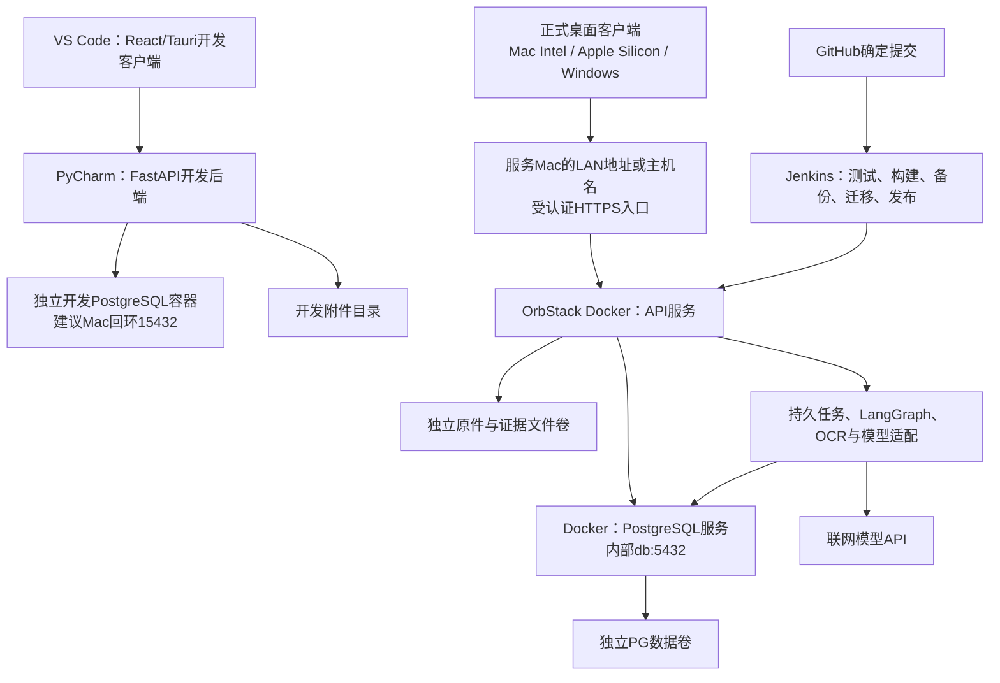

# 本地采购管理与智能对账 技术方案与实施规划

版本 1.4.3    更新日期 2026年10月16日    客户端 macOS Intel / Apple Silicon / Windows；服务部署本机OrbStack

项目面向单管理员在本机及局域网桌面设备使用，在软件内持续记录采购订单、收货和退货，再核对供应商对账单与正式发票，处理差异并保存确认依据。本方案用于收敛设计、组织开发和逐项验收。2026年10月16日已开始工程与认证基础开发，实际进展见[执行日志](execution-log.md)；下文任务状态保留规划快照，不等于功能验收。

## 开发执行入口

本版包含D00至D43共44项业务及客户端任务，以及C00至C13共14项环境与交付任务，总计58项。第十一、十二章说明业务开发，第十五章说明双环境和部署设计，第十六章列出Docker与Jenkins的具体实施步骤。GitHub仓库已由用户创建。2026年10月16日已复用本机检出开始工程开发；首次实现及测试范围见执行日志，正式发布和Jenkins仍待后续任务。

**已确认运行方式：**开发时，PyCharm单独启动本机Python后端，VS Code单独启动React/Tauri客户端；部署时，安装后的桌面客户端连接Docker内的后端。两种环境共用业务源码与API契约，但服务进程、数据库、原件、凭据和连接配置独立。客户端退出不停止任何后端。

建议接续顺序：`D00 → D02/D03`，同时执行`C00`；再`C01/C02 → D05 → D04/D06 → C03 → D07`取得第一套桌面与容器产物。D01规则整理并行推进。GitHub和Jenkins的C04至C06可在工程骨架后开始；C07/C08建立发布通道，C09至C13与后期维护、回归和交付结合。C编号靠后不表示等D43结束才做部署。

**开发客户端与正式客户端：**开发客户端由VS Code启动，默认连接开发后端；正式App按macOS或Windows目标构建并安装，默认连接Docker后端。“设置 → 服务连接”提供地址、环境名称、测试连接与凭据接入，窗口持续显示当前环境。同一份源码不等于共用一套运行环境，也不需要用户在每次操作时输入IP。

仓库已确定为`jaylansun/procure-reconcile`，当前Public、默认分支main；其余地址、端口、Compose项目名、路径、工具和命令按建议实施约定处理，未决项不视为已经确认。建议开发API为`127.0.0.1:18081`，本机Docker API为`127.0.0.1:18080`；二者同在Mac时可以使用相同IP和不同端口。已确认服务位于这台Mac的OrbStack，并允许局域网客户端访问；远端必须配置这台Mac的LAN地址或主机名。127.0.0.1:18080只表示服务Mac本机入口，不是其他设备的连接地址。正式LAN采用受认证HTTPS入口，具体证书和发布端口在C00落实；公网不属于当前范围。

快速定位：[双环境与部署方案](#十五-本地双ide与docker部署方案) · [Docker与Jenkins任务](#十六-docker与jenkins逐项实施步骤) · [原业务任务](#十一-前半程逐项开发步骤) · [一期验收](#十三-一期验收矩阵)。

## 一 需求基线与本次更新

| 事项 | 已确认要求 |
| --- | --- |
| 使用环境 | macOS Intel、Apple Silicon Mac和Windows桌面客户端；同一管理员可从局域网设备使用。服务集中在本机OrbStack，开发和部署数据独立。 |
| 数据库 | 用户已明确选择PostgreSQL（pgsql）；开发、测试、部署均使用PG，版本及驱动细节按兼容验证锁定。 |
| Python项目管理 | 已确认使用uv管理server/的依赖、锁文件和虚拟环境；pyproject.toml/uv.lock/.python-version为项目约定，PyCharm复用server/.venv。 |
| 前端与投入 | React + TypeScript；独立开发，每日约10小时投入，未约定完成日期。 |
| 目录命名 | 顶层统一为`client/`和`server/`；VS Code开发client，PyCharm开发server。脚本、Docker与Jenkins路径遵循此约定，模块内部结构仍属设计建议。 |
| 业务主线 | 日常创建订单，登记收货和退货，核对供应商对账单与正式发票。 |
| 输入与模型 | 一期包含 Excel、文字PDF、扫描PDF和图片；使用联网模型API，允许发送待解析内容。 |
| 收货与问题货 | 一次登记到货、可接受和问题数量；问题货支持退回、换货、后续转为接受。 |
| 核对与差异 | 对账和发票状态分别管理；全部差异人工处理，接受差异必须填写原因并留痕。 |
| 历史与金额 | 保留历史确认，后续退货或漏单新增调整；人民币单币种，含税/未税输入按各自价格口径逐行计算并舍入。 |
| 数值精度 | 数量、单价最多6位小数；税率按百分数最多4位小数；金额2位小数，ROUND_HALF_UP，单据汇总已舍入的行金额。 |
| 对账日期 | 默认自然月，可自选日期范围；收退货按业务发生日期归属，历史补录保留实际日期，通过后续调整处理。 |
| 退货义务 | 每笔已纳入订单义务的退货可选择补交或减量，原订单数量保留，不重复扣减实际接受量。 |
| 超收 | 允许记录真实到货，超出有效履约额度的部分待处理；接受前追加订单变更。未纳入订单义务的超收退回不生成补交或减量。 |
| 更正 | 草稿直接编辑；生效订单追加变更；收退货通过冲销/重录并处理引用依赖；已确认对账/发票保持快照、追加调整。 |
| 访问认证 | 一个管理员账号密码登录，密码6至128个字符，支持6位纯数字；多设备共用同一账号，不开放注册或多人权限管理，会话分别安全存储。 |
| 文件覆盖 | .xlsx/.xls、PDF、PNG/JPG/JPEG，中英文；密码保护文件先由用户解密后导入，扫描PDF和图片仍属一期。 |
| 质量交付 | 解析器对比报告、分层评测集、失败案例与自动化回归记录，均纳入一期交付。 |
| 本地开发 | PyCharm启动Python后端，VS Code启动React/Tauri客户端，各自可调试；业务源码与部署版本共用。 |
| 部署交付 | 服务部署Docker；Jenkins从GitHub拉取代码、构建并一键部署；客户端仍为桌面App。参考本地OrbStack中DevPilot的已运行方案。 |
| 仓库现状 | [jaylansun/procure-reconcile](https://github.com/jaylansun/procure-reconcile)已创建，当前Public、默认分支`main`，1次提交且仅README.md；发布分支策略及Jenkins接入待落实。 |

**需求状态。**当前没有可用模型API、真实样本单据或业务访谈结果。评测先使用带标准答案的模拟单据，真实模型效果在接入后另行测量。

**技术状态。**PostgreSQL是已确认的数据库选型，Docker、Jenkins与GitHub交付链路已纳入要求。Tauri 2与FastAPI已正式确定，React/TypeScript及PostgreSQL继续沿用；Python项目管理已确定uv，Rust承担Tauri原生适配。SQLAlchemy/Alembic、LangChain/LangGraph和解析器按既有推荐方案验证。部署版不再按内嵌Python sidecar设计，PyInstaller不列为一期必需项；macOS与Windows安装包只分发桌面客户端。RAG、向量数据库、多Agent和代码沙箱仍未列为已确认需求。

## 二 业务流程与计算约束

操作主线为创建订单、分批收货、处置问题货、登记退货、导入单据、关联来源、核对差异、人工处理、确认与后续调整。发票可先于对账单到达，两类核对允许交叉进行。

| 操作 | 系统保存的事实或结果 |
| --- | --- |
| 订单生效 | 供应商、物料、数量、单位、价格口径、税率及订单版本。 |
| 每次收货 | 来源订单行、本次到货量、初始接受量、初始问题量、业务日期及附件。 |
| 问题货处置 | 按数量分拆接受、退回或换货；追加处置记录，原收货事实保留。 |
| 退货与补货 | 退货关联来源数量类别；实际补货形成新收货，不提前增加接受量。 |
| 单据核对 | 按明细关联来源和覆盖数量，展示数量、价格、税率、金额及关联差异。 |
| 业务确认 | 保存本次来源版本、分配、差异处理、理由、金额及确认时间。 |
| 确认后变化 | 新增调整；改变原覆盖时关联原确认，未覆盖漏单关联历史范围。 |

### 数量口径

每一收货行满足：到货量 = 初始接受量 + 初始问题量。待处置问题量 = 初始问题量 - 后续转接受量 - 已退问题量。净可接受量 = 初始接受量 + 后续转接受量 - 已接受货退回量。所有处置受来源剩余数量约束。初始问题/待处理池中的超收数量单独标记，质量标签与是否纳入订单义务分别保存；超收经有效订单变更后追加义务纳入依据，初始到货及数量分解保持原值。退货按具体数量分段和有效义务依据决定是否需要选择补交/减量，混合退回时分别记量。

换货事项分别记录已约定、待退回、已退回和待补到。未实际退回的数量仍在问题实物池，但未完成事项占用其可安排数量，避免重复约定；撤销只释放事项占用，实际扣量仍以退货行为准。

**模拟用例。**订单100件，含税单价10元；到货100件、接受90件、问题10件。其中4件后续接受，6件退回后换货，新到6件全部接受，净接受量达到100件，累计实际到货106件。

对账确认100件和1,000元后再退回已接受货5件，假设退货按原价处理：原确认仍为100件和1,000元，当前业务净量为95件，后续待核对调整为负5件和负50元。实际调整金额须依据原覆盖与约定，不能见退货就机械扣同额。

### 必须分别保存的状态

订单履约、问题货与补货、对账确认、发票核对、AI任务分别管理。人工接受差异不改变订单或收货事实；对账单和发票引用同组交易时也不合计成双份金额。退货后的补交或减量已由用户确认可逐笔选择。原订单数量、有效应交量、实际接受量和核对调整分别保存及计算。

### 本轮确认的履约、税价与更正规则

有效应交量以原约定量和有效订单变更、退货减量记录计算；减量不覆盖原订单数量。已纳入订单义务的退货选择补交时保持应交量，选择减量时减少对应应交量；实际接受量仍只按收退货事实计算一次。例如已接受100后退5，补交则应交100/净接受95，减量则应交95/净接受95。问题货退回及减量不能机械冲减从未覆盖它的历史对账。

换货与退货共用稳定来源及事项，不能因退货又新增一份相同补交义务；已约定换货后改为减量，应同步处理原事项占用。超收以本次有效履约额度判断，考虑仍占额度的正常收货、已退回及待补来源，不能以累计到货超过原订单量就判超收，原100件换货后累计到货106的案例仍合法。先补后退等复杂时序未提供时不自行冻结新规则。

订单100实际到105，可记录真实105，正常接受部分及问题/超收待处理合计必须等于到货；超出额度的5件先待处理，接受前追加订单变更，也可退回。未纳入订单义务的超收量退回，其履约动作记为不适用，不额外补交或减少原订单应交量。禁止把未接受的超收量分配成有效核对来源。

记R(x)为金额保留2位的ROUND_HALF_UP，q为数量，p为所录单价，r为比例税率：

- 含税输入：含税行金额G=R(q×p)，未税行金额N=R(G÷(1+r))，税额T=G−N。
- 未税输入：未税行金额N=R(q×p)，税额T=R(N×r)，含税行金额G=N+T。
- 单据分别汇总已经舍入的N、T、G；不先将单价舍入到2位。正负金额使用相同对称舍入，例如0.005→0.01、−0.005→−0.01。供应商尾差仍按已确认规则人工处理。
- 数量与单价最多6位、税率百分数最多4位；输入精度超限明确提示，不能依赖数据库悄悄舍入。字段原值、计算版本和税价口径均保留。

草稿编辑保留必要审计；生效订单追加变更。已登记收退货录错通过冲销与重录，原事实保留且幂等；未确认下游分配需先解除或重算，已确认快照不删除、不回写，影响通过相应反向事实和后续调整承接。冲销所需依赖检查、原因及新旧来源引用必须可追溯。

## 三 推荐架构与职责

使用同一套桌面业务界面、Python业务模块和API契约，分为本机开发与Docker部署两种启动方式。Python业务服务仍是每套数据的受控业务写入入口，客户端始终只调用API。PostgreSQL保存业务事实、持久任务和检查点；原件与证据文件独立保存。开发和部署不共享PG实例、卷、角色、凭据或附件。



| 技术或组件 | 状态 | 职责 |
| --- | --- | --- |
| React TypeScript | 已确认 | 两种环境共用页面、表格、原件预览和复核组件。 |
| Vite Tauri 2 Rust | Tauri 2已确认；构建和原生适配按方案实现 | 桌面窗口、开发热更新、连接配置、受控HTTP/流式调用和本机文件选择。 |
| FastAPI Python | 已确认 | 本机开发进程或Docker服务，承载业务、任务、确定性计算和事务。 |
| PostgreSQL / SQLAlchemy / Alembic | PostgreSQL已确认；访问与迁移工具推荐 | 业务、任务与检查点持久化；独立开发/测试/部署数据库，显式迁移及事务并发保护。 |
| LangChain LangGraph及解析器 | 推荐或候选 | 服务端提取、复核、检查点和PDF/OCR，按原样例验收。 |
| Docker Compose OrbStack | Docker部署已要求；Compose为推荐组织方式 | 正式环境API与PG分别为容器，使用独立PG卷、附件卷和网络；开发PG另起独立实例。 |
| Jenkins GitHub | 已要求 | 从独立仓库检出确定提交，测试和构建Docker镜像，一键发布与留存记录。 |

**连接与权限。**React调用受控Rust命令，Rust读取当前连接配置和平台原生凭据设施保存的当前会话后访问Python API。开发客户端默认连接开发API，正式App默认连接部署API，支持在连接设置中修改并测试。文件内容通过API上传和下载；不向容器提交客户端绝对路径。模型密钥由所连后端管理，管理员登录会话与模型密钥分开。Tauri命令与macOS打包参考R1、R2。

**进程边界。**本地后端归PyCharm管理，部署后端归Compose/Jenkins管理。桌面应用不自动起停Python或容器，不持有Docker socket。关闭窗口、切换环境和重连只影响客户端；服务里的已受理任务按持久状态继续。实例之间不自动同步数据库或附件。

## 四 核心数据模型与关联

以下是逻辑模型建议，表名、字段和状态尚未冻结。采用业务事实、版本和确认快照表达变化，不要求引入完整事件溯源框架。每条业务明细有稳定标识，关联需要保存来源版本。

| 对象组 | 关键记录 | 关联与约束 |
| --- | --- | --- |
| 基础资料 | 供应商 物料 单位 换算 | 名称别名与换算经确认后生效，换算版本可追溯。 |
| 订单 | 订单 订单行 变更版本 | 收货和核对引用具体行及价格版本，历史约定可还原。 |
| 收货 | 收货单 收货行 数量分段 义务纳入记录 | 每次到货独立保存，接受/问题初值保留；超收待处理作为问题/待处理池子类别，质量标签与履约覆盖状态分开记录，数量分段不重复。 |
| 问题与退货 | 处置 退货行 补货事项 | 退货引用具体数量分段、问题/接受类别及当时义务纳入依据；未纳义务的超收返还可识别，处置引用实际退货，数量只计一次。 |
| 外部单据 | 账单 发票 明细 版本 | 字段确认与业务确认分开；原件及旧版本保留。 |
| 匹配与分配 | 候选关联 有效分配 | 同一维度内限制覆盖；对账与发票可独立引用同组业务事实。 |
| 差异与确认 | 差异处理 确认 快照 | 已接受差异仍有金额或数量及原因，不伪造来源分配。 |
| 后续调整 | 调整 来源事实 确认引用 | 改变已有覆盖时引用原分配；未覆盖漏单可仅关联历史范围及原因。 |
| 文件与任务 | 文件 证据 候选 修正 任务 | 原件按内容标识保存，候选与人工修正独立版本化。 |
| 账号与会话 | 单管理员账号 设备会话 | 密码只存哈希，分别保存会话有效期与失效状态；开发和正式隔离，不开放注册。 |

### 关系与剩余额度

订单行可有多条收货行；收货行可有多次问题处置和退货。账单行与业务来源通过分配记录形成多对多关系，支持合并覆盖和部分覆盖。发票使用独立核对维度，不共享一个全局已占用量。

可退数量取自对应来源累计接受或问题数量，扣除已经有效处置的数量。分配上限在确认事务内重检；接受账单数量差异时，额外数量留在差异处理记录中，不能强行占用不存在的收货量。

调整按对账和发票维度分别保存额度及应用状态，同一事实可分别影响两类核对；每个维度内可部分处理，累计不超来源。漏单从未进入确认时，原确认引用可为空；变更既有覆盖时才必须追溯具体原分配。

### 日期和变更

分别保存业务发生日期、录入时间、单据日期和确认时间。对账默认自然月，可自选区间，收退货按业务发生日期归属；补录保留原日期，通过后续调整承接已确认历史。草稿可编辑，生效订单追加变更，收退货冲销重录；已有下游引用先处理依赖，已确认财务核对以追加调整承接，旧快照及关联依据保留。基础资料和价格变更不回填历史。

## 五 业务接口与事务设计

API应表达创建订单、登记收货、处置问题货、分配来源和确认对账等业务动作。下表仅为接口草案。由FastAPI契约生成或校验前端类型，统一返回业务错误、版本冲突与可继续处理的信息。

| 接口组 | 操作示例 | 关键输入或校验 |
| --- | --- | --- |
| 订单 | 创建 确认 变更 查询 | 行明细、价格口径、税率、当前版本、变更原因。 |
| 收退货 | 登记收货 问题处置 退货 | 来源行、数量类别、数量、业务日期、处理理由。 |
| 文件 | 导入 预览 确认字段 | 内容标识、证据引用、候选版本、人工修正。 |
| 核对 | 建议来源 分配 计算差异 | 维度、范围、来源版本、分配量及关联依据。 |
| 确认与调整 | 确认账单 确认发票 纳入调整 | 当前核对版本、差异处理、原确认、来源与剩余额度。 |
| 任务与维护 | 取消 重试 恢复 备份 | 任务版本、运行标识、错误类别、备份或恢复清单。 |

### 一次确认的提交顺序

请求携带command_id和预期版本。服务开启短事务，检查幂等记录；按统一锁顺序锁定影响本次额度的稳定来源记录，再重读来源版本与可分配余额，校验全部差异已处理；原子写入分配、理由、确认快照、审计和幂等结果。事务成功后返回结果。重复请求返回同一业务结果，载荷不一致时拒绝复用标识。

不依靠按钮置灰防重。数据库唯一约束和事务处理双击、超时重试及并发确认。旧页面提交返回版本冲突，由界面提示刷新与重新核对；不得静默覆盖新状态。

### 数量金额与数据库

API精确数值用十进制字符串，服务用Decimal、PG NUMERIC存储。已确认数量/单价最多6位小数、税率百分数最多4位、金额2位；比例税率在存储/API中统一为6位小数，例如13.0000%对应0.130000。金额使用ROUND_HALF_UP，逐行舍入后汇总。列总精度、溢出上限和Decimal运算上下文在实现时记录，不能改变已确认的小数位及舍入口径。保存税价输入口径、未税金额、税额、含税金额和计算规则版本；拒绝NaN/Infinity等非业务值。列类型不替代应用输入精度与舍入校验，避免数据库隐式舍入改变已确认口径。参考R25。

PostgreSQL使用外键、唯一性、检查约束和版本字段，连接池按实际并发设上限；SQLAlchemy与psycopg 3作为推荐访问组合，Alembic显式迁移。耗时解析和模型调用放在短事务之外。所有影响来源余额的收退货、处置、分配及确认命令，应按固定顺序锁定稳定来源或余额记录，再重算与校验；不能让并发事务各自读取同一余额后超额分配。死锁或可重试事务错误在幂等前提下有限重试。参考R11、R26、R27。

### 审计与文件一致性

记录操作时间、动作、原因、目标及前后版本。原件先写临时文件并校验，再原子移动为不可变对象，最后提交数据库引用；失败后清理无引用对象。避免数据库已确认而原件尚未落盘。

## 六 文件导入与证据结构

四类输入均属于一期交付。先构建原件、页面、单元格和证据的统一结构，再接入可替换读取器。模型只能引用系统生成的证据标识，不能自行编造坐标或缺失字段。

| 输入 | 候选处理路径 | 必须处理的情况 |
| --- | --- | --- |
| Excel | xlsx评估openpyxl；xls另做读取适配 | 多工作表、合并表头、公式及缓存、数字格式、单位与隐藏区域。 |
| 文字PDF | 文本与布局提取并渲染预览 | 跨页表格、文字顺序、重复表头、合计行及页面旋转。 |
| 扫描PDF | 逐页渲染后OCR，必要时使用图像模型 | 倾斜、低清晰度、印章遮挡、表格结构和扫描文字区域。 |
| 图片 | 方向处理、预览、OCR或多模态识读 | 拍照透视、模糊、裁边及来源坐标；不能无提示补造内容。 |

混合PDF按页选择路径。Excel原生读取保留工作表、地址、原值、公式和已有缓存；缓存缺失进入复核，不把读取器当作公式计算引擎。损坏、加密、超页数或超大小文件返回具体状态；扩展名与中英文覆盖已确认；密码文件提示先解密，大小、页数、像素与并发限制在资源实验后配置。

### 统一证据模型

证据建议保存file_id、解析版本、证据ID、原文、内容类型、页码或工作表及单元格地址。图像与PDF区域还需保存坐标、页面尺寸、旋转和坐标变换，确保预览缩放后高亮仍正确。候选字段保存原值、规范值、证据列表与校验问题；人工修正另存操作与新版本。

### 读取器与模型分开评估

pdfplumber、pypdfium2、Tesseract、MinerU和PaddleOCR均可列入候选清单，按具体能力选择对比组合。候选不要求全部集成；同样例比较后，只保留满足证据、效果、资源和分发要求的组合。

PDF/OCR须分别验证macOS Intel本地开发与Linux amd64容器。pypdfium2的macOS平台要求用于开发后端兼容性判断，不能套用为Docker镜像的最低系统条件。MinerU按版本和解析层级测试；PaddleOCR另验推理后端、语言资源、原生依赖、发行许可及体积。桌面安装包无需包含服务端OCR或Python资源；开发导入成功也不证明容器可运行。资料见R7和R8。

### 重复导入

内容哈希识别相同原件，业务单据编号、主体和金额等辅助提示不同文件中的疑似重复。相同文件可关联已有记录；不同版本保留关系，由用户决定修订或新增，不能自动合并有歧义的交易。

## 七 AI流程与任务恢复

LangChain用于模型适配、结构化输出和受控查询工具；LangGraph用于阶段状态、人审暂停和恢复。业务计算与确认使用前述业务接口，检查点保存流程状态，业务数据库保存业务事实。推荐同一环境的PG数据库内分开业务/任务与工作流schema，并独立管理连接和权限；LangGraph Postgres checkpointer使用对应适配包，其setup及表迁移由受控命令管理。即使连接同一数据库，业务事务与检查点写入也不会自动成为一个事务，仍需幂等及恢复核对。参考R28。

| 阶段 | 输出 | 继续或暂停条件 |
| --- | --- | --- |
| 读取证据 | 文本 单元格 页面区域 | 文件读取失败时保留原因；可重试阶段与输入版本明确。 |
| 提取候选 | 供应商 单据头 明细 证据引用 | 缺失留空，候选格式及引用范围经过代码校验。 |
| 校验与复核 | 字段问题 人工修正版本 | 缺字段、冲突或歧义进入人审；字段确认不等于对账确认。 |
| 关联建议 | 来源候选 匹配依据 | 先按主体、编号、物料、日期和额度过滤，歧义交用户处理。 |
| 差异解释 | 差异说明 引用依据 | 数量金额由业务代码计算；模型解释不能自动接受差异。 |

### 持久化与重放

任务保存task_id、输入版本、运行版本、阶段、attempt_id、尝试次数、错误和已确认结果引用。建议先限量执行任务，OCR与PDF处理放受控工作线程或子进程；并发、超时与取消策略通过实测调整。

恢复时检查来源是否仍有效、业务写入是否已经提交、人工是否已生成新版本。取消或修正后，旧运行结果即使返回也不得覆盖新版本。进度事件携带序号，界面重连后从持久化状态补齐；建议后端HTTP事件流经Rust转发为Tauri事件，取消客户端订阅不自动取消服务端任务。具体协议在联调时验证。

LangGraph的interrupt恢复会从所在节点开头重新执行。因此模型调用缓存、结果指纹、任务版本和业务command_id分别防重。能够保证业务效果不重复，不能承诺外部模型在网络超时后只执行或计费一次。资料见R3和R4。

### 模型配置与边界

M4结束前准备可用API，比较结构化输出、图像能力、费用、延迟和失败表现。接入前用标记清楚的模拟适配器验证流程；正式效果验收使用真实调用。发送必要文字或图像会离开本机，本方案不属于完全离线运行。日志保存模型、提示词和配置版本，避免记录密钥与不必要的原文。

一期优先明确提取、关联建议和差异解释的职责。是否拆分多个Agent、引入RAG或语义重排，根据样例和效果另行决定；当前没有据此扩展产品需求。

## 八 评测与失败回归交付

解析器对比报告、分层评测集、失败案例与自动化回归记录已经确认为一期交付。它们贯穿开发，不再作为发布前临时补写的材料。

| 评测层次 | 主要指标或判据 | 记录要求 |
| --- | --- | --- |
| 字段提取 | 关键字段准确率 缺失率 | 分别记录数量、单价、税率、日期等字段的标准值及规范化规则。 |
| 明细结构 | 漏行 重复行 错列 | 逐行标注预期结果，负数、合计和跨页续表单独分析。 |
| 证据定位 | 引用有效性与位置正确性 | 统计无依据字段和错误定位；记录可回到原文的覆盖情况。 |
| 关联候选 | 正确来源覆盖率与错误候选 | 存在明确答案时记录前K候选覆盖；多来源分配按预期集合检查。 |
| 业务计算 | 数量金额与约束案例通过 | 双扣、超退、重复覆盖、跨期调整等关键不变量全部通过。 |
| 任务恢复 | 重启 取消 重试 版本保护 | 确认无重复业务事实，无旧结果覆盖；外部调用次数另行记录。 |
| 使用与资源 | 复核耗时 延迟 内存 费用 | 固定机器、版本和样例；解析时间与全任务时间分别记录。 |

### 解析器对比报告

同一批原件、同一标准答案、相同运行条件比较候选组合。报告写明工具和模型版本、配置、格式覆盖、证据输出、错误类型、时间、内存、依赖及包体积，并给出选择或淘汰原因。解析与模型提取分别计量，避免把全部改善归给其中一个组件。

### 评测集与失败记录

先建立模拟订单、收退货、账单和发票的标准事实，再生成四种格式和可控异常。开发调优样例与最终评测样例区分，保留版本与样本数。没有真实企业样本时，报告测试覆盖和已验证范围，不推导行业识别准确率。

每个失败案例至少保存case_id、输入与版本、预期、实际、错误分类、定位、修复、回归状态。可自动判定的部分加入测试，含人工视觉判断的部分保留复核记录。MRR或Recall@K只衡量候选排序，不能替代字段或业务正确性。

## 九 本地运行与数据维护

### 启动与运行

开发时先启动独立开发PG实例并确认数据库连接，再在PyCharm启动Python后端、在VS Code启动Tauri开发客户端。可分别调试，客户端命令不附带启动第二份后端。部署时先由Jenkins或Compose启动容器服务，安装后的App连接已配置地址。服务未启动时，App显示连接失败与检查入口；连接成功需要认证、环境标识和版本检查，而不是仅检测端口打开。

窗口关闭不停止后端。应用退出只释放连接、订阅和本机临时预览；服务异常或部署重启后，持久任务检查输入和运行版本再恢复。服务端停机使用维护门禁、停止接收业务写入及新任务、等待或中止受控执行器，避免旧运行迟到结果提交。

开发业务与检查点使用独立PG实例/数据库，附件建议放`.local/dev/files/`并忽略提交；集成测试使用临时PG实例或隔离测试库及临时文件。部署PG使用专属数据卷，API只挂附件卷到`/app/data/`，不挂PGDATA。容器安装层只保存程序资源，客户端切换地址不会搬迁或合并数据。

### 备份与恢复

备份在统一维护窗口停止业务、任务、检查点和附件写入，并关闭所有应用写入者；PG服务保持运行，使用匹配版本的pg_dump生成逻辑备份，配套复制不可变原件、证据及哈希清单。数据库快照本身不能保证附件一致，二者须对应同一维护边界。备份写入独立备份卷并可导出到Mac；不得把复制运行中PGDATA当作此逻辑备份。资料见R5、R18。

数据库先恢复到隔离的新PG数据库或实例，文件先恢复到新附件目录或卷；校验schema、业务、检查点和文件引用后，在维护状态受控切换。错误备份不覆盖当前有效数据。管理员密码仅以哈希保存；活跃登录会话不作为可复用会话导出，恢复后使旧会话失效。部署秘密及模型密钥另行配置，不默认打进业务备份。镜像回退与数据库恢复是不同动作；发布后已有新业务时，不自动用旧备份覆盖它们。

### 迁移与双产物发行

每次schema变更附PG迁移脚本和旧库样例。生产迁移由部署流程在PG健康且应用停写后，用一次性命令经数据库连接执行；业务Alembic迁移与框架检查点初始化/升级分别管理，不在每次API启动或每个worker中并发运行。迁移前备份；失败时保留旧数据及日志，根据是否产生新写入和schema兼容性选择恢复路径。

服务产物是`linux/amd64` Docker镜像，由本机OrbStack上的Linux Jenkins构建并部署。客户端交付Mac Intel、Apple Silicon Mac及Windows安装包，分别在合适的Mac/Windows构建环境生成并实测；Linux Jenkins继续负责服务镜像。三平台客户端和服务保留提交及兼容版本关系。具体系统版本、Windows架构和可用构建机尚不清楚，不据“不会太旧”宣称兼容；签名、最低系统及更新方式按Q07/Q11落实。

| 问题 | 预期行为 |
| --- | --- |
| 开发后端或Docker服务未启动 | 客户端显示当前目标地址和可执行检查，不启动隐式第二份服务。 |
| 客户端退出或切换环境 | 服务继续，已受理任务状态保留；新请求只进入明确选中的环境。 |
| 断网或模型超时 | 业务数据仍由服务保存；恢复按次数与版本限制重试。 |
| 服务崩溃或容器替换 | 已提交事实与原件留在卷中，恢复检查任务归属与版本。 |
| 迁移或恢复失败 | 保留有效数据及备份，阻止不兼容版本继续写入。 |
| 诊断与日志导出 | 记录环境、服务版本、任务和错误，过滤凭据及不必要原文。 |

## 十 实施里程碑与投入估算

上一版单人每日约10小时的工作量基线为54至81个有效开发日，含缓冲约65至106日。本轮新增Apple Silicon/Windows实机交付、LAN HTTPS与账号登录后，需要在C00资源盘点及M1实验后重新拆分估算，不能把旧区间直接当新增范围的完整承诺。未约定截止日期；C任务穿插M0至M7，构建设备、证书和真实模型等外部等待单列。

| 阶段 | 交付版本 | 开发日 | 进入下一阶段的条件 |
| --- | --- | --- | --- |
| M0 | 规则 核心模型 接口 用例 | 2至3 | 影响数量、金额、期间及更正的关键规则已明确。 |
| M1 | 最小桌面客户端与容器后端 | 4至6 | 双IDE独立启动；正式App可连接独立容器，数据与开发环境分开。 |
| M2 | 订单与收退货业务 | 7至10 | 问题货分拆、补货、来源校验及数量不变量通过。 |
| M3 | 手工对账与发票闭环 | 8至12 | 明细分配、差异人审、确认快照与后续调整通过。 |
| M4 | 四类文件与证据复核 | 8至12 | 全部输入有完整路径，解析器对比报告形成。 |
| M5 | 真实模型与任务恢复 | 6至9 | 真实调用、人审、重启、取消和晚到结果检查通过。 |
| M6 | 数据维护与服务/三平台客户端发行 | 原估算待复核 | 一致备份、迁移及三平台LAN客户端兼容验证通过。 |
| M7 | 完整验收与作品集 | 5至7 | 关键场景、评测、回归和演示材料完整。 |
| C交付工作线 | C00至C13，穿插各阶段 | 原增量8至13，待复估 | GitHub检出到Docker部署、版本检查与失败回退可复现；不与M阶段重复计量。 |

### 每阶段的完成标准

一个阶段同步交付页面、API、迁移或模型变更、验收用例及打包验证。关键业务测试先通过再叠加识别；文件识别在相同单据和业务接口上接入。M4和M5均属于一期，扫描PDF和图片不会因开发顺序后置而移到后续版本。

### 依赖与可并行工作

M0与M1先解决关键规则和分发可行性。M2期间可以准备四格式样例；M3完成后接入M4，避免解析结果缺少稳定业务落点。模型候选调查和API准备可提前进行，真实效果在M5验收。日志、迁移和回归从早期开始，M6集中验证恢复与发行。

第一份可操作产物是M1双环境小样：PyCharm后端与VS Code客户端可独立启动；macOS App可连接容器后端，完成PostgreSQL写入、文件上传、PDF预览、一次OCR及客户端关闭后的服务恢复。Python/PDF/OCR在本机开发与Linux镜像分别验证；不要再按内嵌sidecar打包。

### 任务执行约定

按任务ID和依赖推进，每项在代码、界面或结果可操作后再验收。状态使用“待开发、开发中、待规则决定、待外部资源、待验收、已完成”；不能把讨论过、写了接口或Mock演示成功标为已完成。每项原则上拆为约半天至两天的工作单元，超过时继续拆子任务，但保留所属ID。

除专门的打包或纯计算实验外，每项业务任务同步完成迁移、业务服务、API、React页面和有意义的测试。先实现一个完整操作，再做下一操作。测试覆盖数量约束、事务、状态和恢复；不为简单样式或字段搬运机械增加测试。

每项完成后更新项目内的 `docs/execution-log.md`，记录任务ID、修改文件、实际执行命令、结果、未通过项和下一任务。可用Git时记录对应提交；是否创建提交遵循开发会话的用户要求与仓库规则。没有有效测试或没有实际安装包验证，不记为通过。

### 决策状态与剩余依赖编号

已确认项直接沿用，不再反复询问；尚不清楚的设备版本保留为外部资源核实，不擅自推断。技术配置由实施验证收敛，新增业务含义在对应模块开发前继续确认。

| 编号 | 状态与结论 | 影响任务 |
| --- | --- | --- |
| Q01 | 退货补交/减量、超收待处理及超收退回例外已定；订单关闭边界、先补后退等未给出的复杂顺序按实例再确认 | D10至D14 |
| Q02 | 精度、ROUND_HALF_UP、逐行舍入汇总及含税/未税公式已定，见计算规则 | D08及后续金额功能 |
| Q03 | 自然月默认/自选区间、业务发生日期、历史补录追加调整已定 | D16、D20 |
| Q04 | 草稿编辑、生效订单变更、收退货冲销重录、确认快照追加调整已定 | D10、D13、D15、D18至D20 |
| Q05 | xlsx/xls、PDF、PNG/JPG/JPEG、中英文及先解密已定；资源上限经实验配置 | D22至D29 |
| Q06 | 模型供应商、图像能力、预算及真实API仍待准备；不阻塞基础业务 | D30、D31、D36真实调用 |
| Q07 | 三平台交付已定；最低系统、签名/公证、更新与导出字段仍待落实 | D40、D43、C10 |
| Q08 | Public仓库jaylansun/procure-reconcile及main已存在；发布分支策略及Jenkins任务/凭据在接入时落实 | C04、C05 |
| Q09 | 本机OrbStack服务、局域网访问、Apple Silicon Mac及Windows客户端已定；当前不含公网 | C00、C02、C12 |
| Q10 | 单管理员账号密码、多设备会话、关闭注册已定；TLS证书/信任、会话时效和备份保留参数待工程验证 | D04、C00、C07、C11 |
| Q11 | 用户暂不清楚其他设备系统版本/Windows架构及是否可作构建机；拿到设备时核实，不能虚报实测 | C10、D40、C12相关平台 |

规则编号保留用于追溯。已决定的内容不再标成开发阻塞；剩余规则和资源只阻塞相应分支。

### 建议代码结构

以下路径相对开发会话检查并选定的项目根目录。2026年10月16日已复用`/Users/sunjiale/Documents/procure-reconcile`，沿用origin/main初始历史并保留用户的根main.py与IDE文件；原WebRemix目录已不存在。后续在该仓库推进，不另建独立Git历史。

```text
project-root/
├── package.json                    # 建议统一命令入口
├── pnpm-workspace.yaml             # 若采用pnpm工作区
├── client/
│   ├── src/app/                    # 导航、页面路由、全局错误展示
│   ├── src/lib/                    # 受控API调用与精确数值传输
│   ├── src/features/               # orders receipts returns reconciliation invoices documents
│   └── src-tauri/                  # Rust窗口、连接配置、受控请求与打包
├── server/
│   ├── pyproject.toml               # uv项目依赖、dev组与版本约束
│   ├── uv.lock                      # uv生成并维护的精确版本锁
│   ├── .python-version              # Python 3.13
│   ├── .venv/                       # uv创建，Git忽略
│   ├── app/main.py
│   ├── app/api/                    # 业务动作接口
│   ├── app/domain/                 # 数量、价格、分配、差异与状态规则
│   ├── app/services/               # 用例与事务编排
│   ├── app/persistence/            # ORM模型、会话和幂等记录
│   ├── app/documents/              # 原件、证据、读取器和预览
│   ├── app/jobs/                   # 持久任务、尝试、取消和恢复
│   ├── app/ai/                     # provider、schema、graph和checkpoints
│   ├── app/maintenance/            # 备份、恢复、迁移、诊断和导出
│   ├── migrations/
│   └── tests/unit/ integration/    # 纯业务与数据库/API测试
├── deploy/                         # Compose、环境样例与部署说明
├── Jenkinsfile                     # 从SCM检出、测试、构建与发布编排
├── .dockerignore                   # 排除密钥、数据、开发环境和无关产物
├── contracts/                      # OpenAPI导出与前端类型
├── fixtures/                       # 模拟业务事实、四格式原件和标准答案
├── evals/                          # 解析器、字段、匹配与恢复评测脚本
├── scripts/                        # 检查、测试、服务发布、备份与Mac/Windows打包脚本
└── docs/                           # 规则决定、执行日志、报告及运行说明
```

顶层目录命名已确认：`client/`为桌面客户端，`server/`为Python服务端。根包命令及工作区成员应指向client；Docker构建上下文及Dockerfile统一指向server（采用根上下文时显式指定server/Dockerfile）。模块内部目录仍是可讨论的实施建议。

后续任务“代码与页面”中列出的建议文件路径均相对项目根目录。尚未指定组件文件名的页面归属 `client/src/features/` 对应模块；实际创建文件后在执行日志记录完整路径。

### 开发与验证命令入口

下表是D02及对应后续任务需要建立的项目脚本契约，现在并不存在，不可直接当作已经可运行的命令。前端及根快捷命令采用pnpm；Python后端已确认uv，根后端快捷命令实际调用uv，不建立第二份依赖环境。Python测试暂推荐pytest与FastAPI TestClient，见资料R13和R14；具体版本经M1验证后锁定。

| 项目入口 | 创建任务 | 应执行的工作 |
| --- | --- | --- |
| `pnpm run doctor` | D02 | 检查系统、Node、Rust、uv项目Python与锁文件一致性，不自动改系统配置。 |
| `uv sync --directory server --locked` | D02 | 按server/uv.lock同步项目虚拟环境，配置与锁不一致时失败。 |
| `pnpm client:dev` / `pnpm dev` | D02至D04 | 只启动React/Tauri开发客户端，默认连开发API；Python由PyCharm独立启动。 |
| PyCharm Python模块运行配置 | D03 | 工作目录server，使用其虚拟环境，模块uvicorn，参数建议`app.main:app --host 127.0.0.1 --port 18081 --reload`。 |
| `pnpm check` | D02 | 前端类型检查、Rust检查和后端基础检查，后续按需要补充。 |
| `pnpm db:migrate` | D05 | 定位开发虚拟环境，在server目录执行迁移到目标版本。 |
| `pnpm test:domain` | D08 | 运行 `server/tests/unit/` 中的数量、金额、匹配和状态测试。 |
| `pnpm test:api` | D03建立，D09起扩展 | 运行 `server/tests/integration/` 中的健康接口、数据库和API事务测试。 |
| `pnpm test:ui` | D09起 | 使用确定的UI测试工具验证关键页面操作，具体工具在接入时记录。 |
| `pnpm eval:parsers` | D29 | 同样例比较候选解析组合，输出机器可读结果及对比报告。 |
| `pnpm eval:model` | D36 | 运行隔离的真实模型评测，记录样本、费用、延迟和字段结果。 |
| `pnpm test:recovery` | D34起 | 运行任务重放、取消、迟到结果、服务重启及数据恢复检查。 |
| `pnpm package:mac:intel` | D07 / C10 | 构建Mac Intel客户端。 |
| `pnpm package:mac:arm64` | C10 | 构建Apple Silicon Mac客户端，实机验收。 |
| `pnpm package:windows` | C10 | 在适当Windows构建环境生成客户端，架构及系统基线按Q11核实。 |
| `pnpm docker:build` / `pnpm docker:up` | C01至C02 | 建立后分别构建与启动容器服务；正式发布必须通过C07/C08门禁。 |
| Jenkins“立即构建”或“Build with Parameters” | C05至C08 | 一次触发GitHub检出、测试、镜像构建、备份迁移、部署及结果记录。 |

脚本需使用项目锁定的运行时和虚拟环境。比如后端测试在server目录调用 `uv run --locked pytest`，但不能依赖执行者电脑上碰巧存在的全局包。完整验收以实际输出和界面操作为证据，命令退出成功本身不证明业务正确。

## 十一 前半程逐项开发步骤

D00至D07结合C00至C03先获得可运行的双环境桌面与后端产物，D08至D21再完成无需AI的业务闭环。D01规则整理并行，相关规则依赖仍必须满足。

### M0 规则整理与开发准备

#### D00 核查工作区并建立执行记录

- [ ] 已完成并记录验收证据

状态：待开发。前置：无。

1. 检查目录、AGENTS.md、Git及系统架构；已有目标仓库检出则复用，否则在核查为空的目录克隆`https://github.com/jaylansun/procure-reconcile.git`。非空且不属于该仓库的目录先保留，另选目录；不重复git init或覆盖历史。
2. 核对origin、main、现有README和工作树，记录初始提交；再盘点macOS、Node、Rust、Python及开发工具，在克隆内建立任务状态和执行日志。

代码与页面：`docs/environment.md`、`docs/execution-log.md`；尚无代码时先准备目录约定。

验收：远程为已提供仓库，README和历史保留；环境记录来自实际输出，列出D02能否开始及D01尚需决定的规则。

完成条件：新执行者能知道工程在哪里、当前有什么、下一个可执行任务是什么；所有开发任务初始标为待开发。

#### D01 形成关键业务规则与标准案例

- [ ] 已完成并记录验收证据

状态：待开发。前置：D00；可与D02至D07并行。

1. 将Q01至Q11按已确认、技术验证、待资源和仍需业务决定分类，直接沿用本轮答复，不重问框架、LAN设备类型、税价精度、日期及更正主规则。
2. 按已经确定的规则写订单、收货、退货、账单和发票的标准事实及预期结果；输出核心关系、状态草案和命令错误约定。

代码与页面：`docs/decisions.md`、`docs/domain-model.md`、`contracts/`、`fixtures/business/`。

验收：核对100/90/10、4转接受6换货、后续退5、部分覆盖和漏单等案例；未定规则保留占位，不伪造答案。

完成条件：每项业务任务能指向对应规则版本与标准案例。未决项仅阻塞依赖它的任务，不阻塞桌面实验。

### M1 最小桌面链路

#### D02 创建前端桌面与后端工程骨架

- [ ] 已完成并记录验收证据

状态：待开发。前置：D00；不依赖所有业务规则完成。

1. 在D00检出的同一个仓库内建立React/TypeScript、Tauri和Python工程，保留并扩充既有README，锁定经Intel验证的运行时与依赖。可用官方React/TypeScript模板，见R15，不重新初始化独立仓库。
2. 建立根命令入口、环境配置样例、忽略规则、基础检查和运行说明；此时只做导航框架及空页面，不提前铺全部CRUD。

代码与页面：`package.json`、`client/`、`client/src-tauri/`、`server/pyproject.toml`、`scripts/`、`README.md`。

验收：`pnpm run doctor`能区分可用和缺失依赖；前端开发页与Tauri窗口可启动，基础检查可运行。

完成条件：目录和启动方式明确；版本已锁定；默认配置不含密钥，数据和构建产物被正确忽略。

#### D03 实现独立FastAPI启动健康与环境握手

- [ ] 已完成并记录验收证据

状态：待开发。前置：D02。

1. 提供PyCharm模块启动配置和同等CLI说明，读取后端独立配置，返回结构化错误及日志标识；定义GET /health与存活探针。
2. 健康握手返回环境、服务实例ID、应用/API版本和就绪状态；只暴露连接所需信息，认证与业务写入不能因为端口可达而省略。

代码与页面：`server/app/main.py`、`server/app/api/health.py`、`server/app/settings.py`、`server/tests/integration/test_health.py`、`docs/local-development.md`。

验收：PyCharm可独立启动、调试及停止API进程，不由VS Code拉起；数据库未接入时存活探针可用而业务未就绪，C02/D05接入开发PG后再验完整健康。

完成条件：独立后端可运行并返回真实环境与版本，后续Docker入口复用同一app；桌面连接由D04验收，不在本任务提前依赖Rust适配器。

#### D04 实现三平台连接配置与单管理员登录

- [ ] 已完成并记录验收证据

状态：待开发。前置：D03、D05、C02；D05先提供管理员和会话持久化。

1. 实现服务地址、环境、连接测试及单管理员登录/退出；同一账号可从多设备登录，不开放注册。开发配置连接本机开发API，正式设备连接服务Mac LAN地址，并验证TLS、环境及API兼容。
2. Rust代理受控API、文件与事件流；会话存平台原生凭据设施，按环境/服务实例隔离，密码不存普通前端配置。切换地址清理旧上下文，退出只释放客户端连接，不停止服务任务。

代码与页面：`client/src-tauri/src/connection.rs`、`client/src-tauri/src/credentials.rs`、`client/src/features/auth/`、`client/src/features/settings/ConnectionSettings.tsx`、`server/app/security/`。

验收：真实登录、错误密码、未初始化账号、会话失效/退出及环境不符均有测试；完整三平台凭据与LAN安装包验收留C10/C12。

完成条件：管理员登录主规则已确定；不再用每次启动客户端生成连接密钥来认证独立服务，不自动回落到另一环境。

#### D05 建立双环境PostgreSQL与附件写入基础

- [ ] 已完成并记录验收证据

状态：待开发。前置：D03、C02。

1. 接入SQLAlchemy/psycopg及有界连接池，建立PG迁移、约束、运行角色与权限；提供单管理员账号/会话基础表及受控初始化入口，独立设置开发/正式密码且不提交秘密。业务/任务与工作流schema归属清楚。
2. 实现command_id、指纹、版本、审计及稳定来源锁协议；附件仍采用原子内容写入和数据库文件标识引用，API不挂数据库数据卷。

代码与页面：`server/app/persistence/`、`server/migrations/`、`server/app/services/commands.py`、`server/app/documents/storage.py`、`deploy/env/`。

验收：真实PG验证迁移、事务回滚、外键/唯一约束、幂等和连接错误；两环境数据独立，重建API或DB容器后数据库及附件仍保留。

完成条件：本机和部署后端均连各自PG，测试不以其他数据库代替；运行账号不用数据库超级用户，尚未实现的业务表不冒充已验收。

#### D06 验证macOS开发与Linux容器的PDF和OCR依赖

- [ ] 已完成并记录验收证据

状态：待开发。前置：D05、C01、C02；技术实验配置可先行。

1. 同一文字PDF与扫描小样分别运行在PyCharm使用的macOS Intel环境及linux/amd64容器，验证中文路径、渲染、文字与OCR输出。
2. 记录引擎、语言资源、原生动态库、许可、耗时和内存；确定第一个服务镜像依赖基线，区分本机安装和容器资源路径。

代码与页面：`server/app/documents/spikes/`、`server/Dockerfile`、`fixtures/smoke/`、`docs/parser-platform-matrix.md`。

验收：两种运行环境均生成可定位预览和已知文字；桌面只接收服务结果，关闭客户端不影响容器处理。

完成条件：PDF/OCR在本机开发与容器均有实测，不以Mac导入成功替代Linux兼容验证，也不再要求它们随App分发。

#### D07 构建第一份桌面客户端并连接容器小样

- [ ] 已完成并记录验收证据

状态：待开发。前置：D04、D05、D06、C03。

1. 在Mac构建Intel客户端，配置开发与正式连接默认值及独立客户端身份；客户端不包含Python和OCR服务资源。
2. Finder启动App并连接Docker服务，完成健康认证、数据写入、附件上传、PDF预览、OCR和客户端退出重开；再验证开发客户端连接PyCharm服务。

代码与页面：`scripts/package/macos-intel.sh`、`client/src-tauri/tauri.conf.json`、`client/src-tauri/tauri.dev.conf.json`、`docs/m1-package-report.md`。

验收：`pnpm package:mac:intel`产生真实App；无客户端侧Python或Homebrew依赖。Docker未启动显示连接问题，不启动隐式后端。

完成条件：M1双环境链路通过；未获得干净环境时如实标待验收。开发和正式App的配置及凭据互不覆盖。

### M2 订单收退货与补货

#### D08 实现精确数值与规则计算模块

- [ ] 已完成并记录验收证据

状态：待开发。前置：D05；Q02精度和税价公式已确认。

1. 按Q02实现数量、单价、税率的输入校验、PG NUMERIC映射和Decimal计算；显式处理精度/舍入，保存价格口径与计算规则版本。
2. 建立含税/未税、舍入、数量分解及净量的独立计算单测，并增加真实PG精确数值往返测试；不依赖前端或模型。

代码与页面：`server/app/domain/quantities.py`、`server/app/domain/money.py`、`server/tests/unit/`、`fixtures/business/expected/`。

验收：`pnpm test:domain`验证小数边界、税价计算、非数值输入和100/90/10等标准答案。

完成条件：按已确认的6位数量/单价、4位百分数税率、2位金额及逐行公式实现；输入、计算、PG往返和显示一致。

#### D09 完成供应商物料单位资料

- [ ] 已完成并记录验收证据

状态：待开发。前置：D05、D08；最小字段和单位换算规则已明确。

1. 实现供应商、物料、规格、单位和经确认的换算关系的迁移、服务与API。
2. 完成资料列表、新增/编辑和选择控件，历史业务引用稳定标识；同名不同规格不自动合并。

代码与页面：`server/app/persistence/models/catalog.py`、`server/app/services/catalog.py`、`server/app/api/catalog.py`、`client/src/features/catalog/`。

验收：创建供应商和两种同名不同规格物料，关闭重开后查询；缺换算关系时不能自动换算。运行对应API和关键页面测试。

完成条件：订单页面可以真实选择基础资料；名称变更不会破坏历史引用。

#### D10 完成订单草稿生效与变更

- [ ] 已完成并记录验收证据

状态：待开发。前置：D09；Q02/Q04和Q01的退货减量、超收主规则已确认，未给出的订单关闭边界单列。

1. 实现订单、明细和版本：草稿创建、编辑、确认生效、历史查看；保存原约定数量、有效应交变更、单价口径、税率和来源版本。
2. 完成订单列表和详情；按已定规则处理生效后改价、减量和更正，已有收货的历史价格可还原。

代码与页面：`server/app/persistence/models/orders.py`、`server/app/domain/orders.py`、`server/app/services/orders.py`、`server/app/api/orders.py`、`client/src/features/orders/`；订单创建/确认/变更操作。

验收：界面创建100件、含税单价10元订单并重开；旧版本编辑提交被拒，已有引用后的变更保留旧依据。

完成条件：真实API和数据库驱动订单页面；订单生命周期与履约进度使用不同含义的状态。

#### D11 完成分批收货与数量投影

- [ ] 已完成并记录验收证据

状态：待开发。前置：D10；收货冲销/重录及超收待处理主规则已确认。

1. 实现收货及数量分段，明确订单来源；保存初始到货/接受/问题量、超收待处理子类别及义务纳入依据。实现收货冲销/重录，保留原因及新旧引用，有下游依赖时先按Q04处理。
2. 表单展示累计到货、净接受与问题量；超收保留真实数量并待处理，接受前需增加有效应交依据。按有效来源/待补额度校验，不把合法换货的累计106误判为超收。

代码与页面：`server/app/persistence/models/receipts.py`、`server/app/domain/receipts.py`、`server/app/services/receipts.py`、`server/app/api/receipts.py`、`client/src/features/receipts/`。

验收：一张订单登记两批；到货不等于接受加问题时拒绝；100/90/10保存正确，重试不重复登记。

完成条件：可追溯原始收货；100到105超收待处理、后续变更接受/退回及100到106合法换货有测试。覆盖质量问题与超收混合分段、冲销重录；D12至D16接入后补齐处置、退货、补货和分配依赖检查，未接受超收不得成为有效核对来源。

#### D12 完成问题货部分处置与换货约定

- [ ] 已完成并记录验收证据

状态：待开发。前置：D11。

1. 实现转为接受、安排退回和换货事项；记录来源、数量、日期和原因。
2. 未完成事项占用可安排数量，撤销释放占用；区分实物待处理和已约定待退回，不在约定时虚构退货事实。

代码与页面：`server/app/persistence/models/dispositions.py`、`server/app/domain/dispositions.py`、`server/app/services/dispositions.py`、`server/app/api/dispositions.py`、问题货处置页面。

验收：问题10件中4转接受、6约定换货后净接受94；问题实物仍有6，不能重复安排；取消约定不改变实物数量。

完成条件：选择换货不增加接受量；原收货100/90/10保留，每次处置均可追溯。

#### D13 完成两类退货与来源余额校验

- [ ] 已完成并记录验收证据

状态：待开发。前置：D11、D12。

1. 保存退货数量分段、有效义务依据、问题/接受类别、数量及补交/减量选择，并在同一事务校验额度和版本、保存履约选择与减量依据；未纳入订单义务的超收退回记履约动作不适用，不新增补交或减量。
2. 问题退回引用同一处置/换货事项，避免重复补交；已接受退回仅扣一次净接受。实现退货冲销重录，保留原事实、原因和新旧引用；补货、分配或确认等下游依赖先按Q04处理，履约选择的反向影响一并追溯。

代码与页面：`server/app/persistence/models/returns.py`、`server/app/domain/returns.py`、`server/app/services/returns.py`、`server/app/api/returns.py`、`client/src/features/returns/`。

验收：独立样例中90接受10问题，退问题10仍为90；退已接受5后为85；超退、重复退和跨来源误退被拒。

完成条件：退货、履约选择和来源审计一致；D14据记录计算应交和待补，不二次扣接受量，也不因选择减量自动冲减未曾覆盖的历史确认。

#### D14 完成补货到账与履约进度

- [ ] 已完成并记录验收证据

状态：待开发。前置：D12、D13；退货补交/减量及超收例外已确认，复杂先补后退与关闭边界另行确认。

1. 让新收货关联补货事项，支持分次补到以及补到货仍有问题的情况。
2. 按原约定、有效订单变更及已生效减量计算有效应交，独立展示净接受/待补；换货与退货共用事项。覆盖退10补到8合格2有问题、再退2减量后的应交98/净接受98及事项余额。

代码与页面：`server/app/services/replacements.py`、`server/app/domain/fulfillment.py`、订单/问题货详情的补货与履约区域。

验收：100件接受90问题10，4转接受6退回；新收6全部接受后净量100、累计到货106；未到货不提前完成事项。

完成条件：履约状态能解释具体欠交或减量依据，不能因对账完成就关闭交付。

### M3 手工核对确认与跨期调整

#### D15 完成手工账单与发票草稿

- [ ] 已完成并记录验收证据

状态：待开发。前置：D10、D11、D13；Q02、Q04及单据最小字段已决定。

1. 建立对账单、发票及各自明细和版本，先支持手工录入、草稿编辑、附件引用。
2. 完成两个独立列表与详情，字段确认、业务确认和原件版本分开；录入发票不要求已有账单。

代码与页面：`server/app/persistence/models/statements.py`、`server/app/persistence/models/invoices.py`、`server/app/services/settlement_documents.py`、对应API及reconciliation/invoices页面。

验收：同组业务分别录入900元账单和900元发票，状态独立，不能合计为1,800元采购金额。

完成条件：后续解析模块可通过同一草稿服务写入候选确认后的字段，不另建一套核对模型。

#### D16 完成来源候选与多对多部分分配

- [ ] 已完成并记录验收证据

状态：待开发。前置：D14、D15；Q03及单位换算规则已决定。

1. 先实现供应商、编号、物料、日期和剩余额度的确定性筛选与人工关联，暂不依赖语义检索。
2. 建立账单行/发票行到业务来源的分配记录；保存维度、来源版本、数量金额及依据。完成分配编辑界面。

代码与页面：`server/app/domain/allocations.py`、`server/app/services/source_candidates.py`、`server/app/services/allocations.py`、分配表与AllocationEditor页面。

验收：一行覆盖两次收货，多张账单部分覆盖一批；同维度超额/重复分配及跨供应商关联被拒；发票可独立引用。

完成条件：用户能逐行解释覆盖关系；没有订单号时保留候选歧义，不用金额相等强行匹配。

#### D17 完成差异计算人工处理与重算

- [ ] 已完成并记录验收证据

状态：待开发。前置：D16；Q02、Q04已决定。

1. 实现按行比较物料、单位、数量、单价、税率、金额及关联范围；输出可解释的差异记录。
2. 完成工单详情、证据查看、修正关联、补充处理依据、填写原因接受差异及重新核对；保存计算和处理版本。

代码与页面：`server/app/domain/reconciliation.py`、`server/app/persistence/models/discrepancies.py`、`server/app/services/discrepancies.py`、差异工单API与页面。

验收：总额相等但明细不同仍发现问题；小额差异不自动通过；原因空白不能接受；接受多计量也不伪造收货分配。

完成条件：当前有效差异都有处理状态和依据，旧版本处理不能无提示沿用到新计算。

#### D18 完成账单确认事务和历史快照

- [ ] 已完成并记录验收证据

状态：待开发。前置：D17；Q04已决定。

1. 在PG短事务中按固定顺序锁定来源/余额记录，重检版本、有效性、剩余额度和差异处理，再原子保存分配、理由、快照、审计与幂等结果；新增退货/处置也遵循相同来源锁协议。
2. 来源变化要使相关旧计算失效；不仅检查原收货行是否被编辑，也检查新增退货/处置等影响净量的事实或来源聚合版本。

代码与页面：`server/app/services/confirm_statement.py`、`server/app/persistence/models/confirmations.py`、确认操作API及确认结果页面。

验收：真实PG并发确认争用同一来源不得超额；双击/超时重试只有一份确认，新增退货拒绝旧依据；死锁处理可诊断且有限重试，事务失败无半份结果，历史快照可重开。

完成条件：确认结果是固定版本依据；不能随着当前收货量变化静默改写。

#### D19 完成发票独立核对和确认

- [ ] 已完成并记录验收证据

状态：待开发。前置：D15至D18的通用组件；Q04已决定；这是代码依赖，不要求先确认账单。

1. 复用计算与事务机制，使用发票自己的分配、差异、确认和快照，账单关联只作为依据引用。
2. 完成发票核对页面和独立确认入口，不把账单已确认作为必需的业务前置。

代码与页面：`server/app/services/confirm_invoice.py`、发票核对API、`client/src/features/invoices/`。

验收：账单已确认而发票金额不同仍需处理；发票可在无已确认账单时核对；同一业务事实在两个维度分别引用合法。

完成条件：对账完成不自动更新发票核对状态，两类单据不重复计付。

#### D20 完成跨期退货漏单与调整分配

- [ ] 已完成并记录验收证据

状态：待开发。前置：D13、D18、D19；Q02、Q03、Q04已决定。

1. 调整引用新业务事实；改变既有覆盖时引用具体原分配，未覆盖漏单允许没有原确认引用。
2. 按对账/发票维度分别保存额度、部分应用和状态，将待处理调整纳入后续来源候选；不再次扣减已经反映退货的业务净量。

代码与页面：`server/app/persistence/models/adjustments.py`、`server/app/domain/adjustments.py`、`server/app/services/adjustments.py`、调整列表与纳入核对操作。

验收：期间A确认100，期间B退5：旧快照100、当前净量95，后续纳入负5后净量仍为95；两个维度分别处理且各自不重复/超额应用。

完成条件：漏单、部分调整、补货与退货抵销均保留来源；完整历史和当前状态同时可解释。

#### D21 跑通不依赖AI的连续业务用例

- [ ] 已完成并记录验收证据

状态：待开发。前置：D09至D20。

1. 用界面连续执行订单、分批收货、问题处置、退货、补货、账单/发票录入、分配、差异处理、确认及后续调整。
2. 补齐跨页面导航和来源跳转，把暴露的错误加入业务回归，更新OpenAPI及前端类型。

代码与页面：`fixtures/business/`、`server/tests/integration/`、关键UI测试、`docs/m3-business-demo.md`。

验收：`pnpm test:domain`、`pnpm test:api`及相关UI测试通过；按B01至B10及A01/A02记录实际界面结果，验证本轮已确认的履约、金额、日期与更正规则。

完成条件：在不调用模型的条件下，核心业务闭环可操作、数量正确、历史可追溯。

## 十二 后半程逐项开发步骤

D22先建持久任务与原件，再接证据、四类读取器、人工复核、真实模型与LangGraph。所有四类输入仍在一期完成。D37以后集中验证维护、发行与完整验收。

### M4 四类输入与字段复核

#### D22 建立正式导入与持久任务基础

- [ ] 已完成并记录验收证据

状态：待开发。前置：D05、D15；Q05技术边界已记录。

1. 把最小附件实验扩展为内容上传、文件、导入批次、哈希、单据版本、重复提示和孤立文件检查；服务保存原件，开发和Docker使用相同内容API。
2. 先建立任务表、阶段/运行版本、attempt、错误与取消请求、执行器及重启扫描，再接耗时解析或LangGraph；领取及提交接入统一维护门禁，兼容C07部署排空。

代码与页面：`server/app/documents/storage.py`、`server/app/api/files.py`、`server/app/jobs/models.py`、`server/app/jobs/repository.py`、`server/app/jobs/runner.py`、文件导入和任务列表。

验收：同文件换名重导能关联已有对象；重复任务提交不重复落单；导入后退出重启仍能看到任务和原件。

完成条件：持久任务早于模型流程建立，不能仅用进程内列表或临时后台任务承担恢复。

#### D23 建立服务端证据契约与桌面可定位预览

- [ ] 已完成并记录验收证据

状态：待开发。前置：D22。

1. 定义统一证据ID、解析版本、页码、工作表/单元格、区域和旋转变换；原件及预览通过受认证API提供。
2. 桌面用已知区域小样验证高亮，再接解析结果；Rust受控请求传递内容，不把服务端目录或Mac路径当作可直接共享的地址。

代码与页面：`server/app/documents/evidence.py`、`server/app/documents/preview.py`、`client/src/features/documents/DocumentViewer.tsx`、`contracts/evidence.schema.json`。

验收：同一小样在开发和Docker后端均能从字段定位到Excel单元格、PDF或图片框；缩放旋转后仍正确。

完成条件：模型只引用已存在证据ID；容器与客户端之间无本地路径依赖。

#### D24 完成Excel读取器

- [ ] 已完成并记录验收证据

状态：待开发。前置：D23；Q05中的Excel扩展名已明确。

1. 接入所选原生Excel读取器，处理多工作表、合并区域、原值、数字格式、公式和已有缓存；按已定扩展名分别适配。
2. 输出带单元格证据的表头和明细候选；公式无缓存、单位缺失和布局歧义标记待复核。

代码与页面：`server/app/documents/parsers/excel.py`、`fixtures/documents/excel/`、读取器测试。

验收：至少覆盖多sheet、合并表头、金额格式和无公式缓存；不能把未计算的公式结果当作零。

完成条件：已确定支持的每种Excel扩展名都有完整读取路径，不把xlsx成功称作所有Excel都支持。

#### D25 完成文字PDF读取器

- [ ] 已完成并记录验收证据

状态：待开发。前置：D23。

1. 提取文字、页与位置，生成预览和结构候选；保留重复表头、合计行的来源以便复核。
2. 处理跨页续表、文字顺序和旋转；区分无文字页，为扫描路径留下页级路由信息。

代码与页面：`server/app/documents/parsers/text_pdf.py`、`server/app/documents/parsers/pdf_router.py`、`fixtures/documents/text_pdf/`。

验收：已知多页账单的明细不漏、不把重复表头计为商品；每个关键字段定位到正确页面和区域。

完成条件：文字PDF可经过导入、预览、候选和人工修正路径；原文提取与业务字段解释可分别测量。

#### D26 完成扫描PDF与OCR适配

- [ ] 已完成并记录验收证据

状态：待开发。前置：D06、D23、D25；Q05的资源限制已明确。

1. 按页渲染扫描内容，接入经Intel实验可用的OCR适配器，输出文字框、方向及布局候选。
2. 限制像素、页数、执行时间和并发；处理低质量、印章遮挡和表格缺行，失败保留原因和原件。

代码与页面：`server/app/documents/parsers/scanned_pdf.py`、`server/app/documents/parsers/ocr_adapter.py`、`fixtures/documents/scanned_pdf/`。

验收：清晰、旋转和模糊样例均有明确结果；缺失留空或待复核；OCR文字框可回到扫描页。

完成条件：扫描PDF形成完整一期通路；不能仅生成一张预览就称作支持识别。

#### D27 补齐图片及混合PDF的统一路径

- [ ] 已完成并记录验收证据

状态：待开发。前置：D25、D26；Q05图片类型已明确。

1. 实现图片方向、尺寸和预览路径，复用OCR；混合PDF逐页选择原生文字或扫描处理。
2. 统一文件级、页面级错误和证据坐标，把读取路径与后续字段候选接口衔接。

代码与页面：`server/app/documents/parsers/image.py`、`server/app/documents/parsers/pdf_router.py`、`fixtures/documents/images/`、`fixtures/documents/mixed_pdf/`。

验收：同一混合PDF的文字页和扫描页均可复核；图片旋转不使证据错位，超限与损坏返回明确状态。

完成条件：四类输入均可到达统一候选与人工复核阶段，不删减扫描或图片要求。

#### D28 完成字段复核到业务草稿的衔接

- [ ] 已完成并记录验收证据

状态：待开发。前置：D15、D22至D27。

1. 完成原件与字段并排显示、缺失/冲突展示、人工修正、修正历史及字段确认；没有真实API时使用明确标记的Mock候选。
2. 确认后通过已有单据草稿服务写入账单或发票版本，任务恢复或重复确认不再创建第二张草稿；业务对账确认仍独立。

代码与页面：`server/app/documents/candidates.py`、`server/app/services/confirm_fields.py`、`client/src/features/documents/ReviewPanel.tsx`、字段复核API。

验收：修正数量后重开仍保留原候选和新值；重复点字段确认只产生一版预期草稿；不自动确认账单。

完成条件：所有格式能完成内容上传、证据预览、字段复核、草稿生成和继续核对，开发与Docker均无客户端绝对路径依赖；Mock不计真实识别准确率。

#### D29 交付解析器对比与标准样例集

- [ ] 已完成并记录验收证据

状态：待开发。前置：D24至D28。

1. 固定同批模拟原件、标准答案、机器和版本，分别比较读取/OCR与后续模型提取；保留调优和最终评测样例。
2. 实现评测入口，报告漏行、错列、字段、证据、耗时、内存、依赖和包体积，记录选择与淘汰原因。

代码与页面：`evals/run_parsers.py`、`fixtures/manifest.json`、`docs/parser-comparison.md`、`docs/evaluation-baseline.md`。

验收：`pnpm eval:parsers`能从原件重新生成结果；报告可追溯到样本、版本和错误案例。

完成条件：形成第一个新增交付；数据不足的结论标为待验证，不制造统一准确率。

### M5 真实模型与恢复

#### D30 建立模型适配与分环境配置

- [ ] 已完成并记录验收证据

状态：待开发。前置：D22、D28；真实调用依赖Q06及可用API。

1. 定义文本/图像输入、结构化结果、调用记录和错误分类，实现Mock与已选模型服务适配器，模式标识明确。
2. 开发密钥只在本地后端私有配置中读取，部署密钥通过Jenkins Credentials注入服务运行环境；桌面显示模型状态、非密钥参数和测试结果，模型密钥不进入客户端包。

代码与页面：`server/app/ai/providers/base.py`、`server/app/ai/providers/mock.py`、`server/app/ai/providers/configured.py`、`server/app/ai/schemas.py`、`client/src/features/settings/ModelStatus.tsx`。

验收：缺配置显示待配置；本地Mock不触发部署模型调用；有API后完成真实文本及所需图像能力验证，日志不含密钥。

完成条件：Mock骨架不冒充真实接入；部署模型密钥轮换通过独立凭据与重建服务完成，不复用客户端登录会话凭据。

#### D31 实现真实字段提取与证据校验

- [ ] 已完成并记录验收证据

状态：待开发。前置：D23至D28、D30；真实API可用。

1. 将文本、单元格或图像证据交给模型提取供应商、头部和明细，保存提示词、参数、模型、输入和结果版本。
2. 代码验证字段类型、精确数值、证据存在与引用范围；缺证据或不确定的候选进入复核。

代码与页面：`server/app/ai/extract.py`、`server/app/ai/validators.py`、版本化提示词、提取任务节点和调用记录。

验收：文字样例和扫描/图片样例均有真实调用、候选、证据与人工复核记录；结构合法但无依据的字段被标记。

完成条件：接入真实结果替换Mock路径，业务数量金额仍由确定性模块核算。

#### D32 实现LangGraph人审暂停与恢复

- [ ] 已完成并记录验收证据

状态：待开发。前置：D22、D28、D31。

1. 编排提取、校验、人审、修正和后续候选，采用LangGraph PostgreSQL检查点适配器，独立schema/连接管理；setup与升级交受控初始化命令，保留稳定任务和输入版本。
2. 人审提交先在业务事务持久保存修正，再可重试地恢复；即使检查点与业务位于同一PG数据库，不同连接的写入也不自动同事务，须识别已提交结果并补齐恢复。

代码与页面：`server/app/ai/graphs/document_review.py`、`server/app/ai/checkpoints.py`、`server/app/jobs/runner.py`、复核/恢复接口。

验收：在人审暂停、修正保存后未恢复、恢复后返回前分别退出并重开；均能继续且不重复落单。

完成条件：重放节点不会覆盖已确认修正，不把检查点完成等同于账单或发票业务确认。

#### D33 完成任务调度进度与服务重启恢复

- [ ] 已完成并记录验收证据

状态：待开发。前置：D22、D32。

1. 完善持久任务领取、受控并发、运行标识或租约、中断扫描，避免两个执行者同时有效提交同一运行。
2. 任务事件保存序号，Rust转发服务端事件，UI重连补齐状态；客户端退出只断订阅。维护停机后领取停止、旧运行失效，启动时再安全恢复。

代码与页面：`server/app/jobs/runner.py`、`server/app/jobs/events.py`、`server/app/jobs/recovery.py`、任务列表和详情、SSE或Tauri事件桥接。

验收：执行中杀掉服务、重新打开界面、重复恢复任务；进度与持久状态一致，已完成阶段结果保留。

完成条件：前台请求不会被OCR或模型调用长时间阻塞；所有有效运行的归属和恢复方式明确。

#### D34 完成取消重试迟到结果及故障回归

- [ ] 已完成并记录验收证据

状态：待开发。前置：D31至D33；Q06重试边界已定。

1. 结果提交在事务内检查任务状态、运行版本和输入版本；取消或人工修正使旧结果失效。
2. 实现有限重试、可复用结果缓存和attempt记录；网络超时后外部执行未知时保留诊断，不承诺模型只调用或计费一次。

代码与页面：`server/app/jobs/cancellation.py`、`server/app/ai/call_cache.py`、`server/tests/integration/test_job_recovery.py`、故障注入脚本。

验收：`pnpm test:recovery`覆盖取消后回包、旧尝试比新尝试晚到、重试及确认前后崩溃。

完成条件：已确认业务效果不重复，迟到结果不覆盖新版本，外部调用不确定性可查。

#### D35 接入关联建议与差异解释工具

- [ ] 已完成并记录验收证据

状态：待开发。前置：D16、D17、D31至D34。

1. 封装只读订单、收退货和差异查询工具，输出已有权限范围内的来源候选及解释。
2. 先使用确定性过滤和人工选择；如需语义排序，先在样例中比较收益，再决定是否引入，不能自动扩充为RAG平台。

代码与页面：`server/app/ai/tools/business_queries.py`、`server/app/ai/matching.py`、`server/app/ai/explanations.py`、关联建议及差异说明区域。

验收：缺订单号或同名物料样例展示候选及证据，歧义仍待人审；模型不能写订单数量或自行接受差异。

完成条件：建议和解释有来源，规则校验结果不会被模型的“审核通过”覆盖。

#### D36 完成真实模型分层评测

- [ ] 已完成并记录验收证据

状态：待开发。前置：D29、D31至D35；真实API可用。

1. 固定模型、提示词、样本和标准答案，分别测字段、明细、证据、关联候选、复核耗时、延迟及费用。
2. 把真实Bad Case归档为可复现输入，区分模型问题、读取问题和业务实现问题。

代码与页面：`evals/run_model.py`、`docs/model-evaluation.md`、`fixtures/bad-cases/`、调用成本记录。

验收：`pnpm eval:model`生成带样本数和配置的结果，抽检可回到真实调用及证据；Mock记录不混入。

完成条件：分层评测交付形成，效果阈值按测量基线讨论；没有API时本任务保持待外部资源。

### M6 数据维护与完整发行包

#### D37 实现PG与附件一致备份及隔离恢复

- [ ] 已完成并记录验收证据

状态：待开发。前置：D20、D22、D32至D34、C07。

1. 复用C07维护门禁，在停止全部应用/检查点写入的窗口生成PG逻辑备份及文件清单；应用备份提供桌面进度，本机和服务镜像检查pg_dump/pg_restore工具版本。
2. 将备份恢复到新PG数据库或实例及新附件目录/卷，重建必要角色权限并验证后受控切换；通过受控下载导出备份，默认不带凭据。

代码与页面：`server/app/maintenance/backup.py`、`server/app/maintenance/restore.py`、`scripts/deploy/backup.sh`、`client/src/features/maintenance/`。

验收：实际pg_restore到隔离PG后，历史确认、调整、人审状态及附件均可用；分别验证开发和部署，错误备份不覆盖有效数据。

完成条件：数据库备份与附件对应同一维护边界，不直接复制在线PGDATA；角色权限可重建，业务恢复不依赖导出密码。

#### D38 实现升级迁移与失败恢复

- [ ] 已完成并记录验收证据

状态：待开发。前置：D37；至少准备一个旧schema样例。

1. 每次应用schema升级前做PG与附件一致备份，校验应用/数据库及checkpointer版本，再经PG连接迁移；失败保留旧库与日志。PG大版本升级另列运维步骤，不混入日常API发布。
2. 在真实PG恢复的旧schema样例上验证记录、单据、确认及检查点升级兼容性；检查角色权限、驱动和客户端工具匹配，记录恢复步骤。

代码与页面：`server/app/maintenance/migration_service.py`、`server/migrations/`、`fixtures/upgrade/`、升级提示页面。

验收：旧库升级后可查原件和确认；故意失败的迁移能恢复备份并用对应旧版继续运行。

完成条件：不承诺所有迁移都可逆；确实验证备份恢复路径，数据不会被应用替换覆盖。

#### D39 完善异常诊断与核对结果导出

- [ ] 已完成并记录验收证据

状态：待开发。前置：D21、D34、D37；导出部分依赖Q07字段决定。

1. 完善启动失败、断网、磁盘不足、服务异常、超限文件的状态和可执行处理提示。
2. 导出核对范围、来源、差异理由和确认依据；诊断包包含版本/任务/错误并过滤密钥和不必要原文。

代码与页面：`server/app/maintenance/diagnostics.py`、`server/app/maintenance/exports.py`、全局错误页面、查询与导出页面。

验收：注入磁盘不足或写入失败不出现虚假成功；导出字段与确认快照一致，诊断包无密钥。

完成条件：应付清单未决定时不自行加入完整付款或财务能力；未定导出部分单独待规则决定。

#### D40 验证三平台安装包与LAN部署的完整交付

- [ ] 已完成并记录验收证据

状态：待开发。前置：D24至D39、C08、C10；Q07/Q11对应系统及构建验收资源需实际具备。

1. 最终PDF/OCR与模型适配运行于服务镜像，客户端生成Mac Intel、Mac ARM64及Windows产物；记录各自SHA、版本、目标系统/架构和API兼容关系。
2. 在对应真实设备安装，连接服务Mac LAN HTTPS入口，以同一管理员账号验证四格式、业务闭环、任务恢复和维护；测试文件路径、证书、凭据、重连和平台差异。

代码与页面：`server/Dockerfile`、`scripts/package/`、`client/src-tauri/`、`deploy/compose.yml`、`docs/release-checklist.md`、`docs/release-manifests/`。

验收：三平台各有构建/安装/LAN操作证据；Mac从Finder、Windows从安装入口运行，不借开发路径或客户端Python。

完成条件：设备版本未知或缺少构建机时相应平台保持待外部资源/验收；不能只交Intel包或用容器内部冒烟替代其他平台。

### M7 回归验收与交付

#### D41 执行全量业务与交付回归

- [ ] 已完成并记录验收证据

状态：待开发。前置：D21、D29、D34、D36、D38、D40、C09。

1. 按业务验收矩阵执行空数据、确认、跨期、四格式、任务、维护与恢复，复查各状态独立及两环境隔离。
2. 运行业务、API、关键UI与恢复测试；正式安装包和Docker服务另做完整操作，失败修复后重跑受影响检查及必要回归。

代码与页面：`server/tests/`、`client/tests/`、`docs/acceptance-results.md`、`docs/release-manifests/`。

验收：B01至B10、A01/A02、L01、输入用例D01/D02、R01/R02、P01及部署用例DEP01至DEP08均有输入、步骤、预期和实际结果。

完成条件：Mock、真实模型、开发模式、安装包与部署结果分别记录；失败项不能记为完成。

#### D42 整理三项质量交付与失败回归

- [ ] 已完成并记录验收证据

状态：待开发。前置：D29、D36、D41。

1. 汇总解析器对比、分层评测集和报告、失败案例及回归状态，固定对应代码/数据/模型配置版本。
2. 逐项检查报告可复现、指标分母明确、调优与最终评测区分，模拟样例不描述为真实企业验证。

代码与页面：`docs/parser-comparison.md`、`docs/model-evaluation.md`、`docs/failure-regression.md`、`fixtures/manifest.json`。

验收：另一执行者按报告能运行同组评测并定位至少一个失败及修复；报告与测试实际输出一致。

完成条件：三项新增交付实质完成，不能只交三个空文档或借用参考简历的百分比。

#### D43 完善业务与客户端运行文档并交付

- [ ] 已完成并记录验收证据

状态：待开发。前置：D42、C12。

1. 完善双IDE启动、客户端安装、连接配置、业务操作、模型状态、备份恢复、升级和排查说明，录制连续业务演示。
2. 汇总代码、客户端、服务镜像、真实支持边界、评测与未完事项；与C13部署手册一起完成一期交付，不把待验收资源写成已具备。

代码与页面：`README.md`、`docs/local-development.md`、`docs/user-guide.md`、`docs/release-notes.md`、`docs/connection-settings.md`。

验收：新执行者按文档分别跑通PyCharm/VS Code开发环境，以及正式App连接Docker服务；版本、样例、评测与维护证据可定位。

完成条件：业务与客户端文档可接续；D43与C13均完成才关闭最终交付。

### 当前执行状态与接续方式

| 阶段 | 任务范围 | 当前状态 |
| --- | --- | --- |
| M0 | D00至D01 | D00核查已完成，已收录确认规则与标准数量案例；完整业务建模继续推进 |
| M1 | D02至D07及C00至C03 | 工程、HTTP与PG认证基础已验证；真实桌面、OCR及容器服务小样仍待验收 |
| M2 | D08至D14 | D08纯计算已有11项单测；业务表与操作待实现，规则沿用已确认口径 |
| M3 | D15至D21 | 待开发；先完成手工业务闭环 |
| M4 | D22至D29 | 待开发；四格式证据及复核全部属于一期 |
| M5 | D30至D36 | 待开发；真实调用部分依赖可用API |
| M6 | D37至D40，结合C07至C11 | 待开发；双产物、发布与回退需实测 |
| M7 | D41至D43、C12至C13 | 待开发；完整交付、回归与演示 |
| C交付线 | C00至C13 | 仓库已本地接入并建立工程基础；流水线和正式部署待执行，C04尚未整体验收 |

每次接续先读项目内执行日志，核对代码与测试事实，再取依赖已经满足的最小任务ID继续。任务列表保持建议实施计划的身份，已确认业务需求不会因任务拆分而变化。

执行日志建议按下列格式填写：

```text
任务ID和状态
前置规则及版本
修改文件
实际执行命令
实际结果及证据位置
未通过项或阻塞原因
下一个可执行任务
```

## 十三 一期验收矩阵

以下为最小验收集，已确认规则直接生成标准答案，剩余业务边界在对应分支落实后补充。数量与金额正确性、幂等、历史和恢复属于必须通过的判据；识别效果阈值在测量基线后确定，不预设未经验证的准确率。

| 编号 | 场景 | 预期结果 |
| --- | --- | --- |
| B01 | 到货100 接受90 问题10 后退问题10 | 净接受量仍为90，来源和退货可追溯。 |
| B02 | 问题10中4转接受 6退回换货 | 新收6接受后净量100，原始收货保留。 |
| B03 | 已接受货退5及累计超量退货 | 有效退5减少净量，超出来源可退量被拒绝。 |
| B04 | 多次收货 多账单部分覆盖 | 有效分配不超额；对账与发票分别限制重复覆盖。 |
| B05 | 总额相等 明细不一致及小额差异 | 差异按行展示并人工处理；接受差异必须有原因。 |
| B06 | 原确认后退货或迟到单据 | 快照不变；各核对维度内调整不重复应用，支持未覆盖漏单。 |
| B07 | 字段确认 业务确认 源记录变更 | 状态独立；旧依据不得无提示用于新确认。 |
| B08 | 已接受100退5，分别补交和减量 | 原订单数量保留；补交应交100/净95，减量应交95/净95，不双扣。 |
| B09 | 订单100到105，超出5待处理后接受/退回 | 接受需订单变更；未纳义务的超收退回不再补交或减量。 |
| B10 | 收退货录错，冲销重录及已有下游 | 原事实、原因、依赖处理和新旧来源可追溯；历史确认以调整承接。 |
| A01 | 数量/单价6位、税率百分数4位、金额2位 | 精度超限有提示；含税/未税按主口径逐行算，正负舍入及PG往返一致。 |
| A02 | 跨月业务与历史补录 | 默认自然月/可自选，按实际业务日期归属，已确认历史通过后续调整承接。 |
| D01 | 四格式与混合PDF 多sheet 跨页 | 完整导入和人审；行明细及字段能定位原文。 |
| D02 | 公式无缓存 模糊旋转 损坏超限 | 明确待复核或失败，不造数，不显示虚假成功。 |
| R01 | 换名重复导入 双击 超时后重试 | 不重复生成业务事实；疑似单据重复有提示。 |
| R02 | 节点重放 重启 取消后结果返回 | 恢复已有状态，旧结果不覆盖修正或取消版本。 |
| P01 | Intel Mac/Apple Silicon Mac/Windows安装与LAN连接 | 各有真实产物和操作证据，客户端无需Python，服务和备份可恢复。 |
| L01 | 同一管理员从三平台局域网登录 | 无注册入口，环境/会话隔离，错误凭据拒绝，客户端退出不停止服务。 |
| DEP01 | PyCharm与VS Code分别启动/停止 | 客户端不隐式启动或停止服务，重连后继续使用开发数据。 |
| DEP02 | 开发与Docker服务同时运行 | 独立PG实例/数据库/卷/凭据及附件；开发回环DB端口与部署内部db:5432分开，写入互不影响。 |
| DEP03 | 正式App默认地址与连接设置 | 连接目标、环境和实例可辨认；改地址不重装，版本不兼容阻止业务写入。 |
| DEP04 | 三平台经LAN上传、预览和导出 | 四格式内容API可用，不依赖客户端路径；证书、登录和证据可验证。 |
| DEP05 | Jenkins从GitHub一键更新服务 | 确定提交→测试→镜像→备份迁移→部署→就绪及业务冒烟，客户端包独立发布。 |
| DEP06 | 测试失败、迁移失败、健康失败 | 测试失败不碰现有服务，失败恢复有条件且不覆盖发布后新业务。 |
| DEP07 | 容器重建、任务中断、客户端退出 | 数据留在持久卷；任务恢复防重，客户端退出不终止后端。 |
| DEP08 | DevPilot与新项目并存 | 原容器、端口、卷、任务及凭据均保持独立，无跨项目清理或重启。 |

### 最终交付清单

交付Intel Mac、Apple Silicon Mac及Windows安装包、Linux服务镜像及版本标识、独立GitHub仓库、Jenkinsfile与部署脚本、Compose和配置样例、双IDE启动与连接说明，以及原定业务模型、API、迁移备份、四格式样例、解析对比、分层评测、失败回归和演示。报告标明版本、环境、样本数和条件；凭据不进入交付源码或报告。

**建议范围边界。**当前一期聚焦本地采购事实与单据核对；多人协同、完整库存或财务总账、自动付款、外部ERP、询价优化和自由代码执行没有列为一期已确认需求。应付确认清单是否加入另行决定。

## 十四 决策收敛与剩余事项

本轮已确认框架、LAN设备范围、登录、履约主规则、精度/税价、日期、更正和文件格式。下面只保留尚未确定或需要实测的事项，不能把已确认选择重新标成问题。

| 事项 | 当前状态及后续动作 | 最晚处理位置 |
| --- | --- | --- |
| 订单边界 | 退货和超收主规则已定；复杂先补后退与关闭条件遇到具体场景再确认 | D12至D14相关分支 |
| 设备系统与构建 | 用户暂不清楚Mac/Windows版本与Windows架构及构建可用性；拿到机器再核查，已确认的平台不能擅自删减 | C00/C10，D40 |
| 文件资源限制 | 格式/中英文/先解密已定，页数、大小、像素和批量上限由样例实验形成可配置默认 | D22至D29 |
| 模型API | 供应商、模型、图像能力、预算及可用API仍待准备，不重复索要尚不存在的凭据 | D30前准备 |
| LAN工程参数 | HTTPS、证书信任、实际LAN地址/端口和会话时效落实后验收；单管理员登录主规则已定 | C00/C02/D04 |
| 发布 | 三平台最低系统、签名/公证、更新、导出字段与设备资源分别记录 | C10、D40 |
| Jenkins | 仓库/main已存在；落实发布分支策略、独立任务/节点与运行凭据 | C04至C08 |
| 备份留存 | 份数、导出位置、恢复演练频率采用明确配置，恢复不得覆盖新业务事实 | C07/D37 |
| 排期 | 多平台/LAN新增工作单独拆分后复估，不预设日期 | C00/M1后 |

### 优先风险与处置

分发风险最早处理：Python/PDF/OCR在M1分别验证本机开发和Linux镜像，Mac与Windows客户端分别构建及实机安装；失败时在候选依赖范围内替换。规则风险在M0收敛，数量或价格规则发生变化时同步更新模型、计算规则版本和回归答案。

识别风险通过证据和人工复核处理，保留未知值与异常；真实模型未接入前不承诺提取效果。任务重放风险用command_id、运行版本、结果指纹和确认事务控制。数据损失风险通过原件持久化顺序、一致备份和恢复演练验证。

**技术扩展标准。**只有在既有样例显示明确不足，并有对照评测证明收益时，再决定RAG、向量库、语义重排、多Agent、长期记忆或其他服务。新增框架要说明解决的问题、运行成本和替代方案；本轮在原三个质量交付之外，已确认增加双IDE独立开发、Docker服务部署以及GitHub/Jenkins一键构建发布。

## 十五 本地双IDE与Docker部署方案

### 15.1 已确认内容与暂定参数

用户已确认：本地开发由PyCharm和VS Code分别启动后端与客户端，部署服务进入Docker，界面保留桌面App；Jenkins从GitHub拉代码并一键构建部署。用户已提供仓库，已核实Public、默认分支main，当前仅README初始提交。已确认本机OrbStack服务允许局域网Apple Silicon Mac和Windows桌面客户端访问；本机Intel Mac继续作为开发及客户端目标，公网不在当前范围。具体系统版本暂不清楚。

**同一套源码，两套运行环境。**开发客户端是VS Code启动的调试进程，正式客户端是安装后的App；开发后端是PyCharm中的Python进程，部署后端是Docker服务。正式App日常不需要来回切换到开发环境。双方的数据库与原件不共享、不自动同步。

| 项目 | 本地开发 | 本机Docker部署 |
| --- | --- | --- |
| 启动客户端 | VS Code执行`pnpm client:dev` | Mac或Windows启动对应安装后的App |
| 启动后端 | PyCharm运行Python模块uvicorn，可断点调试 | Jenkins一键发布，Compose持续运行服务 |
| 建议API地址 | `http://127.0.0.1:18081` | `https://<服务Mac局域网IP或主机名>:<C00确定端口>`；回环18080仅为服务Mac本机联调示例 |
| 后端监听 | 开发API绑定`127.0.0.1:18081` | 容器内8000，经C00/C02选定的LAN HTTPS入口访问；回环18080仅为服务Mac本机入口示例 |
| 前端开发资源 | 建议Vite使用15173供Tauri开发窗口加载 | React资源已编入App，不需要Vite服务 |
| 业务数据 | 独立开发PG容器；建议回环`127.0.0.1:15432` | 正式PG容器`db:5432`，默认不发布宿主端口 |
| 附件 | `.local/dev/files/` | 附件卷`procure_files`挂API的`/app/data/` |
| PG及检查点 | 开发PG专属卷`procure_dev_postgres` | 正式PG专属卷`procure_postgres`；检查点独立schema/连接 |
| 账号初始化与模型配置 | 开发管理员和模型配置独立，模型可Mock | 正式管理员受控初始化，服务秘密经Jenkins注入；客户端会话经登录取得 |
| 客户端退出 | 仅断开连接，PyCharm服务不受影响 | 仅断开连接，容器及已受理任务继续 |

以上端口、目录和`procure`命名是建议值。2026年10月15日核查时，18080、18081、15173未发现TCP监听；实施前仍需复查。现有DevPilot占用8000、5174、5432、8080，本项目不复用这些服务端口。

**连接地址按访问设备区分。**开发API18081及开发PG15432保持服务Mac回环；服务Mac本机可使用本机入口。局域网其他Mac或Windows上的127.0.0.1指它自己，必须配置服务Mac的LAN IP或主机名及HTTPS入口端口；不能用容器临时IP、0.0.0.0或数据库地址作客户端目标。实际网卡、地址稳定性与证书信任在C00核查，端口机制见R16/R22。

### 仓库接入记录与最近下一步

2026年10月15日，用户提供[GitHub仓库](https://github.com/jaylansun/procure-reconcile)。只读页面核实：仓库Public，默认分支main，当前1次提交且仅README.md，内容为项目标题。README无需删除，后续在同一历史上扩充即可。

| 项目 | 当前事实或执行约定 |
| --- | --- |
| 仓库 | `jaylansun/procure-reconcile` |
| HTTPS remote | `https://github.com/jaylansun/procure-reconcile.git` |
| 已有默认分支 | `main` |
| 发布分支 | 建议沿用main，在C05落实策略；不默认提交即自动发布 |
| 本地检出 | 当前WebRemix为空，本轮未克隆；D00检查后选定目录并克隆 |
| 工程与部署 | 当前仓库无应用源码或Jenkinsfile，新项目镜像与部署尚未建立 |

最近下一步：D00检出与盘点 → D02工程骨架 → C04基础检查及Jenkinsfile → C05连接源码流水线。不要重新创建仓库或重写已有历史。本记录用于接续，不表示本轮已提交或推送代码。

### PostgreSQL已确认选型与环境约定

用户已明确数据库采用PostgreSQL（pgsql）。当前业务工程未实现，因此是更新设计和开发任务，不需要迁移已有业务数据。建议先验证PostgreSQL 17以参考本机已有运行经验，具体补丁与镜像digest在C00/C02锁定；不要求pgvector或其他扩展。

| 环境 | 数据库入口与用途 | 隔离方式 |
| --- | --- | --- |
| 本地开发 | 原生PyCharm后端连建议`127.0.0.1:15432` | 独立开发PG容器、卷、库、角色、凭据；不能连DevPilot 5432 |
| Docker部署 | API通过私有网络连`db:5432` | 正式PG专属卷，不默认发布宿主端口；附件使用另一卷 |
| 集成测试 | 测试API经临时网络连接临时PG | 单次测试资源和Mock模型，结束只清理本次资源 |

15432在本次核查未发现监听，仍须实施前复查；API地址仍建议开发18081、部署18080。PG容器并不替代PyCharm中的本机后端，VS Code继续独立启动桌面客户端。

建议SQLAlchemy 2配psycopg 3，驱动、同步/异步模式与连接池参数经测试后锁定。开发与部署使用同一PG主版本进行集成回归，客户端不直接连接PG。业务/任务schema与LangGraph工作流schema分开管理；普通运行角色不使用超级用户，迁移与初始化由受控权限执行。框架管理表不能随意让业务Alembic自动生成覆盖。

PG备份使用pg_dump（建议custom格式）并实际pg_restore到隔离库验证；客户端工具不应旧于服务端，优先匹配主版本。角色/权限通过受控脚本重建，密码另行配置。数据库与附件在同一维护窗口备份，恢复到新库与对应附件卷后验证再切换，不覆盖发布后的新事实。

PG官方镜像的初始化变量只在空数据目录初始化时生效，修改运行环境变量不会自动修改已有用户密码；凭据轮换、PG主版本升级需单独验证。PG数据挂载路径按实际锁定镜像确认，不能跨主版本直接复用假定目录。参考R29。

### 15.2 桌面客户端怎样选择后端

建议提供“设置 → 服务连接”，字段包括环境名称、服务地址、连接凭据状态、测试连接和保存；窗口顶部持续显示环境、实例及服务版本。IP端口保存在连接配置中，不需要地址栏或每次手动输入。

修改开发源码不会实时改变已安装的正式App；正式App只在重新构建并安装后更新。Docker服务也只在镜像构建和部署后更新，不跟随PyCharm工作区实时改动。开发构建的默认连接为开发后端；正式构建默认连接部署后端。允许修改地址用于初始化、换服务器或排查，但不可因某个地址连接失败就自动尝试另一环境。环境变化必须清理请求、预览缓存和事件订阅，避免旧结果出现在新环境。开发和正式客户端采用独立配置命名空间、平台原生凭据条目及应用身份，具体标识在C00确定，允许并行运行且不覆盖偏好。

React仅向Rust发受控业务命令；Rust使用保存的目标和凭据访问API。服务在握手中返回实例ID、环境、API版本、服务版本和就绪状态。客户端验证预期环境与兼容范围；遇到环境不符、凭据失效、迁移未完成或API不兼容时明确提示并阻止业务写入。登录会话存平台原生凭据设施（Mac Keychain/Windows对应设施），模型密钥仅留在相应后端。首次由受控入口初始化单管理员，登录会话独立保存并支持退出/失效；地址可达不代表认证成功，TLS与会话参数在Q10技术验证中落实。

### 15.3 双IDE启动步骤与开发契约

1. C02先提供独立开发PG，D02/D03建立工程后，在PyCharm选择`server/`及uv创建的`server/.venv`解释器，配置模块`uvicorn`，工作目录`server`，参数建议为`app.main:app --host 127.0.0.1 --port 18081 --reload`。开发环境标识、数据库连接、附件路径及凭据由本机私有配置加载；PG主机建议127.0.0.1、端口15432，示例不含实际秘密。
2. PyCharm启动后检查真实健康接口及断点；不存在业务API前只验健康与演示表，不伪造业务验收。
3. VS Code打开同一工程，在依赖安装后执行`pnpm client:dev`，由脚本启动Vite/Tauri开发客户端，默认连接18081。脚本不附带启动或重启Python。
4. 后端改动由PyCharm调试，React改动由Vite更新，Rust改动按Tauri开发机制重新构建。客户端与后端可分别停止；重连后以持久业务状态恢复界面。
5. 验证纯React组件时可以使用浏览器和Mock适配器；浏览器页面没有Tauri Rust运行时，不能把组件预览成功当作真实桌面认证、文件访问或生产联调通过。
6. 部署版App连接已配置的Docker服务入口；其他局域网设备使用服务Mac的HTTPS地址和发布端口，18080回环仅为服务Mac本机示例。更新客户端安装包与更新后端容器是两条发布动作；只修改后端且API兼容时可仅部署服务，修改客户端页面或原生命令时须重新构建并安装客户端。

### 15.4 本地OrbStack参考项目核查

以下为2026年10月15日的只读观察，不表示采购项目已实现这些能力。没有读取模型密钥、Jenkins凭据值、数据库内容或触发任何构建。

| 观察对象 | 实际发现 | 规划使用方式 |
| --- | --- | --- |
| Docker运行目标 | 当前context为`orbstack`，Engine为Linux amd64；Docker 29.8.2，Compose v5.5.0 | 服务镜像先以linux/amd64验证；工具版本在C00重新盘点 |
| DevPilot容器 | `devpilot-web-1`、`devpilot-api-1`、`devpilot-db-1`、`devpilot-jenkins-1`运行，网络`devpilot_default` | 作为参考，不改其容器、网络或数据 |
| 当前发布端口 | 实际分别为回环5174、8000、5432、8080 | 新API选择独立端口；不根据文件默认值猜实际监听 |
| Jenkins源码任务 | DevPilot任务是Pipeline from SCM，仓库`jaylansun/DevPilot`、分支`*/main`、入口`Jenkinsfile`；配置中未见任务级触发器 | 新项目建立独立SCM任务，不能因参考仓库存在而推定新仓库归属或自动触发已配置 |
| 已有流水线 | 检出、环境准备、Compose检查、隔离后端测试、API/Web构建、部署、健康检查；限制并发与执行时间 | 借鉴顺序；新项目测试通过后才接入部署凭据、备份和迁移 |
| 数据与权限 | Jenkins有独立home卷并挂Docker socket；API/数据库各有命名卷 | 新业务使用独立卷；复用Jenkins服务时仅新增独立任务和凭据，不扩散socket到业务服务 |
| 配置来源差异 | API/Web的Compose标签指向Jenkins工作区及Jenkins内override；工作区文件写Web 0.0.0.0:5174，但当前运行容器实际为127.0.0.1:5174 | 文档同时保存检出的配置来源及实际inspect结果，不把工作区文件直接视为线上最终配置 |

本地证据：[Jenkinsfile](/Users/sunjiale/Documents/DevPilot/Jenkinsfile:12)、[Compose](/Users/sunjiale/Documents/DevPilot/docker-compose.yml:19)、[覆盖配置](/Users/sunjiale/Documents/DevPilot/docker-compose.override.yml:19)、[后端Dockerfile](/Users/sunjiale/Documents/DevPilot/service/Dockerfile:17)、[部署说明](/Users/sunjiale/Documents/DevPilot/docs/day14-deployment-demo.md:88)。现有Jenkins任务配置仅提取SCM类型、仓库、分支、脚本路径和触发器类型，不导出完整配置。

用户已选PostgreSQL，新项目正式部署采用API与PG两个容器，原件/证据使用独立附件卷。参考DevPilot的PG17运行经验，但使用新项目独立实例、卷、角色和凭据；不需要复制pgvector、Vue或Nginx组件。GitHub webhook、镜像仓库推送、自动回滚在已读流水线中没有现成实现，必须由本项目按需求补充，不能写成参考项目已经具备。

### 15.5 Docker服务、数据与认证约定

- 正式Compose建议项目名`procure`，网络`procure_default`，PG卷`procure_postgres`、附件卷`procure_files`、备份卷`procure_backups`。开发PG另用项目`procure-dev`及卷`procure_dev_postgres`；名称均待C00复查，不能复用DevPilot资源。
- API容器监听8000，经选定LAN网卡/主机名与HTTPS入口供客户端访问；仅发布回环18080不足以满足LAN需求。可由API本身TLS或可选网关实现，具体C00验证后采用；正式PG仍只在内部网络，不向LAN发布。
- 业务服务首版仍建议一个API实例、一个worker，控制OCR及模型并发；这是任务调度与资源的初始约定，不是PG只能单写。所有业务命令仍需约束、版本和来源锁。API通过`DATABASE_URL`连接PG，只挂附件卷，不挂PG数据卷。
- API镜像包含应用、PG驱动/备份客户端、锁定运行依赖与PDF/OCR资源；不包含数据库数据、模型密钥、正式原件或开发虚拟环境。依赖资源在构建或显式准备阶段就绪，不把首次业务导入变成不透明的大模型下载。
- 日常容器替换保留命名卷；不把Jenkins工作区当数据目录。禁止发布脚本执行`down -v`、全局volume prune或跨项目清理。镜像清理仅针对本项目未被发布/回退记录引用的产物。
- 单管理员账号密码登录，服务只存密码哈希；每台设备会话可失效，密码与会话不写普通前端配置。会话与模型密钥分开。开发后端读取忽略提交的本机私有配置；部署版借鉴参考方案，由Jenkins Credentials Secret file临时提供运行配置，Compose读取后注入服务运行环境。构建与常规测试不加载部署秘密，临时文件权限600并最终删除；`.dockerignore`排除它们。不得归档展开后的含秘密Compose配置、完整inspect环境或密钥日志。
- 若以后采用Compose secrets或`*_FILE`方式，须验证Docker daemon可见的文件或用受控工具注入命名卷；Jenkins容器内的路径不天然是OrbStack Docker宿主可bind的同一路径。该改进是可选实现，不能只替换配置关键字就宣称秘密管理完成。

命名卷持久性参考R18，Jenkins凭据类型参考R20，可选Compose secrets参考R23。上述为本项目建议设计，凭据存储不意味着持有Docker管理权限的人无法查看运行配置。

### 15.6 一键流水线及维护发布协议

在已有[procure-reconcile仓库](https://github.com/jaylansun/procure-reconcile)基础上完成工程首次提交、Jenkins任务、凭据、目标卷和配置后，日常点击一次“立即构建”或受约束参数构建，完成下列流程。main已存在，是否沿用为发布分支在C05落实；Jenkinsfile须先提交到所选分支，不能把现有README当作流水线已可用。

| 顺序 | 阶段 | 成功证据与失败行为 |
| --- | --- | --- |
| 1 | 检出仓库 | SCM获取指定分支的确定提交，记录完整SHA；后续镜像和发布均使用该工作区，不再次追逐分支最新值 |
| 2 | 检查与隔离测试 | 纯业务测试可不连DB；API、锁和迁移测试连接临时PG与隔离测试网络/卷，模型Mock；不连开发、正式或DevPilot库，失败不改变运行服务 |
| 3 | 构建镜像 | 运行镜像建议标记`procure-api:<sha>-<build>`并记镜像ID；不只依赖可变latest，也不把秘密作为构建参数 |
| 4 | 发布前检查与备份 | 获取目标锁，确认PG健康；冻结业务、任务、检查点及附件写入，排空旧API，PG保持运行；生成pg_dump及配套附件/哈希清单 |
| 5 | 单次迁移 | 待发布镜像的一次性迁移命令经本项目网络连接PG，执行Alembic及受控checkpointer初始化/升级；不访问PGDATA，不在API entrypoint迁移 |
| 6 | 启动候选服务 | 更新为已构建镜像，以维护状态启动；检查存活、schema、认证、资源及只读业务冒烟，此时正常业务写入仍关闭 |
| 7 | 开放并确认就绪 | 解除维护后检查业务就绪与客户端兼容，记录SHA、镜像ID、schema、配置版本、备份引用及耗时；服务未就绪不能显示成功 |
| 8 | 留存与清理 | 保存脱敏报告和可回退镜像，清理临时凭据；失败、取消和Jenkins重启均保留发布阶段，供受锁保护的恢复命令接续 |

`disableConcurrentBuilds()`防止同一任务同时发布，但不能代替不同发布/回退任务之间的目标锁。发布阶段不得配置“新构建自动打断旧构建”，也不对整条备份/迁移流水线做无条件重试；只对已证明幂等的下载或连接步骤做有限重试。超时/终止后的恢复必须先核对发布状态，再决定继续或回退。Jenkins机制参考R19、R21。

Docker健康检查与业务就绪分别定义：进程存活探针允许维护状态；业务就绪要求schema、认证、必要资源和版本匹配且维护解除。这样可先启动候选容器做受控检查，再开放业务，不因`up --wait`仅等到进程运行就宣称发布完成。Compose等待机制见R17。

Jenkins容器里的`127.0.0.1`指Jenkins自身。建议从加入本项目网络的一次性检查容器访问`api:8000`，不要把Mac回环地址直接当Jenkins内部地址。Jenkins可借既有Docker socket调度新项目资源，但业务API不挂socket；发布只接受可信仓库/分支，不在有宿主Docker管理权限的执行节点运行不可信PR代码。Docker daemon权限参考R24。

本机Docker引擎可直接使用本机构建镜像，首版无需额外镜像仓库。若目标改为远程Docker，再追加镜像推送/拉取、传输和远程凭据任务；这不属于已确认的本机部署能力。

### 15.7 失败处理、兼容与回退

1. 检出、测试或镜像构建失败：停止发布，当前服务继续使用原镜像；不得先停服务再做常规构建。
2. 排空或备份失败：不能迁移。保持可诊断状态，只有确认旧服务和schema仍有效才退出维护。
3. 迁移失败：保持停写，保留现场与备份；确认没有新业务写入且备份校验通过后才执行对应恢复路径。部分迁移不能假设可自动downgrade。
4. 候选健康或兼容检查失败：若旧程序能运行当前schema，使用已记录旧镜像回退并验证；若不兼容，保持维护并选择向前修复或受控数据恢复，不盲目换镜像。
5. 新版本已经开放并产生业务后：旧备份不能直接覆盖现状。先保留当前数据与发布记录，评估兼容镜像、修复或数据迁移。不能承诺“自动无损回滚数据库”。
6. 客户端和服务分别升级：健康握手提供API兼容信息，服务自行检查schema。客户端不直接读数据库版本，不兼容组合阻止业务写入并给出升级路径。

首版PG部署仍允许短维护停机，数据库服务保持运行；日常应用发布只更新API，不强制重建db容器或升级PG主版本。C07实现最早的统一维护/备份/迁移入口，D22接入任务门禁，D37完善应用内备份与恢复；C09用故障演练证明回退条件，避免三个模块各自建立互相冲突的锁和数据协议。

## 十六 Docker与Jenkins逐项实施步骤

本章沿用已确认的运行方式：同一份源码支持本机开发与容器部署。开发时由PyCharm启动本机Python，VSCode启动React与Tauri，客户端不自动启动Python。正式Mac与Windows客户端连接Docker业务API，API连接独立PostgreSQL容器；开发数据库为另一套PG实例。客户端仍独立打包，不增加Web容器或内嵌Python。

本机开发API建议为`http://127.0.0.1:18081`，容器建议映射`127.0.0.1:18080:8000`，为本机联调示例；LAN访问已确认，远端改用服务Mac的受认证HTTPS地址，公网不在当前范围。GitHub仓库`jaylansun/procure-reconcile`已创建，当前Public/main且仅README；工程和流水线仍待执行。路径相对D00检出的项目根目录。

#### C00 落实LAN部署与双环境配置契约

- [ ] 已完成并记录验收证据

状态：待开发。前置：D00。

1. 只读核查OrbStack、DevPilot及本机网络，选定LAN网卡地址或主机名、独立发布端口、Compose项目和数据卷；开发API与开发PG保持回环，正式PG仅供内部连接，不复用现有服务、凭据或数据。
2. 落实单管理员账号密码与多设备会话的初始化、HTTPS证书和客户端信任方案，核查Apple Silicon Mac/Windows构建验收条件；版本暂不清楚的部分记Q11，不重复询问设备类型。

代码与页面：`docs/deployment/environment-contract.md`、`scripts/deploy/doctor.sh`、`deploy/env/README.md`。

验收：地址、端口与访问边界有实际核查记录，TLS和认证方案可实施；未验证项明确列出。

完成条件：开发、测试与正式配置归属清楚；不操作DevPilot，秘密不进入文档。

#### C01 建立后端测试与运行镜像

- [ ] 已完成并记录验收证据

状态：待开发。前置：D03、C00。

1. 编写后端Dockerfile的测试/runtime目标，锁定Python、PG驱动和匹配服务版本的pg_dump/pg_restore客户端工具；以`linux/amd64`验证PDF/OCR，API镜像不包含PG服务器。
2. 区分构建依赖和运行依赖，排除测试数据、开发凭据与本机虚拟环境；模型秘密在运行时注入。

代码与页面：`server/Dockerfile`、`deploy/README.md`、`.dockerignore`、`scripts/ci/test-server.sh`。

验收：测试目标可执行已有基础检查；runtime存活探针可用，所选原生依赖可加载。C02/D05接入PG与schema前，业务未就绪不等同镜像启动失败。

完成条件：镜像不借用宿主Python；后续新增解析依赖须同步补充镜像验证，不据此提前宣称四格式已验收。

#### C02 建立独立PG与LAN受控服务入口

- [ ] 已完成并记录验收证据

状态：待开发。前置：C01。

1. 配置独立开发PG及正式api/db，分离项目、网络、库、角色、凭据与数据卷；开发PG仅回环发布，正式PG不发布宿主端口，API只挂附件卷，以PG健康和实际连接校验区分业务就绪。
2. 部署API采用server/Dockerfile，按C00方案建立LAN可达且受认证的TLS入口；验证API原生TLS或可选网关，不预设已有证书，保留服务Mac本机入口并禁止将容器IP当客户端地址。

代码与页面：`server/Dockerfile`、`deploy/compose.yml`、`deploy/compose.dev.yml`、`deploy/env/`、`server/app/api/health.py`、`server/app/security/service_auth.py`。

验收：PG实际凭据SELECT 1、TLS存活探针与卷持久性可用；未初始化管理员时业务默认拒绝，D05建账号基础后由D04验真实登录，避免互等。

完成条件：开发API仍由PyCharm运行；正式PG内部连接，不复用DevPilot资源。

#### C03 完成当前开发客户端与LAN入口联调

- [ ] 已完成并记录验收证据

状态：待开发。前置：D04、D05、D06、C02。

1. 由PyCharm原生启动server、VS Code启动client，分别连接开发PG与正式Docker服务；区分数据、附件、凭据和缓存，验证当前开发客户端上传、预览及D05已实现的持久化API。
2. 从至少另一台LAN设备执行受认证TLS API探针，核对Mac地址或主机名、证书信任和错误提示；仅验证当前客户端与LAN入口，不等待C10或D07，多平台安装包完整业务验收交C12。

代码与页面：`deploy/env/server.local.example.env`、`deploy/env/client.local.example.json`、`deploy/env/client.docker.example.json`、`client/src/features/settings/ConnectionSettings.tsx`、`docs/deployment/lan-smoke.md`。

验收：当前客户端双环境数据不串，另一LAN设备探针成功；错误证书或凭据可诊断。

完成条件：客户端退出不停止API；不把探针成功记为三平台客户端通过。

#### C04 接入已有GitHub仓库与基础流水线文件

- [ ] 已完成并记录验收证据

状态：待开发。前置：D02、C00；仓库创建子项已由用户完成，现有默认分支main，发布分支策略在C05落实。

1. 在D00检出的`jaylansun/procure-reconcile`历史上完善README、忽略规则和环境样例，记录origin与初始提交；不再创建空仓库、git init或强推覆盖历史。
2. 提交可运行的基础Jenkinsfile与检查脚本，先实现检出和基础检查，再随任务扩展；开发阶段按执行授权提交并推送到既有仓库，当前仅README不代表流水线已具备。

代码与页面：`README.md`、`Jenkinsfile`、`scripts/ci/bootstrap-check.sh`、`.gitignore`、`docs/deployment/repository.md`。

验收：从已有仓库干净克隆后可执行基础检查，已推送提交包含有效流水线入口且无运行数据和秘密，原初始历史保留。

完成条件：仓库接入、源码和基础入口可追溯，C05可从已选分支读到Jenkinsfile；仅创建远程仓库不把C04整体标完成。

#### C05 配置独立Jenkins源码任务与凭据

- [ ] 已完成并记录验收证据

状态：待开发。前置：C04、C02。

1. 创建独立SCM任务，仓库URL使用`https://github.com/jaylansun/procure-reconcile.git`，入口`Jenkinsfile`；建议采用现有main并明确发布策略，首次执行前确认C04已把脚本推到该分支。
2. 分配独立凭据和工作目录，核验节点对OrbStack与本项目部署的必要访问；不覆盖DevPilot任务。公开源码检出不等于部署凭据已配置，手动触发先通过，自动触发另定。

代码与页面：`docs/deployment/jenkins-setup.md`、`Jenkinsfile`；Jenkins本项目任务及凭据设置页面。

验收：点击构建能检出指定提交并执行基础检查；日志不显示秘密，不改变DevPilot状态。

完成条件：SCM、执行节点和凭据配置可复现，构建目标明确属于本项目。

#### C06 建立测试与提交SHA镜像构建流水线

- [ ] 已完成并记录验收证据

状态：待开发。前置：C05、C01、D05。

1. Linux阶段运行类型/组件和后端测试；API、并发和迁移使用独立临时PG容器/库及私有测试网络，纯业务测试可禁网。不能照搬禁网容器运行跨容器PG集成测试；Mac/Windows原生构建与安装检查交C10。
2. 检出具体提交后构建测试与runtime目标，以提交SHA标记镜像，记录镜像ID或digest、依赖和测试结果，保留可回退产物。

代码与页面：`Jenkinsfile`、`scripts/ci/check.sh`、`scripts/ci/build-server-image.sh`、`docs/deployment/build-record.schema.json`。

验收：故意失败的检查阻止后续构建；成功结果可对应唯一提交和镜像，重复构建不混用其他提交。

完成条件：不只产出易变的latest标签，测试过程不写正式数据。

#### C07 建立PG与附件一致备份及单次迁移入口

- [ ] 已完成并记录验收证据

状态：待开发。前置：C02、C06、D05；D37后续复用本入口。

1. 获取统一维护锁，停止业务、任务、检查点和附件写入，排空应用连接；PG保持运行，用匹配工具生成包含业务/工作流schema的逻辑备份及附件清单，实际恢复到隔离PG验证。
2. 确认db健康后，待发布镜像的一次性迁移命令经数据库连接更新业务schema，独立管理checkpointer setup/迁移；记录备份、schema及状态，失败不开放写入。

代码与页面：`scripts/deploy/maintenance.sh`、`scripts/deploy/backup.sh`、`scripts/deploy/migrate.sh`、`server/app/maintenance/gate.py`。

验收：持续写入被维护门禁停止；dump配套附件可恢复到新PG；迁移失败可定位且保留有效数据，API无PG数据卷访问。

完成条件：所有应用/检查点写入均冻结后才能开始一致备份；不复制在线PGDATA，不在普通API启动时并发迁移。

#### C08 实现一键部署与发布记录

- [ ] 已完成并记录验收证据

状态：待开发。前置：C06、C07、C11。

1. 将检出、PG隔离测试、SHA镜像、数据库健康、维护备份、迁移和API更新串为一键流水线；日常保留db与其数据卷，PG主版本升级另行执行。
2. 更新后执行健康、schema就绪、认证和只读业务冒烟检查；通过后解除维护并记录提交、镜像、schema、配置版本和备份引用。

代码与页面：`Jenkinsfile`、`scripts/deploy/release.sh`、`scripts/deploy/smoke.sh`、`docs/deployment/release-record.schema.json`。

验收：一次触发可完成已配置环境发布；错误镜像或迁移失败不会显示发布成功，不触碰DevPilot。

完成条件：发布结果可追踪；失败保持可诊断状态，不自动以旧数据库覆盖当前事实。

#### C09 演练失败回退与新事实保护

- [ ] 已完成并记录验收证据

状态：待开发。前置：C08、D20、D34、D38。

1. 在隔离PG与配套附件副本注入启动、健康、迁移和恢复失败，区分兼容schema的API镜像回退、向前修复，以及恢复到新PG库后受控切换。
2. 发布后新增收退货与确认记录再演练，证明回退程序不会覆盖新事实；不兼容时停止自动回退并保留数据、备份及失败记录。

代码与页面：`scripts/deploy/rollback.sh`、`server/tests/integration/test_release_recovery.py`、`docs/deployment/rollback-drill.md`。

验收：兼容旧镜像可恢复服务；新产生的业务、调整与任务记录仍可追溯，原发布记录保留。

完成条件：明确镜像回退不等于数据库回退，不能以恢复旧备份冒充无损回退。

#### C10 实测Mac与Windows三平台客户端产物

- [ ] 已完成并记录验收证据

状态：待开发。前置：D07、C04。

1. 建立Mac Intel、Mac ARM64及Windows桌面打包入口，客户端不捆绑Python；Windows建议x64，具体系统版本、架构与可用构建机按Q11核实，记录每份产物的提交、版本与服务兼容关系。
2. 在Mac与Windows各自兼容的构建环境生成并安装实测；现有Linux Jenkins仅构建服务，Mac/Windows agent自动化可选，但三平台真实产物为一期必交，缺资源时如实标待外部资源。

代码与页面：`scripts/package/macos-intel.sh`、`scripts/package/macos-arm64.sh`、`scripts/package/windows.ps1`、`client/src-tauri/tauri.conf.json`、`docs/deployment/client-release.md`。

验收：三平台各有可启动安装包及构建、安装证据，不依赖客户端侧Python。

完成条件：不以交叉编译或Linux检查代替实机；未实测平台不标完成。

#### C11 建立客户端API与服务schema兼容门禁

- [ ] 已完成并记录验收证据

状态：待开发。前置：D03、D04、C01。

1. 提供API协议版本及兼容信息，服务自行检查schema和迁移就绪状态；客户端通过API判断可否继续，不直接读取数据库。
2. 建立至少一组前后版本兼容用例；不兼容时阻止业务写入并给出升级说明，作为部署冒烟和客户端连接检查的一部分。

代码与页面：`server/app/api/system.py`、`server/app/maintenance/compatibility.py`、`client/src/features/settings/CompatibilityStatus.tsx`、`docs/deployment/compatibility-matrix.md`。

验收：兼容组合正常操作；不兼容或迁移未完成时明确拦截，不静默继续写入。

完成条件：服务单独升级不会让旧客户端无提示使用不兼容契约。

#### C12 完成三平台LAN客户端与发布回归

- [ ] 已完成并记录验收证据

状态：待开发。前置：C03、C08、C09、C10、C11、D40、D41。

1. 在Mac Intel、Apple Silicon Mac及Windows安装真实桌面产物，连接本机OrbStack的LAN TLS入口；验证证书信任、独立凭据、文件上传预览、业务确认、任务事件、断线重连及客户端退出后的服务持续运行。
2. 结合双环境隔离、PG迁移与附件恢复、版本兼容及回退演练，记录平台与资源差异；验证失效证书和凭据被拒、发布后新事实保留，不用容器内部冒烟替代真实LAN客户端证据。

代码与页面：`server/tests/integration/`、`client/tests/`、`scripts/deploy/acceptance.sh`、`docs/deployment/acceptance-results.md`、`docs/release-manifests/`。

验收：三平台关键场景均有预期、实测与产物版本；失败进入回归，PG仍仅内部访问。

完成条件：全部必要平台实测通过；缺设备或构建资源时保持待验收。

#### C13 交付多平台运行与部署记录

- [ ] 已完成并记录验收证据

状态：待开发。前置：C12。

1. 编写Mac Intel、Apple Silicon Mac和Windows的安装、LAN地址配置、证书信任、管理员初始化、登录退出与会话失效及故障定位手册；说明PyCharm与VS Code独立启动、开发回环与正式LAN入口、PG内部访问边界。
2. 汇总三平台产物、服务镜像、提交、schema、测试、备份恢复及Jenkins发布记录；列明未完成项、构建机或设备缺口与补齐条件，自动化agent仅作为可选增强，不将资源缺失写成已支持。

代码与页面：`docs/deployment/runbook.md`、`docs/deployment/client-release.md`、`docs/deployment/delivery-index.md`、`docs/deployment/known-limitations.md`。

验收：按手册能完成已准备环境的安装连接及一次发布，并定位证据与恢复入口。

完成条件：手册与三平台实测一致，缺口如实留档；未满足交付条件不关闭任务。

### 并行顺序与已有任务的衔接

任务按依赖推进，编号先后不表示必须串行。D00后可启动C00；D02后可准备C04；D03完成后可推进C01，D03、D04与C01具备后可完成C11。C01至C03验证容器及双环境，C04至C06建立源码与构建入口，两条线可并行；C07形成最早可用的备份迁移门禁，C08在C11通过后接入一键发布。

C09需要D20、D34、D38完成后再做完整数据和任务回退演练；C10可在D07及仓库准备好后独立推进。C12等待完整部署、客户端及D40、D41验收，C13最后整理证据。D37复用C07的维护备份入口并完善应用级备份恢复，不能另建相互冲突的维护锁或迁移机制。

本章不因位于第十六章、C编号后置或D43尚未完成而延后启动。D07应验收连接外部服务的Mac客户端最小包，D40应验收正式客户端与DockerAPI的分离产物；原计划中的内嵌Python、sidecar和PyInstaller依赖不再属于一期。仓库已创建并核查为Public/main，现有README保留；本地检出与首批工程已开始；开发PG/认证验收、正式发布等实际范围以执行日志为准，未通过部分继续按任务推进。

## 十七 官方技术资料

以下资料用于核验推荐方案的能力与边界，查阅日期为2026年10月15日。实现时锁定经过Intel兼容、解析效果和打包实验的版本；资料能力不等于本项目已经实现。

[R1 Tauri 前端调用Rust](https://v2.tauri.app/develop/calling-rust/)

用于实现受控命令与连接适配器；不再以sidecar作为一期运行方式。

[R2 Tauri macOS应用打包](https://v2.tauri.app/distribute/macos-application-bundle/)

用于Mac构建客户端App；Linux镜像和macOS客户端属于不同产物。

[R3  LangGraph 人审暂停与恢复](https://docs.langchain.com/oss/python/langgraph/interrupts)

用于确认interrupt、恢复和节点重新执行。

[R4  LangGraph 持久化](https://docs.langchain.com/oss/python/langgraph/persistence)

用于理解检查点、任务线程和状态保存边界。

[R5 PostgreSQL逻辑备份](https://www.postgresql.org/docs/current/backup-dump.html)

用于pg_dump/pg_restore备份恢复；应用冻结写入并组织附件一致性，角色权限另行可复现配置。

[R6  Tauri 桌面自动化测试](https://v2.tauri.app/develop/tests/webdriver/)

用于核验桌面自动化的平台支持；Mac原生操作按实际可用工具与安装包验收，浏览器组件测试不替代原生验证。

[R7  pypdfium2 平台支持](https://pypdfium2-team.github.io/pypdfium2/platforms.html)

用于确认所选PDF渲染组件的Intel和系统版本条件。

[R8  MinerU 官方项目与配置](https://github.com/opendatalab/MinerU#choose-local-tier)

作为解析器候选，按具体版本、层级、资源与许可测试。

[R9  openpyxl 读取说明](https://openpyxl.readthedocs.io/en/stable/tutorial.html)

用于Excel工作表、公式与已有缓存值读取。

[R10  Python Decimal](https://docs.python.org/3/library/decimal.html)

用于十进制计算和显式舍入；字段精度仍需业务定义。

[R11 PostgreSQL并发控制](https://www.postgresql.org/docs/17/mvcc.html)

用于事务、隔离与并发设计；来源额度仍需本项目统一加锁和校验。

[R12  Alembic 数据库迁移](https://alembic.sqlalchemy.org/en/latest/)

用于设计可验证的schema迁移。

[R13 pytest 调用与测试选择](https://docs.pytest.org/en/stable/how-to/usage.html)

用于建立后端业务和集成测试入口；属于推荐测试工具，不是已实现能力。

[R14 FastAPI 接口测试](https://fastapi.tiangolo.com/tutorial/testing/)

用于API测试与TestClient集成，事务和并发还需专门用例验证。

[R15 Tauri 创建项目](https://v2.tauri.app/start/create-project/)

用于D02建立React与TypeScript桌面骨架，脚手架不替代Python集成和安装包验收。


[R16 Docker端口发布](https://docs.docker.com/engine/network/port-publishing/)

用于区分宿主地址、发布端口和容器监听端口。

[R17 Compose启动顺序与健康等待](https://docs.docker.com/compose/how-tos/startup-order/)

用于构建容器就绪等待；业务维护与schema就绪由本项目显式校验。

[R18 Docker命名卷](https://docs.docker.com/engine/storage/volumes/)

用于持久化独立业务数据，备份一致性仍需应用协议。

[R19 Jenkinsfile与SCM](https://www.jenkins.io/doc/book/pipeline/jenkinsfile/)

用于仓库内流水线与检出步骤，手动发布不等同Webhook自动触发。

[R20 Jenkins凭据](https://www.jenkins.io/doc/book/using/using-credentials/)

用于独立凭据标识与Secret file注入，秘密值不进入交付文档。

[R21 Jenkins声明式流水线](https://www.jenkins.io/doc/book/pipeline/syntax/)

用于并发、超时、阶段与结束清理；跨任务环境锁需额外实现。

[R22 OrbStack容器网络](https://docs.orbstack.dev/docker/network)

用于本机端口与网络访问验证，不固定容器临时IP。

[R23 Compose secrets](https://docs.docker.com/compose/how-tos/use-secrets/)

作为可选运行配置方式，采用前需验证实际路径与Docker daemon可见性。

[R24 Docker daemon访问保护](https://docs.docker.com/engine/security/protect-access/)

用于限制构建部署节点与Docker socket的访问边界。


[R25 PostgreSQL精确数值类型](https://www.postgresql.org/docs/current/datatype-numeric.html)

用于NUMERIC与浮点差异；已确认数量/单价6位、百分数税率4位及金额2位，具体NUMERIC总精度与溢出边界由实现记录。

[R26 SQLAlchemy PostgreSQL与psycopg](https://docs.sqlalchemy.org/en/20/dialects/postgresql.html#module-sqlalchemy.dialects.postgresql.psycopg)

用于驱动、连接和同步/异步模式验证，版本在实现时锁定。

[R27 PostgreSQL显式锁](https://www.postgresql.org/docs/17/explicit-locking.html)

用于来源行锁、固定锁顺序与死锁处理设计，不把单API实例当作无并发保证。

[R28 LangGraph PostgreSQL持久化](https://docs.langchain.com/oss/python/langgraph/add-memory)

用于Postgres checkpointer及受控初始化；业务与检查点不会自动共享一个事务。

[R29 PostgreSQL官方Docker镜像](https://hub.docker.com/_/postgres)

用于主版本、PGDATA和首次初始化配置验证，不复用DevPilot实例或凭据。

[R30 PostgreSQL pg_dump工具](https://www.postgresql.org/docs/17/app-pgdump.html)

用于备份格式、工具版本和恢复链路验证；数据库之外的附件须另行一致保存。


[R31 Tauri Windows安装包](https://v2.tauri.app/distribute/windows-installer/)

用于Windows构建环境、安装包及运行依赖验证，不以Linux后端构建替代Windows实机验收。

[R32 Tauri分发](https://v2.tauri.app/distribute/)

用于分别组织Mac Intel、Mac ARM64与Windows产物，具体系统支持按Q11实际设备验证。
